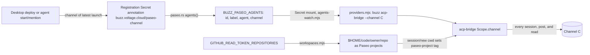
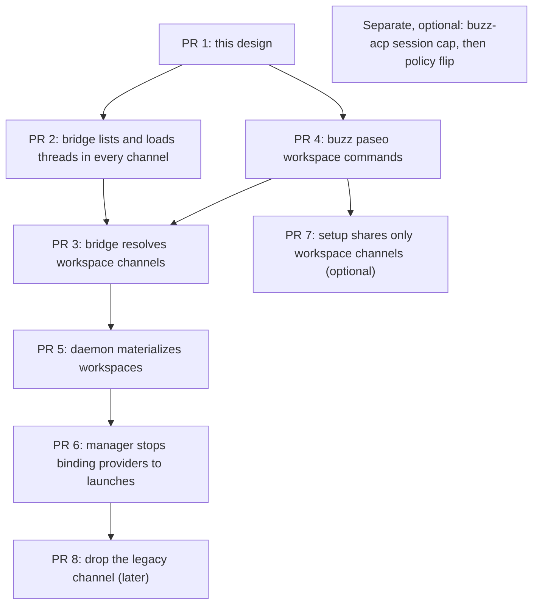

# Paseo Workspaces — First-Class, Channel-Bound Workspaces

A Paseo workspace becomes an owner-signed NIP-MP `kind:30621` project with a
Paseo workspace marker. The project gives the workspace its own slug and
name, one `buzz-channel`, and an optional set of GitHub sources. The daemon
materializes each workspace as one Paseo project directory. A session's
working directory selects its workspace, and the workspace selects the
channel that the session posts in.

Results after the full sequence:

- Two workspaces on one repository show as two Paseo projects.
- A workspace can exist without a repository.
- The posting channel changes only when the owner replaces the workspace event.
- One provider serves an agent in every workspace channel. Deploys and
  launches no longer choose the channel.
- The Paseo session list keeps the agent's older threads when a channel
  changes.

The `SessionPolicy` default flip does not reach the Paseo path. Section 5
explains why and recommends a separate, optional change.

All code references are at `157150af8` unless a line names another revision.

## 1. Terms

| Term | Meaning in this document |
| --- | --- |
| Workspace | An owner-signed `kind:30621` project with a `buzz-channel` tag, which the daemon materializes. |
| Workspace directory | `$HOME/workspaces/<dir>` on the daemon. One per workspace. Registered as a Paseo project. |
| Source | A GitHub repository that a workspace checks out for reading. |
| Paseo project | Upstream Paseo's registered directory (`paseo project create`). |
| Provider | One Buzz remote-agent entry in the daemon's `config.json`. It runs `buzz acp-bridge`. |
| Session | One ACP session of the bridge. It maps to exactly one Buzz thread. |
| Gateway | The daemon's own Nostr key, delegated by the owner through `kind:30181`. |

Upstream Paseo 0.15.3 also has its own per-directory "workspace" records,
keyed by `workspaceId` and `cwd`. Registering a directory creates one. This
document uses "workspace" only for the Buzz-declared unit above.

## 2. Current wiring (verified)



### 2.1 Verification of the reported locations

| Reported location | Result at `157150af8` |
| --- | --- |
| `voltage/images/paseo-daemon/workspaces.mjs:41-96` | Confirmed. `sync` clones each manifest entry to `$HOME/code/<owner>/<repo>` (`:72-85`) and registers it (`:60-65`). |
| `crates/buzz-cli/src/commands/acp_bridge/projects.rs:15-80` | Confirmed. `project_of_cwd` (`:20-32`) parses identity from the path. The thread root keeps it in a `paseo-project` tag (`:15`). |
| `voltage/images/paseo-daemon/providers.mjs:11-54` | Confirmed. `provider()` puts `--channel` in argv (`:19`). `buzzProviders` requires a UUID channel (`:50`). |
| `crates/buzz-sandbox-reaper/src/mobile_launch.rs:21-24` | Confirmed. `CHANNEL_ANNOTATION` (`:21`) and `CHANNEL_AT_ANNOTATION` (`:24`). |
| `mobile_launch.rs:473-530` | Partial. This range is `Start::remember_channel` (start and mention paths). Deploys write the same annotation through `save()` (`:153-169`). |
| `create_agent` has no channel parameter | Partial. `create_agent` is an upstream Paseo MCP tool. It takes a provider, a prompt, and a `workspaceId`; the resulting agent has a `cwd`. The channel comes from provider argv. |
| `acp_bridge/mod.rs:168-178` | Different code. This is `prepare_prompt`, which posts with `channel_id: self.scope.channel` (`:170`). The CLI arguments are at `crates/buzz-cli/src/lib.rs:359-369`. |
| `acp_bridge/mod.rs:101-121` | Partial. `run()` builds the `Scope` at `:109-121`. The struct is at `frames.rs:61-78`, with `channel: Uuid` at `:70-71`. |
| `acp_bridge/frames.rs:63-78` | This is the `Scope` struct. The subscription filters are at `mod.rs:479-500`. |
| `acp_bridge/bridge.rs:521-559` | Confirmed. `session/new` reads only `params.cwd` (`:535-538`). The thread root is created by the first prompt. |
| `crates/buzz-sandbox-reaper/src/paseo.rs:300-357` | Confirmed. `agents()` (`:300-334`) builds the list. `entry()` (`:337-357`) leaves out an agent without the annotation. |
| `paseo/channels.rs:88-189`, kind 30180 | Different crate and kind. The code is `crates/buzz-cli/src/commands/paseo/channels.rs`. It adds the gateway to every owner stream and forum channel with `kind:9000`. Kind 30180 is `KIND_AGENT_CHANNEL_GRANT`, which shares an agent with other members. Gateway authority is `kind:30181`, which has no channel field. |
| `crates/buzz-acp/src/config.rs:22-91` | Confirmed at `:22-94`. A process holds at most one `BoundSession`. The Kubernetes Sandbox sets one per Pod. |
| `crates/buzz-acp/src/scope.rs:28-42` | Confirmed. `Channel` is `#[default]`. Clap repeats the default as `default_value = "channel"` (`config.rs:443-449`). |

### 2.2 Single-channel sites in the bridge

`Session` (`bridge.rs:234-267`) has no channel field. These sites read
`scope.channel`:

| Site | Use |
| --- | --- |
| `mod.rs:109`, `:118` | Parses `--channel` into `Scope`. |
| `mod.rs:170` | Sets the `h` tag on every prompt. |
| `mod.rs:393-400`, `:491-500` | One thread subscription with `#h: [channel]`, sent once per connection. |
| `frames.rs:162-165` | Drops telemetry frames from other channels. |
| `frames.rs:322-335` | Puts `channelId` in the cancel frame. |
| `bridge.rs:624`, `:651`, `:673` | Builds `message_link` for `/fresh` and the ended notice. |
| `bridge.rs:1187-1197` | Ignores thread events whose `h` differs. |
| `history.rs:63-74` | `scoped` and `root_for` require `h` to equal the channel. |
| `history.rs:88-99`, `:432-493` | Mention, alias, root, and reply queries use `#h: [channel]`. |
| `discovery.rs:44-49`, `:187-218` | `session/list` queries use `#h: [channel]`. |
| `transcripts.rs:100`, `:158` | Transcript reads and envelope checks use the channel. |
| `messages.rs:637-651` | Refuses a post when a mentioned key is not a channel member. |

### 2.3 Problems

1. **Identity is a path.** The bridge and the daemon derive a workspace from
   `$HOME/code/<owner>/<repo>`. Upstream Paseo groups projects by Git remote
   and names them `owner/repo` (`packages/server/src/server/project-key.ts`,
   upstream `v0.15.3`). Two checkouts of one repository therefore show as
   one project with one name.
2. **A workspace needs a repository.** Only manifest repositories and
   `~/buzz` are registered. A repository-free workspace cannot exist.
3. **One channel per provider.** Every session of a provider posts in the
   argv channel, so all conversations with an agent share one channel.
4. **The channel follows launches.** The annotation records the channel of
   the most recent successful deploy or start. A change moves the provider.
   `session/list` then shows only threads in the new channel
   (`discovery.rs:44-49`), so older conversations leave the provider list.
5. **No launch, no provider.** An agent without the annotation is not
   listed (`paseo.rs:338-343`).
6. **The assistant prompt is stale after a reload.** `entrypoint.sh:191-197`
   writes each provider's channel at startup. `withAgents` does not rewrite
   it.

## 3. Goals and non-goals

Goals:

1. A workspace has an identity (owner, slug) and a name, independent of any
   path.
2. A workspace can exist with no repository.
3. A workspace declares one channel. Every session created in it posts there.
4. Signed relay state is the record. A replaced daemon pod rebuilds from it.
5. No credential widens. The GitHub read token stays the read boundary.

Non-goals:

- Sandbox-side session scoping. Each bridge session is one thread, and each
  thread already gets its own Sandbox with one `BoundSession`
  (`crates/buzz-backend-kubernetes/src/sandbox.rs:518-539`).
  `BoundSession` multiplicity needs no change for this design.
- Cloning Buzz-hosted repositories on the daemon. The daemon has no Buzz Git
  read credential.
- Workspace edits by the gateway, the assistant, or agents.
- Any change to Git push policy. A project never affects push authority
  (`docs/nips/NIP-MP.md:139`, `:322`).
- Changes to upstream Paseo.

## 4. Target model

### 4.1 The workspace record

```jsonc
{
  "kind": 30621,
  "pubkey": "<owner hex>",
  "content": "",
  "tags": [
    ["d", "payments-review"],
    ["name", "Payments review"],
    ["buzz-paseo", "workspace"],
    ["buzz-channel", "<channel uuid>"],
    ["buzz-source", "https://github.com/voltagecloud/backend"],
    ["buzz-source", "https://github.com/voltagecloud/buzz"],
    ["buzz-visibility", "unlisted"]
  ]
}
```

| Rule | Value | Reason |
| --- | --- | --- |
| Signer | `BUZZ_PASEO_OWNER` only. Readers query `authors: [owner]`, then check `pubkey` and the signature again. | Any key can publish a project that names any channel (`NIP-MP.md:102`, `:318`). |
| Which projects | Live owner projects with exactly one `["buzz-paseo", "workspace"]` tag and one valid `buzz-channel` UUID (decision D2). | `buzz projects create --channel` binds a channel to forge projects (`crates/buzz-cli/src/commands/projects.rs:436-445`). Without a marker, those projects would use workspace slots and subscriptions. |
| Shared channel | Two workspaces may name one channel. Roots that the bridge creates carry a `paseo-workspace` tag, so they are placed exactly. A root that placement steps 1 and 2 do not place (section 4.5) goes to the workspace with the newest `created_at`, then the lowest `d`. | Deterministic placement without a new restriction. |
| Edits | `workspace update` and `delete` act only on marked projects. `update` keeps `a`, `description`, and unknown tags, as `projects update` does (`projects.rs:634-638`). | A workspace command never changes a forge project. |
| Channel | Exactly one. A project without one is not a workspace. | The channel is the posting destination. |
| Channel type | An unarchived stream or forum channel, the allowlist that `share` uses (`crates/buzz-cli/src/commands/paseo/channels.rs:24`, `:110`). A workspace that names a DM, system, unknown, or archived channel is invalid. | A gateway must never join a DM or a system channel. |
| Members (`a`) | Optional. The Buzz project card shows them. The daemon does not clone them. | Section 4.2. |
| Sources (`buzz-source`) | 0 to 16 per workspace, each `https://github.com/<owner>/<repo>`, at most 256 bytes. | Section 4.2. |
| Visibility | Not a filter for the daemon. `workspace create` writes `unlisted` unless `--listed` is given. | Visibility is a listing rule (`NIP-MP.md:203-211`). `unlisted` keeps the card off the Buzz project collection, and `buzz repos create --channel` does not add repositories to it (`projects.rs:229-249`). |
| Caps | 32 workspaces and 64 distinct sources per daemon. The parser takes marked workspaces newest `created_at` first, then lowest `d`. It skips and logs a workspace that would exceed either cap. | One deterministic order, so the bridge and the daemon accept the same set. |
| Write scope | The owner's key needs `repos:write`, as for any project (`NIP-MP.md:192`). | Unchanged relay rule. |

A reader validates every rule. A workspace that fails a rule is skipped and
logged by slug; it never falls back to another channel.

### 4.2 Repositories become an attribute

A NIP-MP member is a `kind:30617` coordinate. On this relay, every
`kind:30617` reserves a community-unique repository name and seeds an empty
Buzz-hosted repository (`crates/buzz-relay/src/handlers/side_effects.rs:3852-3862`).
It also counts against a per-key quota. A "mirror" announcement for a GitHub
repository would therefore create an empty Buzz repository with a colliding
name.

| Option | Effect | Decision |
| --- | --- | --- |
| `buzz-source` tag on the workspace | No relay change. NIP-MP readers ignore unknown tags (`NIP-MP.md:98`). Readers bound the tag. | Recommended (D1) |
| `a` member that names a `kind:30617` with a GitHub `clone` URL | Reserves a Buzz name, seeds an empty Buzz repository, uses quota. | Rejected |
| Buzz-hosted repositories only | The daemon needs a Buzz Git credential. GitHub work stays unreadable. | Later option |

The `buzz-source` tag is a Voltage extension. It is documented beside the
daemon, not in `docs/nips/NIP-MP.md`, so upstream syncs do not conflict. A
later NIP-MP amendment in block/buzz can add relay ingest bounds for it.

Sources do not change the credential boundary. The daemon clones a source
through `paseo-code clone`, which applies the existing credential helper. At
`157150af8`, the helper sends the token only for manifest repositories. Open
PR #204 changes this to the token's own permissions and keeps the manifest as
a prefetch list. In both cases, the token's GitHub permissions bound reads,
and a workspace cannot add a credential (decision D8).

### 4.3 Rootless workspaces

NIP-MP allows a project with no members (`NIP-MP.md:147-151`). The SDK builder
accepts one (`crates/buzz-sdk/src/builders.rs:2496-2557`). The current CLI
does not: `buzz projects create` without `--repo` creates a default Buzz
repository bound to the channel (`crates/buzz-cli/src/commands/projects.rs:380`, `:436-445`).

The new `buzz paseo workspace create` writes a project with no members when no
`--repo` is given. NIP-MP says a client SHOULD require one member at creation
(`NIP-MP.md:151`). This design departs from that recommendation on purpose: a
workspace is complete with a channel. Decision D3 confirms it.

### 4.4 Daemon layout

```text
$HOME/
├── buzz/                           conversations without a workspace (unchanged)
├── code/<owner>/<repo>             shared partial clones (unchanged)
├── code/<owner>/<repo>@<branch>    branch views (unchanged)
└── workspaces/
    ├── payments-review/            Paseo project root, not a Git repository
    │   └── voltagecloud/
    │       ├── backend -> ../../../code/voltagecloud/backend
    │       └── buzz    -> ../../../code/voltagecloud/buzz
    └── scratch/                    rootless workspace, empty
```

- The directory name is the `d` value when it matches
  `^[a-z0-9][a-z0-9._-]{0,63}$`. Otherwise it is `_` and the first 16 hex
  digits of SHA-256(`d`). A literal name cannot start with `_`, so the two
  name sets are disjoint.
- Before it registers anything, the daemon checks that no two workspaces map
  to one directory. On a collision, it skips both workspaces and logs both
  slugs. The bridge refuses new sessions in a skipped workspace.
- The bridge and the daemon use one Rust implementation of these rules
  (section 6).
- A workspace root is not a Git repository. Upstream Paseo keys such a
  project by its local path and names it by the last path segment
  (`project-key.ts`, `deriveProjectKey` and `deriveProjectGroupingDisplayName`).
  Two workspaces on one repository therefore become two projects.
- Each source is a symbolic link to the shared clone, so one clone serves
  every workspace. If upstream file trees do not follow directory links,
  PR 5 uses a detached `git worktree` per workspace instead, as
  `paseo-code view` does. A worktree costs one checkout per workspace and
  source, and the clone bounds below then count worktrees.
- `paseo-workspaces` registers workspace directories before it clones
  anything. It then clones sources in the background, as today.
- `paseo-workspaces` repeats this every 60 seconds, with the existing
  process deadlines. Runs are single-flight: a run that is still in progress
  skips the next tick.
- A failed workspace read keeps the previous state. The run registers,
  retires, and deletes nothing, and logs the failure.
- A deleted or invalid workspace keeps its directory and registration, so
  existing Paseo agents keep a valid `cwd`. The bridge refuses new sessions
  there (section 4.5).
- Retained state has its own bounds. At 32 retired directories, the daemon
  stops admitting new workspace directories and source clones until cleanup
  brings the count below 32. Count directories used by live agents and
  directories with local work. Preserve existing agents and active workspaces.
  Admission also caps active plus retired directories at 64, including a batch
  that retires all 32 active workspaces. Never delete local work to meet a cap.
- Cleanup removes the oldest unused retired directories only when they
  contain generated links and unchanged daemon metadata. Treat unexpected
  files, modified metadata, and failed inspections as local work; preserve
  the whole directory. Archiving an agent never authorizes deleting its files.
- Each run logs retained directories, their local-work status, live users,
  and the clones that only they keep. To release state, the operator archives
  its agents, then moves local work outside daemon-managed directories or
  explicitly removes the retired directory after preserving wanted files.
  Dirty-clone protection still applies independently.
- Active workspaces name at most 64 distinct sources. The manifest keeps its
  own cap of 64 (`voltage/images/paseo-daemon/code.mjs:27`), so active
  sources and manifest entries keep at most 128 clones.
- A resync deletes a clone only when no workspace directory on disk links to
  it and no manifest entry or branch view uses it. It never deletes a clone
  that has uncommitted changes or commits that its remote does not have; it
  logs that clone and keeps it. The assistant has a shell, so a clone can
  hold local work.
- Pod-local home is lost on pod replacement, so the daemon rebuilds all of it
  from the relay.

### 4.5 Providers and the bridge

| Item | Before | After |
| --- | --- | --- |
| `BUZZ_PASEO_AGENTS` entry | `{"id","label","agent","channel"}` | `{"id","label","agent"}`, plus a frozen legacy `channel` until PR 8 (section 4.7) |
| Provider command | `buzz acp-bridge --agent A --channel C --owner O` | `buzz acp-bridge --agent A --owner O [--channel C]` |
| Meaning of `--channel` | The only channel | Legacy channel for sessions outside every workspace |
| `Session` | No channel | `channel: Uuid` and an optional workspace slug |

Session channel resolution:

| Request | Channel | Thread root |
| --- | --- | --- |
| `session/new`, `cwd` inside workspace W | W's `buzz-channel` | New root at the first prompt, tagged `["paseo-workspace", "<d>"]` |
| `session/new`, other `cwd`, `--channel C` given | C | New root |
| `session/new`, other `cwd`, no `--channel` | Error that names `buzz paseo workspace create`, and the workspace directories that link the `cwd`'s source, if any; nothing is posted | None |
| `session/new`, `cwd` in W, workspace lookup fails | Retryable error; never the legacy channel | None |
| `/fresh` in any session | Resolved again from the session's `cwd`, with the `session/new` rows | New root, tagged as for `session/new`. Its "Previous thread" link uses the old root's channel, not C (`bridge.rs:646-651`). On an error, nothing is posted. |
| `session/load` | The root's own `h` | The root |
| `session/list` | Every channel that the gateway can read and the owner belongs to, by agent participation | `cwd` from the placement rule below |

"Other `cwd`" includes the shared clones under `$HOME/code`, which stay
registered Paseo projects. A session there posts in C, as today.

Rules:

- **Workspace lookup.** The bridge reads `{kinds:[30621], authors:[owner]}`
  with `"consistency":"strong"`. The result chooses where a write goes, so it
  reads from the writer (`PLANS/REPLICA_FULL_READ_ROUTING_DESIGN.md`). Each
  lookup has a 5-second deadline. `session/new` and `/fresh` always do a
  fresh lookup, so a replaced or deleted workspace never routes a new
  session. Listing and placement reuse a result for at most 30 seconds, as
  gateway lookups do (`docs/agent-gateway-key.md:247-248`).
- **No blocking.** Client requests run inline in the bridge's `select!` loop
  (`bridge.rs:417-420`, `:506`). The lookup, the channel-type read, and the
  owner-membership read therefore run as spawned operations, bounded like
  history operations (`history.rs:110-135`). The bridge inserts the session
  when the operation completes, and checks `MAX_SESSIONS` again at that
  time.
- **Selection.** `create_agent` already places an agent in a Paseo workspace
  and gives it that `cwd`. The `cwd` then selects the channel. No ACP
  extension field is needed, and the bridge accepts no channel from the
  client. A `create_agent` call without a `workspaceId` makes a new upstream
  workspace outside `$HOME/workspaces`, so it follows the "other `cwd`" rows.
- **Discovery.** `session/list` runs today's two participation filters
  (`discovery.rs:44-49`) without `#h`: events that `p`-tag the agent, and
  events the agent authored. Without `#h`, the relay returns events in the
  channels that the gateway can read, plus global events
  (`crates/buzz-relay/src/handlers/req.rs:1420-1449`). The bridge therefore
  keeps requiring a valid channel `h` tag, as `scoped` does today
  (`history.rs:63-67`), and drops events without one. The list then shows
  every thread that the agent took part in within those channels, including
  threads that did not start in Paseo, as the list does for C today.
- **Owner membership.** The bridge never removes a gateway membership
  (section 4.6), so the gateway can stay in a channel that the owner left.
  Discovery and loading therefore keep only roots in channels where the owner
  is a current posting member, and `session/new` refuses a workspace whose
  channel the owner left. This matches the harness strict owner mode
  (`docs/agent-gateway-key.md:230-232`).
- **Membership reads.** The bridge reads each channel's `kind:39002` (`d` is
  the channel) with one strong read per channel. The relay repairs a stale
  roster only for a single-channel read (`docs/agent-gateway-key.md:236-240`),
  so the reads are not batched. They count against discovery's budget of 64
  queries (`discovery.rs:10`). One `session/list` call reads at most 32
  uncached channels, so at least half of its budget reads events. The
  returned cursor stops before the first root whose channel membership was
  not read, so no thread is skipped. Results are reused for at most 30
  seconds, across calls. When the budget runs out, discovery returns
  the page so far with a cursor, as today (`discovery.rs:133-141`).
- **Exhaustive reads.** The relay pushes `authors` and a single-value `#p`
  into SQL (`req.rs:1270-1317`). It turns `#h`, or the readable-channel set
  when `#h` is absent, into a SQL channel predicate (`req.rs:1426-1450`).
  Every relay filter above is therefore applied before the limit, and a short
  page means the end. The owner-membership filter runs after the page, so
  the bridge pages until it has a full page or the relay has no more events,
  within today's scan limits.
- **Loading.** `session/load` accepts a root when the owner rule holds and
  today's participation check holds for its thread (`history.rs:76-78`).
  Alias scans use the alias filter without `#h`.
- **Posting after load.** A loaded session posts only in its root's thread,
  except `/fresh`, which follows its own row above. The gateway must still be
  a posting member of that channel.
- **Placement.** A root's `cwd` is the first match in this order:
  1. The root has one valid `paseo-workspace` tag, and a trusted key authored
     it: that workspace's directory if it exists on disk, live or retained.
     Otherwise `~/buzz`.
  2. The root has a valid `paseo-project` tag, and a trusted key authored it:
     `$HOME/code/<owner>/<repo>` if that directory exists. This is today's
     rule (`acp_bridge/projects.rs:53-67`).
  3. A live workspace binds the root's channel: that workspace's directory,
     in the shared-channel order of section 4.1.
  4. `~/buzz`.

  The trusted keys are the owner and the bridge's signer, as for
  `paseo-project` today (`acp_bridge/projects.rs:34-50`). A tag on a root that another
  member authored never selects a directory.
- **Reads.** Discovery and alias scans have no `#h`. The live subscription
  uses one bounded subscription per channel. History of one root queries its
  own `h` and `#e`. Every query keeps today's page and scan limits.
- **Path identity.** The bridge matches a `cwd` to a workspace after lexical
  normalization (`acp_bridge/projects.rs:111-126`), without resolving links. A path
  through a source link stays in its workspace.
- **Subscription.** The live thread subscription covers the channels of the
  sessions in memory. A session's channel joins the set when the session is
  created or loaded. It leaves after the last session in memory with that
  channel is evicted. Retained channels keep their subscriptions and reconnect
  watermarks. Only newly added channels replay an overlap, using a boundary
  captured before replay output. Fresh subscription IDs fence stale EOSE.
  The existing `seen` set removes overlap duplicates. At most 64 channel
  subscriptions and one telemetry subscription exist per connection.
- **Telemetry.** A telemetry frame is accepted only when its channel equals
  the channel of the session that owns its root. Today's check compares with
  C (`frames.rs:162-165`).
- **Membership.** The existing member check (`messages.rs:637-651`) refuses
  a post when the agent is not in the session's channel. The bridge returns
  that error to the client.
- **Bounds.** `MAX_SESSIONS` (64) is unchanged. The subscribed channels are
  at most 64, one for each session in memory.

Transitions:

| Transition | New sessions | Existing threads |
| --- | --- | --- |
| Workspace deleted, invalid, skipped, or over the cap | Refused in its directory | Listed and loadable. Tagged roots stay in the retained directory while it exists, then go to `~/buzz`. Other roots follow placement steps 2 to 4. |
| Workspace channel changes from A to B | Post in B | Threads in A, including third-party roots the agent joined, stay listed and loadable. Tagged roots stay in the workspace directory. Other roots in A follow placement steps 2 to 4. |
| A session in A stays open after the change | Not applicable | A stays subscribed until that session is evicted |
| The owner leaves channel A | Refused in a workspace bound to A | Threads in A leave `session/list`; `session/load` refuses them |
| C removed (PR 8) | Outside a workspace: error | Legacy roots, authored by a trusted key, stay listed and loadable |

### 4.6 Authority and membership

A session in workspace W works only when all of these hold:

| Condition | Enforced by | Change |
| --- | --- | --- |
| The owner signed W | Bridge and daemon | New |
| The gateway is a posting member of W's channel | Relay on post; harness strict owner mode (`docs/agent-gateway-key.md:230-232`) | `workspace create` adds the gateway |
| The owner is a posting member | Harness; bridge on `session/new`, discovery, and load | New bridge check (section 4.5) |
| The agent is a member | Bridge member check; harness | `workspace create` warns when it is missing |
| The owner's `kind:30181` delegation is live | Harness and mention launcher | None |
| The agent has a mention-launch registration | Manager; one per owner, agent, and relay | None |
| The mention launcher watches W's channel | Launcher, which watches at most 64 of the agent's channels (`crates/buzz-sandbox-reaper/src/mentions/channels.rs:10`) | `workspace create` warns when the agent belongs to more than 64 channels |

- `buzz paseo workspace create` reads the channel metadata first and refuses
  a channel outside the stream and forum allowlist. It then adds each live
  delegated gateway with the owner-signed `kind:9000` path that `share` uses
  (`crates/buzz-cli/src/commands/paseo/channels.rs:137-189`).
- Creation and channel updates first persist an owner-local operation journal,
  including the workspace ID, intended event, and live delegated gateways.
  Use an atomic file replacement and flush it before any relay write.
- Add and confirm posting membership for every gateway before publishing the
  workspace event. A partial membership prefix grants access but advertises
  no usable workspace. Keep existing workspace records unchanged on failure.
- Retry unfinished operations from the journal on the next workspace command
  and setup run. Recheck delegation and owner posting membership before retry;
  a revoked delegation or lost owner membership requires operator resolution.
  Reuse the workspace ID and signed event when retrying ambiguous publication.
- Report success and remove the journal only after strong reads confirm all
  required memberships and the intended workspace head. A failed write or
  confirmation returns a pending-operation error with the workspace ID.
  Never remove memberships automatically when an operation fails.
- Channel updates use this same procedure for the destination channel.
  Creation and updates report pending until destination memberships exist.
- The bridge and the daemon apply the same allowlist to every workspace
  record, including records published by other tools. They never add a
  member.
- `buzz paseo setup` keeps all-channel sharing until decision D4. No step
  removes an existing gateway membership automatically.
- Kind 30180 is not part of this path. Kind 30181 stays channel-free; channel
  membership is the per-channel boundary. A channel field on 30181 is
  rejected: it repeats membership and needs a migration in the harness, the
  launcher, and the manager.

### 4.7 Manager

- `entry()` (`paseo.rs:337-357`) lists every valid registration, with or
  without the annotation.
- An entry keeps the channel of an existing annotation as a frozen legacy
  `channel`. An agent without the annotation gets an entry without
  `channel`. PR 8 drops `channel` from every entry.
- The manager stops writing the `paseo-channel` annotations. `save()` and
  `remember_channel` lose those writes, so a launch no longer moves a channel.
- Provider ids stay stable when agents are added. Today an id is the
  label's slug, and a repeated slug gets a key suffix in sort order
  (`paseo.rs:206-228`). The cap keeps the first 64 entries by label, then key
  (`paseo.rs:298-331`). A new agent could therefore rename an existing
  provider or push it past the cap.
- PR 6 keeps today's ids and order for entries with a legacy `channel`,
  computed among those entries only.
- Every other entry gets an id from its own key: the label's slug, a hyphen,
  and the key's first 8 hex digits. When a legacy entry already has that id,
  or another entry would share it, the entry uses its full key instead. The
  id therefore does not depend on registration order, and an added agent
  does not rename an existing provider. One exception: when two agents share
  a label slug and the first 8 hex digits of their keys, both use the full
  key, so the older one is renamed. For two agents with one label, the
  chance is 1 in 2^32. The cost: a new agent's id always carries a key
  suffix.
- The cap keeps legacy entries first, then the others by the registration
  Secret's `creationTimestamp`, then key. Two registrations created in the
  same second at the cap boundary are ordered by key, so the newer one can
  displace the other. The manager already warns when it truncates
  (`paseo.rs:322-331`).
- PR 8 keeps these rules and uses the annotation only to select the legacy
  rule. Removing a legacy agent can still change the id of another legacy
  agent with the same label, as it can today.
- No daemon Secret key is added. `paseo_env.rs:38-46` refuses unknown keys,
  so a new key would break older managers. Workspaces live on the relay.

### 4.8 Restore

- Restore stays keyed by provider id. PR 6 adds providers for agents
  without the annotation and keeps every existing id (section 4.7), so
  existing restore keys stay valid.
- `session/list` reports the workspace directory as `cwd`. `importCwd`
  accepts it: it is a real directory under `$HOME` with no hidden segment.
- `daemonReady` waits for `~/buzz`, and a failed check fails every restore
  task (`restore.mjs:398-406`). `~/buzz` stays its only condition. Restore
  waits for workspace directories only as a best effort, within the same
  60-poll bound, and never fails because of them.
- A conversation whose workspace directory is missing at import goes to
  `~/buzz`.

### 4.9 Assistant prompt

The generated prompt lists one line per agent and one line per workspace with
its channel. It tells the assistant to pass a `workspaceId` to `create_agent`.
The workspace lines are refreshed by the same resync that registers
directories.

### 4.10 Tension with NIP-MP and the project vision

A workspace gives a project a second meaning for one consumer, the Paseo
daemon. This design intentionally conflicts with three statements:

| Statement | Conflict | How the design limits it |
| --- | --- | --- |
| "A project points at repos. That's all it does." (`VISION_PROJECTS.md:71`) | A workspace also selects where Paseo sessions post, and it can have no repository. | Only marked projects have this meaning (decision D2). A project without the marker keeps the NIP-MP meaning only. |
| `buzz-channel` is "metadata only" (`NIP-MP.md:93`, `:139`) | The tag now selects a posting destination. | The NIP-MP statement is about authority: a project channel cannot change push policy. A workspace grants nothing either. Channel membership decides every post (section 4.6). |
| A project with an unresolvable channel renders without a link and is never dropped (`NIP-MP.md:106`) | The daemon and the bridge skip such a workspace. | The rule governs the project collection, which this design does not change. The Buzz card still renders. |

A separate event kind would remove the tension. It is rejected for v1: it
needs a new relay kind in a fork that syncs from upstream, and it loses the
Buzz project card.

## 5. Assessment: `SessionPolicy` default `Channel` → `Thread`

**Finding: the flip does not change the Paseo path.**

- The bridge does not run `buzz-acp`. It drives a remote agent through the
  relay (`acp_bridge/mod.rs:1-10`).
- That agent runs in a Kubernetes Sandbox, which sets
  `BUZZ_ACP_SESSION_POLICY=thread` and one thread binding
  (`sandbox.rs:518-530`).
- `buzz paseo` team launch also sets `thread`
  (`crates/buzz-cli/src/commands/paseo/team.rs:208`).
- Each bridge session already starts its own thread root.

The flip changes only launches that do not set the policy:

- development scripts (`scripts/_goose-env.sh`);
- the sprig image (`Dockerfile.sprig`);
- direct CLI use;
- non-Sandbox pod deploys whose requester sends no policy
  (`crates/buzz-backend-kubernetes/src/provider.rs:264-265`).

Desktop and GPUI set the policy explicitly. The desktop default stays
`Channel` (`desktop/src-tauri/src/managed_agents/session_policy.rs:30-38`),
and NIP-AP documents `channel` (`docs/nips/NIP-AP.md:101`).

| Risk | Evidence | Severity | Mitigation |
| --- | --- | --- | --- |
| Live ACP sessions per worker have no cap | `crates/buzz-acp/src/pool.rs:137`; turn rotation is off by default (`config.rs:474-478`) | Medium to high for long-running agents | Add a per-worker LRU cap first |
| A top-level `!cancel` or `!rotate` does nothing | `lib.rs:3910-3916`, `:3962-3968` | Medium | Make top-level control channel-wide, or document it |
| Threads stop sharing context | `scope.rs:142-157`; `pool.rs:4234-4249` | Medium | Release note; `BUZZ_ACP_SESSION_POLICY=channel` rolls back |
| More context reads and sessions | `pool.rs:4234-4249` | Low to medium | Canary with metrics |
| Two defaults must change together | `scope.rs:37`; `config.rs:446`; test at `config.rs:3181-3187` | Low | Change both and the docs in one PR |
| In-flight sessions | No persisted session map; the policy is read at startup | None | None |

**Recommendation.** Do not ship the flip as the first PR of this effort. It
cannot relieve Paseo channel crowding. If a specific agent collapses a
channel into one session, check its prompt header first. `Session scope:
channel` or `thread` shows its effective policy (`crates/buzz-acp/src/queue.rs:2048-2079`).
Then set the policy for that launch path, or ship the flip as a separate
`buzz-acp` PR after the session cap (decision D5).

## 6. PR sequence



| PR | Title | Behavior | Acceptance checks |
| --- | --- | --- | --- |
| 1 | `docs(plans): design channel-bound Paseo workspaces` | None | Decisions D1 to D9 answered |
| 2 | `feat(acp-bridge): list and load the agent's threads in every channel` | Sessions carry their own channel. `session/list` and `session/load` follow section 4.5: discovery, owner membership, loading, subscription, and telemetry. New sessions still post in `--channel`. This fixes problem 4 alone. | Existing `acp_bridge` tests pass. New tests use the production list, load, and prompt paths: threads in two channels are listed; a thread in a channel the owner left is neither listed nor loadable; a global event without `h` is never listed; a thread loaded from channel B gets replies and posts only in B, while a new session posts in C; a telemetry frame with a B session's root and channel C is dropped; a reply in B that arrives during subscription catch-up is delivered once, without replaying A after deduplication eviction; a listing across more than 32 uncached channels returns every thread across pages. `cargo test -p buzz-cli` passes. |
| 3 | `feat(acp-bridge): post each session in its workspace channel` | Section 4.5 routing. `--channel` becomes optional. | Tests: two workspaces on one repository post in two channels; an unmarked project and a project from another key are ignored; a new session after a replacement or deletion uses the new state, with a warm cache; outside a workspace with no `--channel`, nothing posts; a session in a shared clone posts in C; a failed lookup posts nothing; a slow lookup does not delay a prompt in another session; `MAX_SESSIONS` holds when lookups complete together; `/fresh` in a workspace, and after its channel moves, posts in the current channel and links the old root in its own channel; a `paseo-workspace` tag on a root that another member authored is ignored; a missing gateway or agent membership returns an error and posts nothing. Each placement step and each transition row holds across a bridge restart and a restore run, including a third-party root that the agent joined before its workspace moved. Path cases: lexical workspace path, path through a source link, and `..` traversal. The fake relay accepts a multi-value `#h`. |
| 4 | `feat(cli): manage Paseo workspaces` | `buzz paseo workspace create`, `list`, `update`, `delete`. `create` writes the marker and `unlisted`, and warns that workspace metadata is community-readable. `list --owner <hex>` prints validated workspaces and their directory names as JSON. | Unit tests for every rule in 4.1, including a DM, system, and archived channel; zero members; two workspaces on one channel; more than 64 distinct sources with overlap; directory names (a literal slug never equals a hashed name, and a forced collision skips both workspaces); an unmarked project is never listed, updated, or deleted; `update` keeps `a`, `description`, and unknown tags. Create adds the gateway once and is idempotent. Create warns when the agent is not a member or belongs to more than 64 channels. Refuses NIP-OA agent credentials, as `buzz gateway grant` does. |
| 5 | `feat(paseo-daemon): materialize owner workspaces` | Section 4.4, 4.8, and 4.9. `providers.mjs` accepts an entry without `channel`. | `test-workspaces.mjs`: rootless workspace; two workspaces on one repository; cap of 32; removal keeps the directory; retired-directory and unused-clone cleanup never removes a directory a live agent uses, including with more than 32 such directories; a retired workspace with a unique source keeps that source after a resync; a clone with uncommitted changes or unpushed commits is kept; a failed workspace read changes nothing; an overlapping run is skipped. `test-agents-watch.mjs`: channel-less entries. `test-restore.mjs`: workspace placement, and a missing workspace directory does not fail readiness. Image test confirms that upstream accepts a non-Git project root and follows directory links. |
| 6 | `feat(sandbox-reaper): stop binding Paseo providers to launches` | Section 4.7. | Replaces `registrations_keep_the_latest_channel_thread_for_paseo` and `a_start_records_its_channel_for_paseo`. New tests: an agent with no annotation is listed without `channel`; a launch does not change an entry; successive additions of agents with colliding labels, including registrations with equal `creationTimestamp` values and descending keys, keep every existing id; a forced 8-digit prefix collision gives both agents their full key; at the cap, an agent registered in a later second never displaces an existing provider. Updates `docs/remote-agents.md:2267-2297`. |
| 7 | `feat(cli): share the gateway only into workspace channels` | Decision D4. | `channels_tests.rs` covers the new plan. No membership is removed. |
| 8 | `feat(sandbox-reaper): drop the legacy Paseo channel` | Entries lose `channel`. Sessions outside a workspace fail with the section 4.5 error. | Decision D9 holds. Existing ids stay the same. Legacy threads stay listed and loadable. |

- PR 2 comes first because it fixes lost history without new records. Its
  tests use the production list, load, and prompt paths, so they need no
  workspace.
- PR 3 uses PR 4's workspace parser and directory rule from one shared module,
  so the bridge and `list --owner` cannot disagree.
- PR 5 reads workspaces through `buzz paseo workspace list --owner`, so the
  daemon has no second JavaScript parser.
- PR 5 changes `workspaces.mjs`, which open PR #204 also changes. Rebase PR 5
  after #204 is merged or closed.
- Every implementation PR opens as a draft and gets `buzz-subagent review` for
  quality and security before it is marked ready.

## 7. Rollout and compatibility

| Daemon image | Manager | Result |
| --- | --- | --- |
| Before PR 5 | Before PR 6 | Today's posting behavior. With PR 2 in the image, the list also shows threads in other channels. |
| PR 5 or later | Before PR 6 | Sessions in a workspace directory post in its channel. Other sessions, including sessions in shared clones, post in the legacy channel. |
| PR 5 or later | PR 6 up to PR 8 | Launches no longer move the legacy channel. An agent without a launch gets a provider; outside a workspace, it returns the section 4.5 error. |
| PR 5 or later | PR 8 or later | Every session outside a workspace returns the error. Legacy threads still load. |
| Before PR 5 | PR 6 or later | **Invalid** when any agent has no annotation. The old `providers.mjs` refuses an entry without `channel` (`providers.mjs:50`): startup exits 64, and the watcher keeps old providers. |

1. Deploy PR 5's image to every daemon.
2. Have each enrolled developer create a workspace for each channel they use.
3. Deploy PR 6's manager.
4. Confirm that a new Paseo session in each workspace posts in its channel.
5. Deploy PR 8's manager when decision D9 holds.

Rollback:

- Roll back in reverse order. After PR 6 is deployed, PR 5's image is the
  floor. Roll back the manager below PR 6 before any daemon image below PR 5.
- Rolling back PR 8 restores the frozen legacy channel from the annotations,
  which PR 6 keeps.
- Rolling back PR 6 restores the annotation writes, so launches move the
  legacy channel again. Agents without an annotation lose their provider.
  Redeploying PR 6 later moves agents that gained an annotation in between
  to the legacy id rule, which can change their ids and restore keys.
- Rolling back PR 5's image leaves the workspace records on the relay. Older
  images ignore them. The new pod starts with an empty home, so no workspace
  directory needs cleanup.

## 8. Security considerations

- **Owner-only authority.** Only owner-signed projects with the marker are
  workspaces. The assistant holds the gateway key, not the owner key. A
  prompt-injected assistant therefore cannot redirect posts by publishing a
  project. A `paseo-workspace` tag on a root that another member authored
  never selects a directory.
- **Workspace metadata is community-readable.** `kind:30621` is global
  (`NIP-MP.md:190`), so any community reader sees the name, the channel UUID,
  and the source repository names. `unlisted` and the GitHub token do not
  hide them. A channel UUID grants no access to the channel. `workspace
  create` states this before it publishes. Keep confidential names out of
  workspaces, or use a separate access-controlled store later.
- **Explicit destination.** The posting channel changes only with an
  owner-signed replacement event. Deploys, starts, and mentions no longer
  change it.
- **Membership still decides.** The relay and the harness check gateway,
  owner, and agent membership. A workspace that names a channel without that
  membership cannot post there.
- **Discovery follows owner membership.** The Paseo list shows the agent's
  threads in channels that the gateway can read and the owner still belongs
  to. When the owner leaves a channel, its threads leave the list. Decision
  D4 sets which channels the gateway joins.
- **No credential widening.** Sources pass through the existing credential
  helper and path checks. The token's GitHub permissions bound every read.
- **Writer reads.** Workspace resolution uses strong reads, so a lagging
  replica cannot route a post to a replaced channel.
- **Bounds.** Active state: 32 workspaces, 16 sources each, 64 distinct
  sources, at most 128 clones with the manifest, 64 subscribed channels, and
  64 sessions per bridge. Retired-directory admission stops at 32, counting
  live-agent directories and local work; total workspace directories cannot
  exceed 64. Retained clones include those linked by directories, the manifest,
  or branch views, and clones with local work. Each run logs retained state.
- **Local work.** Cleanup preserves agent-created files in retired workspace
  roots and clones with uncommitted changes or unpushed commits.
- **Removal paths.** Deletion, channel change, invalid replacement, a name
  collision, the cap, and the owner leaving the channel each stop new
  sessions in the affected workspace. None hides a thread from
  `session/list` while the owner belongs to its channel.

## 9. Decisions needed

| ID | Question | Recommendation |
| --- | --- | --- |
| D1 | How does a workspace name GitHub repositories? | `buzz-source` tag (section 4.2). |
| D2 | Which owner projects are workspaces? | Projects with the `["buzz-paseo", "workspace"]` marker and one `buzz-channel`. Rejected: every owner project with a channel, because forge projects would use workspace slots and subscriptions (section 4.1). |
| D3 | May `workspace create` write a project with no members? | Yes, as a deliberate departure from NIP-MP's SHOULD. |
| D4 | Should `buzz paseo setup` keep adding the gateway to every owner channel? | Keep for compatibility; add a workspace-only mode in PR 7. |
| D5 | Ship the `SessionPolicy` flip? | Not in this effort; section 5. |
| D6 | Are projects signed by the owner's NIP-OA agents also workspaces? | Not in v1. |
| D7 | Should the Paseo project show `name` instead of the slug directory? | Slug in v1; a directory rename breaks upstream records keyed by `cwd`. |
| D8 | What is the read boundary: the manifest or token permissions? | Follow PR #204's outcome. The design works with both. |
| D9 | When does PR 8 remove the legacy channel? | After every enrolled developer confirms a workspace for each channel they use. |

## 10. Risks and unknowns

- Upstream Paseo was read at `v0.15.3`, not run. PR 5 must confirm that a
  non-Git directory registers and that file trees follow directory links.
- Paseo shows the directory name, so a workspace shows its slug until D7
  changes.
- `buzz-source` and `buzz-paseo` are fork extensions. Other Buzz clients
  ignore them and show a workspace as a project without sources.
- PR 2 widens the Paseo list from one channel to every channel that the
  owner and the gateway share. With today's all-channel sharing, the list
  shows the agent's threads in every owner stream and forum channel.
- The mention launcher watches at most 64 of an agent's channels. An agent
  in more channels can miss mentions in a workspace channel. `workspace
  create` warns, but does not fix this.
- After PR 8, a developer with no workspace cannot start a Paseo session.
  Step 2 of the rollout and decision D9 cover existing developers.

## Decisions Taken

tee8z approved the section 9 recommendations for this implementation sequence.

- D1: Use `buzz-source`.
- D2: Require the workspace marker.
- D3: Allow rootless workspaces.
- D4: Keep all-channel sharing until PR 7.
- D5: Do not flip `SessionPolicy`.
- D6: Exclude NIP-OA signers in v1.
- D7: Use slug directories.
- D8: Follow PR #204's outcome.
- D9: Defer PR 8.
