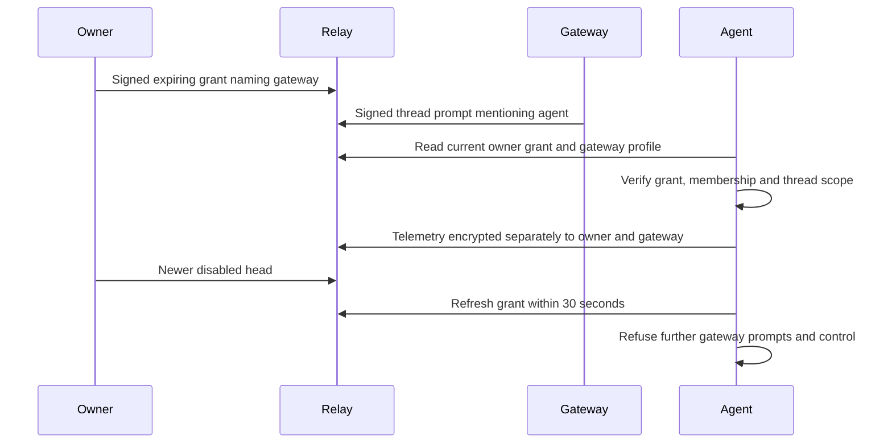

# Gateway keys for remote agents

A gateway drives your remote agents with its own key. Your main Nostr key stays
with you. Existing Buzz apps continue using your main key without a grant. Direct-message
sandboxes and unbound harness sessions never enable gateway access.

## Authority

An owner signs a kind `30181` addressable event naming one gateway. The
coordinate is `(30181, owner, gateway hex)`. Enabled heads require a NIP-40
`expiration` within 90 days. A newer disabled head revokes the grant permanently
until a newer enabled head replaces it.



| Path | Authorization |
| --- | --- |
| Mention launch | Current signed owner grant, current remote-agent registration, visible trigger and channel |
| Thread prompt | Bound channel thread in strict owner mode; live grant checked at ingress and again before queued model dispatch |
| Turn cancellation | Live grant; signed, fresh NIP-44 observer control; command exactly `cancel_turn` |
| Observer telemetry | Agent ownership verified by relay; separate NIP-44 copy for each live gateway |
| Owner DMs, profile and channel administration | No delegated authority |
| Model changes and owner announcements | Owner key required |
| Explicit checkpoint/fresh recovery requests | Not delegated; existing agent-signed deployment remains required |

A gateway remains a separate ordinary relay member. A grant provides neither
relay membership nor channel membership. It does not impersonate the owner.
Normal actions permitted to that separate account remain available, including
posting its own records into an explicitly joined recording channel.

Only the newest signed head per coordinate counts. Consumers accept at most two
live gateways, ordered by grant timestamp and then gateway key. They read at most
32 heads per owner. Grants outside that window fail closed.

Agent keys never serve as gateways. The SDK refuses a gateway profile carrying
an `auth` tag. The relay also refuses keys recorded as owned agents. NIP-OA
owner attestations cannot substitute for gateway grants.

## Enroll and grant

The manager provisions a distinct gateway key in the per-developer daemon
Kubernetes Secret. Its enrollment reply returns only `gateway_pubkey`.
It never returns the gateway secret key. Provisioning and onboarding have
separate PRs; deploy those before using this enrollment path.

1. Enroll with the owner key using the Buzz app.
2. In every shell below, set `BUZZ_RELAY_URL` to your community relay first.
   Without it, `buzz` uses `http://localhost:3000`, so a channel change, grant,
   or revoke would change a local relay instead. Confirm the target with
   `buzz gateway list` before granting.
3. Ask a relay operator to admit the returned gateway public key as a member.
4. Add that public key to each channel the daemon should use.
5. Run the grant command with your owner key.

```sh
# Relay operator, using the configured admin environment:
buzz-admin add-member --pubkey "$GATEWAY_PUBKEY" --role member

# Channel administrator (BUZZ_RELAY_URL set as in step 2):
buzz channels add-member --channel "$CHANNEL_ID" --pubkey "$GATEWAY_PUBKEY"

# Owner (BUZZ_PRIVATE_KEY is your owner key; BUZZ_RELAY_URL set as in step 2):
buzz gateway list
buzz gateway grant "$GATEWAY_PUBKEY" --expires 90d
```

Owners of a managed Paseo daemon can run `buzz paseo setup` instead of steps 1,
4, and 5: it enrolls from the CLI, creates the daemon, adds the gateway to the
owner's stream and forum channels, and grants it for 90 days. A relay operator
still admits the gateway (step 3); setup prints that command. See
[`voltage/remote-agents.md`](../voltage/remote-agents.md#pair-one-developer).

The CLI refuses NIP-OA agent credentials for grant management. It reads the
current head before writing and advances its timestamp when two actions occur
within the same second. Conflicting writes fail visibly and can be retried.
`list` returns the latest 32 visible heads, including revocations.
Relay expiration rules can omit expired grants.
At 28 heads it warns on stderr that the lookup window is nearly full.
Renew an active gateway grant to move that coordinate back into the window.

Gateway keys retain independent ordinary-account permissions. A generic key may
also have separate channel-sharing rights; revoking delegation does not revoke
those independent rights. Managed Paseo keys use the manager restriction below.

For managed Paseo key rotation, revoke the old delegation and retire the old
community membership before deleting or rotating the daemon Secret.
The matching manager identifies current daemon keys from their Secrets and
refuses independent human-sharing admission for them. Delete that identity
only after retiring its community membership.
An operator then deletes the daemon Secret. The owner enrolls again to generate
new credentials. Admit the new public key, join its channels, and grant access.

## Gateway-owned scheduled workflows

A live gateway can create workflows that send literal prompts to its owner's
remote agents. Only a workflow with a `schedule` trigger can confer gateway
prompt authority. The prompt template must contain no `{{` substitution syntax.
Message, reaction, diff, and webhook triggers do not confer this authority.
The owner's manual `buzz workflows trigger` of such a workflow runs it at once
with the same authority as a scheduled fire, and is not subject to the interval
floor below; Paseo asks the developer to approve each manual trigger.

The executor captures the stored schedule trigger in its durable run context.
Client inputs and webhook fields cannot set that origin. Before posting, it
checks the stored step ID and exact original template again.
The relay signs `["buzz:workflow-schedule", "literal-v1"]` only for that case.
Harness and launcher require this assertion, the existing signed workflow-owner
proof, an explicit agent mention, live delegation, and bound-channel membership.
A member cannot forge relay authority by copying those tags.

Scheduled intervals must be at least 60 seconds. Cron schedules run on the existing
60-second scheduler tick. Overlapping fires create separate bound threads.
They consume the owner's existing session quota; they do not replace prior work.
Staging currently caps primary sessions at 10 per developer, plus five workers,
under an aggregate 15-Pod quota. Capacity refusal uses the existing manager error.
Workflow message dispatch success does not prove that a Sandbox started.
No new quota or capacity is requested by this feature.

```sh
buzz workflows create --channel "$CHANNEL" --yaml - <<EOF_WORKFLOW
name: Daily agent check
trigger:
  on: schedule
  interval: 24h
steps:
  - id: check
    action: send_message
    text: '@AgentName read the repository and report the current status'
EOF_WORKFLOW
```

Paseo asks for human approval before creating, updating, or triggering workflows.
List and delete schedules through the existing workflow commands.
Stored relay schedules survive daemon replacement; local Paseo schedules do not.
Queued prompts are checked again before dispatch. Revocation, expiry, or channel
removal stop further delegated prompts under the same bounds as direct gateway use.
Use the matching manager's managed-key restriction to prevent human-sharing fallback.
Workflows cannot grant owner administration, model changes, or owner DM access.

## Revocation and failure behavior

Revocation uses a newer disabled replacement, without expiration. The relay
ignores NIP-09 deletion of gateway heads. Deleting a head could otherwise let an
old signed grant be replayed into an empty coordinate. Use `gateway revoke`,
with `BUZZ_RELAY_URL` set to the same relay as the grant:

```sh
buzz gateway revoke "$GATEWAY_PUBKEY"
```

Gateway authority also requires current posting membership in the bound channel.
The harness strongly reads the latest kind39002 roster signed by the current
NIP-11 relay key. The owner, agent, and gateway must all remain posting members.
A global grant never admits a gateway into a private channel. Membership removal
stops gateway prompts, cancellation, and telemetry after the 30-second cache
window. The launcher rechecks membership immediately before each launch.

For an explicit strong kind39002 lookup with the current relay author and one channel
coordinate, the relay checks canonical writer membership behind its existing
membership lock. A stale discovery projection is repaired before returning it.
Only a current channel member can trigger or receive that repair. Unchanged
rosters keep their event ID; this read path never broadcasts metadata.

Authority reads use `"consistency":"strong"` on HTTP queries and WebSocket REQ
filters. The relay pins these reads to the writer, so a lagging replica cannot
renew stale authority or hide the current revocation head.

The harness ages successful lookups from their start, for at most 30 seconds.
Each lookup has a five-second deadline. It serializes
refreshes so an older lookup cannot overwrite a newer result. A lookup failure
refuses gateway use and is retried after five seconds. Positive verdicts never
outlive the grant expiration. Owner-authored messages bypass gateway lookup.
At queued dispatch, definitive refusals remove only the refused instructions,
including cancelled instructions. Other authorized messages in that batch proceed.
Indeterminate authority keeps remaining work under the existing bounded retry policy.

The relay caches observer verdicts for at most 30 seconds and fences local
writes by generation. The 30 seconds count from when a verdict is stored, after
its lookup completes. A replica whose lookup read the grant just before the
revocation committed can therefore route observer frames for up to 30 seconds
plus that lookup's duration after the revocation.
The mention launcher rechecks authority before each launch. New grants enter
its listener filters within the existing 60-second listener recycle interval.
Revocation does not cancel a model turn already running. The owner can cancel
that turn using the existing owner control path.

Telemetry fan-out is capped at two gateways. Additional recipients consume
subsequent idle ticks, preserving the existing average relay publication rate.
Ephemeral observer frames are not replayable history.

## Rollout and verification

Deploy the relay changes before granting gateway access. Then deploy the manager
and agent image containing the updated launcher and harness. Older harnesses
continue accepting owners but ignore gateways. No database migration is needed.

A gateway mention starts a Sandbox only where mention launch already works.
Mention launch is off by default, and each agent needs a launch registration
created by starting it once from desktop. Complete the
[mention-launch rollout](server-mention-launch.md#rollout) before the
verification below.

Exercise one owner agent in a test channel. Admit the gateway into that relay
and channel, grant it, and send a mention using the gateway key. Confirm one
sandbox starts and answers. Confirm the gateway receives encrypted observer
telemetry and can cancel a turn. Revoke it and wait 30 seconds. Confirm its next
prompt and cancellation are refused, while the owner's prompt still works.
Confirm a second owner's agent and the owner's DMs remain inaccessible through
the grant.
