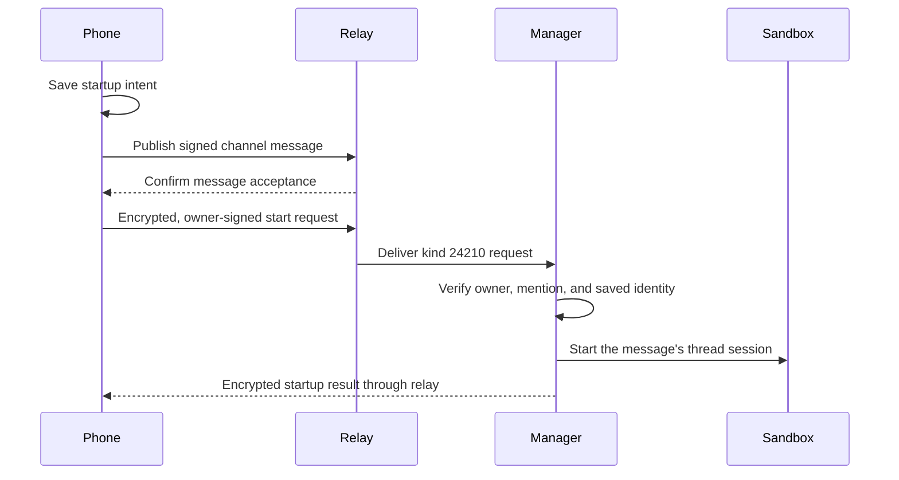

# Start remote agents from mobile

Mention an owned Remote workspace agent from mobile to start its session in that thread.
The desktop can be closed after the agent has registered its launch settings with the manager.

## Behavior

The manager derives the channel, thread root, and replay floor from the original signed message.
The harness replays the triggering message after startup.
An existing session keeps its current workspace and configuration.
An ended session requires explicit recovery from desktop, or a new thread.

The phone shows startup progress above the composer.
A startup failure leaves the accepted message in place and offers **Retry** and **Dismiss**.
Retry preserves the launch intent and message, with a new operation ID to escape cached refusals.
The provider converges on the same thread session; retry never republishes the message.
Interrupted attempts retain their operation ID when resumed after restart.
Pending intents survive app restarts and remain scoped to the community and owner.
The complete relay endpoint, including its path and query, separates communities sharing a host.
On restart, an unconfirmed message must be found on the relay before its agent can start.
Each account and community retain at most 32 intents, with at most four starts in flight.

Only owner-signed kind 30177 records with runtime `voltage.remote-workspace/sandbox` enable automatic starts.
Other owners' agents, local agents, and display-only `mention` references do not request startup.
If eligibility lookup fails, the message still sends and a dismissible notice explains that startup was skipped.
Malformed or unverified listings cannot authorize startup.
Once an eligible agent is confirmed, its startup intent must save successfully before the message sends.
The manager key matches the desktop default; `BUZZ_SANDBOX_MANAGER_PUBKEY` can override it at build time.

## Credentials and authorization

The phone signs `start` as the owner and encrypts it to the manager with NIP-44 v2.
The request contains the agent pubkey, community relay URL, and original signed channel message.
It carries no agent private key, model credential, namespace, image, or launch override.

The manager accepts `start` only from a configured owner's key, without an agent attestation.
It verifies the message signature and author, addressed agent, channel, and canonical thread root.
The verified owner selects the developer namespace.
The manager rechecks the saved agent key and current owner attestation before invoking the ordinary confined provider.
Replies must verify under the manager key and match both request ID and request event ID.
The existing freshness, expiration, replay, concurrency, and idempotency limits also apply to `start`.

A successful agent-signed desktop deploy saves its agent payload in a mutable Kubernetes Secret named `buzz-mobile-launch-*`.
The registration binds the owner, community, and agent, and retains the last successful desktop launch settings.
The manager replaces it with a resourceVersion check and at most three conflict retries.
A failed save returns an error, even if the Sandbox already started; retry reconciles that same session.

Registrations contain agent identity and launch credentials and survive Sandbox cleanup.
Cluster operators who can read namespace Secrets can read these credentials, as with existing launch Secrets.
Agent service accounts receive no Secret permissions from this feature.
Deleting the registration disables mobile starts until a subsequent desktop deploy registers it again.
Credential payloads are never logged or returned to the phone.
Serde and the Kubernetes client own the plaintext copies needed to persist and deploy a registration.

## Rollout

1. Apply the reviewed staging Terraform change that adds `update` on Secrets for the Sandbox manager.
2. Publish and promote the manager image containing this change through the CD repository.
3. Start each existing agent once from desktop to register its identity and settings.
4. Install a mobile build containing this change.
5. Complete the phone test below before accepting the rollout.

Older managers return an unsupported-operation error that mobile displays as an upgrade requirement.
Unregistered agents display the one-time desktop setup instruction.
This change does not deploy a manager, sync ArgoCD, or change production permissions.

## Why existing mobile builds need an update

Existing mobile builds publish the owner's signed channel message, including its addressed agent and thread tags.
They do not send the separate kind 24210 `start` request.
The manager currently subscribes only to kind 24210 requests addressed to its key, so it never receives those channel mentions.

This is an implementation boundary, not a signature or protocol limitation.
A server-side mention watcher could support existing clients using the saved launch registration and the same owner and thread checks.
That watcher is not implemented here.
It must receive messages through an identity with access to the agent's channels, preserve community boundaries, and reconcile duplicates and reconnect gaps.
The manager's service identity does not automatically inherit each developer's private channel memberships.

A web client can also send the same `start` operation without changing the cluster agent protocol.
It still needs the user's signing identity, the registered agent, and verified manager replies.

## Phone acceptance test

Use an owned staging Remote workspace agent and a disposable test thread.

1. Start the agent from the updated desktop once, then close desktop.
2. From mobile, post `@Agent reply with mobile launch confirmed` as a new thread.
3. Confirm startup progress appears and the agent replies in that exact thread.
4. Mention the agent again in a reply; confirm the existing thread continues.
5. Start another new thread; confirm it receives a separate session.
6. Interrupt the connection during startup, then restore it and use **Retry**.
7. Confirm the original message appears once and startup either completes or shows an actionable error.
8. Restart mobile with a pending launch; confirm its intent remains available.
9. Switch communities during startup; confirm no launch or notice crosses the community boundary.
10. Mention another owner's agent and confirm mobile sends no owner-start request for it.

Record the phone platform, build, and observed result in the PR.
