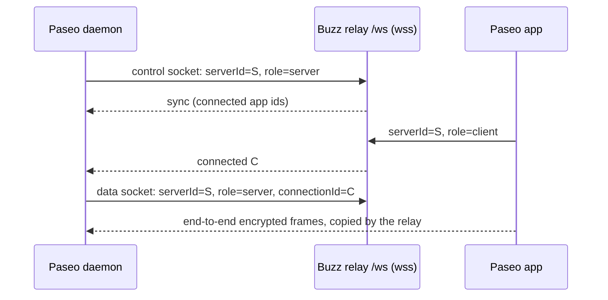

# Paseo relay on `/ws`

The Buzz relay can serve the [Paseo](https://paseo.sh) relay protocol on `GET /ws`.
An unmodified Paseo daemon and unmodified Paseo apps (desktop, mobile, CLI) then reach each other through the Buzz relay instead of `relay.paseo.sh`.

Neither side accepts inbound connections. The daemon and the app each dial out to the relay, and the relay joins the two connections.



This endpoint carries a third-party protocol for unmodified Paseo clients. It is not a Buzz feature API, so it is an intentional exception to the guidance to model new operations as Nostr events. Agent work still flows over Nostr.

## Enable the endpoint

| Variable | Default | Meaning |
|---|---|---|
| `BUZZ_PASEO_RELAY_ENABLED` | unset | Set to `true` to mount `/ws`. When unset, `/ws` answers like any unknown path. The relay then refuses to start unless `RELAY_URL` starts with `wss://`. |

Paseo traffic never uses plain `ws://`. The relay serves plain HTTP behind the deployment's TLS front, and the `wss://` `RELAY_URL` is the deployment's statement that this front is in place, so the relay checks it at startup. For local development, run the relay behind a TLS proxy (for example Caddy with a local CA) and set `RELAY_URL` to the proxy's `wss://` address.

With `BUZZ_NIP_FI_MODE` set to anything other than `off`, the router's NIP-FI guard refuses `/ws`, because Paseo clients send no NIP-FI assertion. The endpoint then does nothing.

## Point a Paseo daemon at the relay

Set these on the daemon (Paseo 0.15.3 or later). Use the relay's public host and port 443:

```text
PASEO_RELAY_ENABLED=true
PASEO_RELAY_ENDPOINT=buzz.voltage.cloud:443
PASEO_RELAY_PUBLIC_ENDPOINT=buzz.voltage.cloud:443
PASEO_RELAY_USE_TLS=true
PASEO_RELAY_PUBLIC_USE_TLS=true
PASEO_PASSWORD=<from a secret>
```

- `PASEO_RELAY_ENDPOINT` and `PASEO_RELAY_USE_TLS` control the daemon's own connection.
- `PASEO_RELAY_PUBLIC_ENDPOINT` and `PASEO_RELAY_PUBLIC_USE_TLS` go into the pairing offer, so apps also use `wss://` to this relay.
- The daemon turns TLS on by itself only for `relay.paseo.sh:443`. Set both TLS variables for any other relay.
- Paseo makes `PASEO_PASSWORD` optional. Always set it: without it, anyone with the pairing offer can control the daemon.

Run `paseo daemon pair` on the daemon and scan the QR code with the Paseo app.
An app keeps each paired daemon with its own relay, so one app can use a daemon on this relay and another daemon on `relay.paseo.sh`.

## Protocol

The behavior matches Paseo's reference relay (`@getpaseo/relay` `cloudflare-adapter.js`, 0.15.3). The implementation is `crates/buzz-relay/src/paseo_relay.rs`.

| Socket | Query | Relay behavior |
|---|---|---|
| Daemon control | `serverId=S&role=server&v=2` | One per server. A new one replaces the old one with close code 1008. It receives `sync`, `connected`, and `disconnected`. |
| App | `serverId=S&role=client&v=2[&connectionId=C]` | The relay assigns `C` when it is absent; Paseo apps always leave it absent. Frames buffer until the daemon's data socket for `C` opens. |
| Daemon data | `serverId=S&role=server&v=2&connectionId=C` | One per connection, accepted only while `C` has an app socket (otherwise closed with 1001). Frames copy both ways with the app sockets of `C`. |

- When the last app socket of `C` closes, the relay closes the data socket (1001) and sends `disconnected`.
- When the data socket closes, the relay closes the app sockets (1012) so that they connect and handshake again.
- If the daemon does not open a data socket for a new app within 10 s, the relay sends `sync` again. After 5 s more, it closes the control socket (1011) so that the daemon reconnects. After 45 s more, it closes the app (1013), so that no connection waits and buffers indefinitely.
- Only the socket that the relay currently holds for a role routes frames. A replaced or dropped socket's frames are ignored until it closes.
- Protocol v1 is refused with HTTP 400. Current daemons use v2.

## Multiple relay replicas

`/ws` works with any number of relay replicas behind one load balancer, using the Redis that the relay already requires. No sticky sessions are needed.

```text
app ─wss─▶ replica B ──open/frame/closed──▶ Redis inbox of A ─▶ replica A (owner) ◀─wss─ daemon
                      ◀──deliver/close────── Redis inbox of B ◀─
```

- **Ownership:** one replica owns each Paseo server and applies every protocol rule for it. The first socket for a server claims `buzz:paseo:v1:owner:{community}:{serverId}` in Redis (`SET NX PX`, 30 s). The owner refreshes the claim every 5 s and releases it when its session is empty.
- **Forwarding:** a replica that accepts a socket for a server another replica owns forwards that socket's frames to the owner's Redis inbox (`buzz:paseo:v1:replica:{id}`), and the owner sends the socket's frames back to the forwarding replica's inbox. Each replica publishes on one connection, so messages between two replicas stay in order.
- **Graceful shutdown:** when a replica begins shutting down (SIGTERM), it refuses new sockets, closes its sockets with 1012 (including the sockets other replicas forwarded to it), then deletes its owner keys and alive key. Daemons and apps reconnect to another replica, which claims the servers at once.
- **Failure:** each replica refreshes `buzz:paseo:v1:alive:{id}` (15 s). When a replica stops, its alive key expires, other replicas close the sockets they forwarded to it (1012), and the next socket claims the server for a live replica without waiting out the owner key. If Redis messages could have been lost (a subscriber reconnect, a failed publish, or a publish with no subscriber), the affected sockets are closed and Paseo reconnects.
- **One replica:** every server is local. Redis holds only the ownership claim and heartbeat; frames never pass through it.
- **Redis unavailable:** a new socket gets HTTP 503, because its owner cannot be found.

Frames that cross replicas are JSON with base64 for binary frames, up to about 1.4 MB per message. Redis disconnects a subscriber whose pub/sub output buffer exceeds its `client-output-buffer-limit` (32 MB by default), so keep that limit when running Paseo daemons on several replicas. The design assumes a standalone Redis, which is what the relay deploys.

## Limits

All Paseo sessions share the relay process, unlike Paseo's hosted relay, which isolates each server. So every resource has a bound:

| Resource | Limit |
|---|---|
| Frame size | 1 MiB (Paseo's hosted relay has the same Cloudflare limit) |
| Servers owned per relay process | 1,024 |
| Servers owned per community, per process | 256 |
| App connections per server (and so data sockets) | 64 |
| App sockets per connection | 8 |
| Buffered frames per connection | 200 frames and 4 MiB, newest kept |
| Send queue per socket | 256 frames and 8 MiB; a socket that stops reading is dropped |
| Buffered, queued, and cross-replica bytes, all sockets | 128 MiB; a connection that would exceed it is closed (1013) |
| Idle socket | The relay pings every 30 s and closes a socket silent for 90 s |

Each socket also holds one relay connection permit (`BUZZ_MAX_CONNECTIONS`). A draining relay refuses new sockets with HTTP 503.

## Security

- **Content:** the app and the daemon encrypt end to end with the daemon's public key from the pairing offer, and the daemon checks `PASEO_PASSWORD` when set. The relay copies opaque frames.
- **Metadata:** the relay sees `serverId`, connection ids, frame sizes, timing, and peer addresses. `wss://` hides them from the network. The relay's own logs record the route `/ws`, not the query. An ingress or proxy in front of the relay can still log full URLs, including `serverId`.
- **Community boundary:** the community comes from the request host, as on the main relay door. An unmapped host gets HTTP 404 before the upgrade. Sessions are keyed by community and `serverId`.
- **No relay identity:** a socket is not tied to a Buzz identity. The `serverId` works as a capability. Anyone who knows it can connect as an app, but cannot read anything without the daemon's key, or control it without the password. Anyone who knows it can also replace the daemon's control socket, which interrupts service until the daemon reconnects. Anyone on a mapped host can also hold up to 256 server slots in that community. Paseo's hosted relay has the same properties.

## Open items before production use

1. **Authorize `serverId`s.** Accept a control socket only for a `serverId` that a relay member announced in a signed Nostr event. This closes the replacement and slot-holding problems above.
2. **Archive.** Archiving a community does not close its open Paseo sessions.
3. **Crashes wait out the alive key.** A replica that dies without a graceful shutdown leaves its servers claimed until its alive key expires (at most 15 s); daemons and apps reconnect within that time.
4. **Protocol changes.** Paseo versions its relay protocol (`v`). Check each Paseo release that changes `@getpaseo/relay`.
