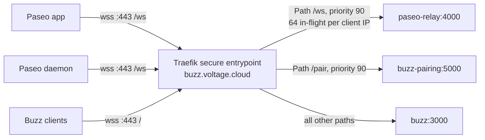

# Paseo relay

Voltage runs its own [Paseo relay](https://github.com/getpaseo/paseo-relay) at `wss://buzz.voltage.cloud/ws`.
Paseo apps ([paseo.sh](https://paseo.sh)) use it to reach a developer's Paseo daemon, which fronts that developer's Buzz remote agents.
The app and the daemon both connect out to the relay, so neither one needs an open inbound port.

The Paseo relay is a separate service. The Buzz relay does not know about Paseo, and Paseo traffic never enters the Buzz Nostr relay.
This repository only builds the image. The deployment is in voltagecloud/cd (`charts/paseo-relay`, `prod/apps/paseo-relay`).

## What runs

| Item | Value |
| --- | --- |
| Source | [getpaseo/paseo-relay](https://github.com/getpaseo/paseo-relay) (Apache-2.0, Elixir/OTP), unmodified |
| Pinned commit | `5f4b7636af41a85ef20200c0b7e99dd1ea2ee1f2`, in `PASEO_RELAY_SOURCE` of [`voltage-agent-images.yml`](../.github/workflows/voltage-agent-images.yml) |
| Image | Prod ECR repository `paseo-relay`, tagged with the voltagecloud/buzz commit, pinned by digest in voltagecloud/cd |
| Workload | One pod in the prod EKS cluster, namespace `buzz`, Argo CD Application `paseo-relay` |
| State | None on disk. Sessions live in the memory of the one BEAM node. |
| Secrets | None |

The relay forwards frames that are end-to-end encrypted between the app and the daemon.
It reads only the routing query parameters and the public key in `hello` and `e2ee_hello` frames.

## Routing

The relay shares the `buzz.voltage.cloud` hostname and the public Traefik `secure` entrypoint with the Buzz relay.
Traefik selects the backend by path. No DNS record is added.



| Rule | Owner | Middleware |
| --- | --- | --- |
| `Host(buzz.voltage.cloud) && Path(/ws)` | voltagecloud/cd `charts/paseo-relay` IngressRoute | `paseo-relay-inflight-limit` |
| `Host(buzz.voltage.cloud) && Path(/pair)` | Buzz IngressRoute in `prod/values/buzz/prod.yaml` | `pairing-inflight-limit` |
| `Host(buzz.voltage.cloud)` | Buzz IngressRoute | none |

The Buzz relay does not serve `/ws`. It accepts WebSockets on `/`, and `/ws` matches none of its routes, so it returns 404.
TLS terminates at Traefik. Clients always use `wss` on port 443; the relay never accepts plain `ws` from outside the cluster.
`/health`, `/ready`, and `/metrics` listen on the same port 4000 but have no public route.

## Connections

Every socket uses the path `/ws` and these query parameters:

```text
/ws?serverId=<id>&role=server&v=2                       daemon control socket
/ws?serverId=<id>&role=client&v=2&connectionId=<cid>    app socket
/ws?serverId=<id>&role=server&v=2&connectionId=<cid>    daemon data socket for one app
```

The relay sends the control socket a `sync` message, and a `connected` message when an app arrives.
The daemon then opens one data socket for that `connectionId`.
`serverId` and `connectionId` are limited to 256 bytes.

## Point a daemon at the relay

Set these variables in the Paseo daemon's environment:

| Variable | Value |
| --- | --- |
| `PASEO_RELAY_ENABLED` | `true`, unless the daemon config already enables the relay. New daemon homes start with the relay off. |
| `PASEO_RELAY_ENDPOINT` | `buzz.voltage.cloud:443` |
| `PASEO_RELAY_PUBLIC_ENDPOINT` | `buzz.voltage.cloud:443` |
| `PASEO_RELAY_USE_TLS` | `true` |
| `PASEO_RELAY_PUBLIC_USE_TLS` | `true` |

The daemon connects to `PASEO_RELAY_ENDPOINT`. It gives `PASEO_RELAY_PUBLIC_ENDPOINT` to the apps it pairs with, so both values are the same public address.
Without these variables, the daemon uses Paseo's hosted relay, `relay.paseo.sh:443`.
Do not set the TLS variables to `false`: Traefik routes `/ws` only on its TLS entrypoint.

## Relay settings

The cd chart sets these values. The upstream [runtime contract](https://github.com/getpaseo/paseo-relay#runtime-contract) lists every setting.

| Setting | Prod value | Reason |
| --- | --- | --- |
| `PASEO_RELAY_HOST`, `PASEO_RELAY_PORT` | `0.0.0.0`, `4000` | Listen on the pod IP. |
| `RELEASE_DISTRIBUTION` | `none` | The release otherwise starts EPMD and a distribution port on all interfaces, protected only by a cookie that is readable in the image. |
| `RELEASE_COOKIE` | not set | Not used without distribution. |
| `PASEO_RELAY_MEMORY_WATERMARK_BYTES` | `805306368` (768 MiB) | Shed sockets with close code `1013` before the 1 GiB memory limit. |
| `PASEO_RELAY_INGRESS_BUDGET_BYTES` | `268435456` (256 MiB) | Two 32 MiB messages at weight 4. |
| `PASEO_RELAY_CONNECTIONS_PER_ACCEPTOR` | `40` | 4,000 sockets. An idle socket and its session measured about 125 KiB. |
| `LANG` | `C.UTF-8` | The VM expects UTF-8 file names. |
| `ERL_CRASH_DUMP_SECONDS` | `0` | The root filesystem is read-only. |

The pod runs as UID 65532 with a read-only root filesystem, all capabilities dropped, and the `RuntimeDefault` seccomp profile.
Resources: requests 100m CPU and 256 MiB, limits 1 CPU and 1 GiB.
Prometheus scrapes `/metrics` through a ServiceMonitor. `paseo_relay_ready`, `paseo_relay_active_websockets`, and `paseo_relay_beam_total_memory_bytes` show health and load.

## Limits

- **No Buzz gating.** Any client that reaches `/ws` can register any `serverId`, as on Paseo's hosted relay. The relay does not check Buzz membership. End-to-end encryption and the daemon password protect the sessions.
- **One replica.** A restart or rollout drops every session for a few seconds, and apps and daemons reconnect. More replicas need BEAM clustering and an adapter that reroutes upgrades to the owning node.
- **Shared in-flight budget.** Traefik allows 64 concurrent requests per client IP and returns 429 above that. Daemons behind one egress IP, such as the single staging NAT gateway, share the budget. Raise `ingressRoute.inFlightPerClientIp` in voltagecloud/cd when more daemons share an IP.
- **Pod-wide ceiling.** At 4,000 sockets or under memory pressure, `/ready` returns 503 and new connections fail until load drops.

## Build and test the image

[`voltage-agent-images.yml`](../.github/workflows/voltage-agent-images.yml) builds `PASEO_RELAY_SOURCE` as a remote BuildKit context, with the upstream `Dockerfile` unchanged.
Pull requests build `linux/amd64` and `linux/arm64` without a push. `main` pushes both and merges them into one manifest list.
[`test-paseo-relay-image.sh`](../voltage/images/test-paseo-relay-image.sh) runs the image with the prod hardening and limits.
The test checks `/health`, `/ready`, `/metrics`, a `101` upgrade on `/ws`, UID 65532, and that port 4000 is the only TCP listener.

```bash
docker buildx build --check "https://github.com/getpaseo/paseo-relay.git#5f4b7636af41a85ef20200c0b7e99dd1ea2ee1f2"
docker build -t paseo-relay:local "https://github.com/getpaseo/paseo-relay.git#5f4b7636af41a85ef20200c0b7e99dd1ea2ee1f2"
bash voltage/images/test-paseo-relay-image.sh paseo-relay:local
```

Expected last line:

```text
paseo relay image paseo-relay:local passed
```

## Upgrade the relay

1. Read the upstream commits and the runtime contract since the pinned commit. Note new or changed settings.
2. Change the commit in `PASEO_RELAY_SOURCE`, here and in this document, and open a pull request.
3. After the merge, copy the `paseo-relay` digest from the `main` run's job summary.
4. In voltagecloud/cd, pin the digest in `prod/values/paseo-relay/prod.yaml` and sync `paseo-relay` manually. See `prod/apps/paseo-relay/README.md`.
