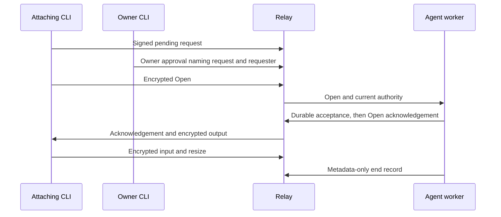

# Sandbox terminal CLI

`buzz sandbox attach` forwards a local terminal through NIP-TA relay events.
It needs the SDK foundation and ACP terminal worker in the agent image.
This CLI PR alone does not enable a terminal in an existing sandbox; rebuild both CLI and agent images after the dependent changes land.
Use an HTTPS relay URL; the terminal connection uses WSS and normal certificate verification.

Set `BUZZ_PRIVATE_KEY` and `BUZZ_RELAY_URL` on the attaching machine.
The owner, agent, and requester must already have posting membership in the channel.
A hosted gateway must also have a live owner delegation and set `BUZZ_PASEO_OWNER` to the human owner's public key.
That delegation permits requesting approval; an owner-signed approval is required for every terminal session.

```sh
buzz sandbox attach --channel <uuid> --thread <event-id> --agent <pubkey> --owner <owner-pubkey>
```

The CLI accepts a thread root or a reply, verifies its channel, and resolves its root.
Omit `--agent` only when configured mappings or the root's single recipient identify it unambiguously.
The default session lifetime is 15 minutes; `--minutes` accepts 1 through 60.

For a hosted gateway, the CLI prints a pending request ID and waits without forwarding input.
On the owner's machine, using the same relay and the owner's primary signing key:

```sh
buzz sandbox authorize --request <pending-request-id> --minutes 15
```

The command checks current membership and gateway authority before signing the approval.
The worker independently verifies the immutable sandbox owner, agent, thread, and channel before accepting it.
An owner attaching with their primary key signs their own per-session approval as part of the attach action.
To end an approval early, run `buzz sandbox revoke --grant <approval-event-id>` with its owner's key.



The local TTY enters raw mode only after the worker acknowledges Open.
Control keys and pasted bytes are forwarded unchanged; `Ctrl-]` detaches locally.
Resize is checked every 100 ms. Idle sessions close after five minutes; empty transport heartbeats do not reset idle time.
Both sides refresh current authority every five seconds with a five-second total query deadline, bounding revocation detection to ten seconds plus teardown.
The four-frame/64 KiB window, retry limits, and frame admission budget apply in both directions.
The CLI restores terminal settings after peer close, expiry, input/output failure, or authorization failure.

For Paseo, configure a terminal profile with `command: "buzz"` and `args: ["sandbox", "attach"]`.
With no target flags, the command offers up to 64 `BUZZ_PASEO_AGENTS` mappings, then at most 64 recent addressed thread roots in the selected channel.
The variable uses the wrapper's existing `id`, `label`, `agent`, and `channel` JSON entries.
This menu does not launch an agent or create a sandbox; start a thread first.
Enabling the Paseo host-tools profile remains an operator choice after these consumers land and images are rebuilt.
No substrate connection, exec endpoint, broker, or tunnel is involved.
