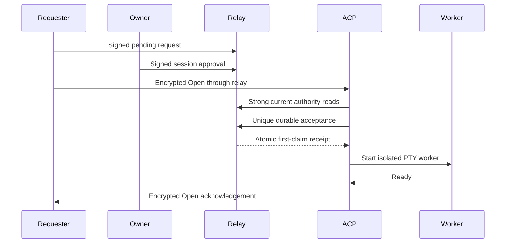

# Owner-approved sandbox terminals

The ACP harness accepts an interactive terminal through the existing community relay.
The service requires Linux, `--respond-to owner`, an immutable channel-thread binding, a known owner, and WSS.
Unbound agents, direct-message workspaces, other author modes, and plaintext transport never subscribe to terminal requests.
Rebuild the agent image and CLI after the dependent layers land.
See the [CLI runbook](sandbox-attach-cli.md) for request, approval, attachment, and revocation commands.

Every attachment requires a separate owner-signed approval for its requester, agent, channel, thread, and session.
A global gateway grant permits requesting approval; it cannot authorize a shell or approve another gateway.
Terminal and snapshot approvals use distinct types and modes.
Terminal approval grants the sandbox user's shell permissions, including workspace changes and access to credentials available inside that sandbox.

The server checks current pending request and approval heads, their signatures, immutable scope, posting membership, and live gateway delegation.
Missing, replaced, revoked, expired, malformed, or unavailable authority denies access.
The owner, agent, and requester must remain posting members in the relay-signed roster.
Per-session approval does not confer relay or channel membership.

Authority refresh runs in a separate task every five seconds, with a five-second lookup deadline.
Results apply only to the same active approval generation.
The authority lease starts before its lookup; admission latency cannot extend it.
An absolute ten-second lease also bounds blocked relay and worker writes, capped by approval expiry.
Admission must retain the full five-second readiness budget before spawning a worker.
The server stops terminal I/O when that lease ends and immediately requests contained worker teardown.
Confirmed cleanup has a separate fifteen-second bound.
Slow authority queries do not block terminal output, input, or cancellation.

The [atomic claim contract](sandbox-attachment-claims.md) makes each approval single-use across overlapping harnesses.
Generic success, duplicate receipts, mismatched IDs, and ambiguous acknowledgements never start a worker.
The private local journal reserves an approval before publishing its exact acceptance event.
After restart, a consumed approval cannot reopen; unfinished owned audits are recovered for retry.
An unconfirmed or losing claim never publishes an end record for another replica's operation.
The journal caps records at 256 and each record at 16 KiB.

One terminal runs per bound sandbox.
Frames use recipient-encrypted NIP-44 payloads, four-frame windows, 16 KiB data packets, and a 64-frame-per-second budget.
Reliable empty heartbeats run every five seconds without resetting idle expiry.
Five failed one-second retries close the transport; idle peer disappearance can therefore take about eleven seconds to detect.
Actual input, resize, or output resets the five-minute idle deadline.
The server drains acknowledged final output before reliably closing the transport.
It bounds that final transport drain to six seconds.

The [contained worker](sandbox-terminal-worker.md) owns a real PTY and an isolated Linux subreaper process tree.
The harness propagates unconfirmed cleanup, worker exit 2, or a worker-task panic as a fatal containment error.
Fatal containment errors terminate the harness before checkpoint scans.
Ordinary transport failures close the PTY, retain metadata retries, and retry with bounded backoff.
After five failures, terminal service stops; restart the sandbox to restore it.
Ordinary model work can continue when worker containment was confirmed.

Stored acceptance/end events and local retry records contain approval metadata and byte counters only.
Keystrokes and file bytes pass through encrypted ephemeral frames and local worker pipes.
The service does not persist terminal output or include it in diagnostics.
Failed audit publication remains durable for an idle retry or the next startup.
This feature adds no tunnel, broker, public exec endpoint, or substrate exec permission.
