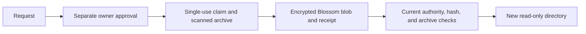

# Read a sandbox snapshot and return a patch

`buzz sandbox snapshot pull` restores a new local directory from an owner-approved sandbox snapshot.
`push-patch` returns a diff through the existing thread. The agent decides whether to apply it.

The protocol is [NIP-SA](nips/NIP-SA.md). See the [producer](sandbox-snapshot-producer.md) and [archive reader](sandbox-snapshot-archive.md) for scan and restore limits.

## Before requesting a snapshot

Use the same HTTPS community relay as the sandbox. Plain HTTP, URL credentials, queries, and fragments are refused.
Use an owner key or a currently delegated gateway key. Agent attestations cannot request this access.
Owner, requester, and agent must remain posting members of the channel.

The owner signs a separate snapshot approval. A terminal approval cannot authorize a snapshot.
On a gateway, set `BUZZ_PASEO_OWNER` to the human owner's public key.
Keep the owner's private key on the owner's device.

Restore requires Linux or macOS and Git 2.29 or newer. In Paseo, enable `host-tools=on` before requesting a snapshot.
The command checks Git before publishing a request. It preserves the host-tools profile's Git refusal.

Create a dedicated store with room below the volume's actual quota:

```sh
mkdir -m 700 ./sandbox-snapshots
```

Set `CHANNEL_ID`, `THREAD_ID`, and `AGENT_PUBKEY` to the sandbox's channel, thread, and agent.
Authenticate through `BUZZ_PRIVATE_KEY` and `BUZZ_RELAY_URL` using your normal local credential setup.

## Pull the snapshot

Run this command as the requester:

```sh
buzz sandbox snapshot pull \
  --channel "$CHANNEL_ID" \
  --thread "$THREAD_ID" \
  --agent "$AGENT_PUBKEY" \
  --into ./sandbox-snapshots/review-1 \
  --store-root ./sandbox-snapshots
```

The destination must be absent. Its parent must already exist within the store.
The default work budget is 64 MiB. The default store budget is 128 MiB, including existing snapshots.
Use `--work-bytes` and `--store-bytes` only within the actual volume quota. Each accepts at most 2 GiB.
The extractor also checks filesystem free space. That check cannot discover a Kubernetes `emptyDir.sizeLimit`.

When the requester owns the sandbox, the command signs approval with that owner key.
When a gateway requests access, the command prints the exact approval command for the owner.
Run that command on the owner's device, against the same relay:

```sh
buzz sandbox snapshot authorize \
  --owner "$OWNER_PUBKEY" \
  --request "$REQUEST_EVENT_ID"
```

The signing key must equal `--owner`. The command rechecks current authority after publishing approval.
`--minutes` limits request or approval lifetime to 1–60 minutes. Approval cannot outlive its request.



Success prints JSON containing `directory`, `repositories`, and `grant`.
Open the listed repository directories to inspect history and diffs.
Files remain owner-only and read-only. Executable files retain executable permission.

The snapshot includes full scanned, locally available Git history. Explicit shallow boundaries remain shallow.
Private runtime paths and `.env*` files are excluded from the working-tree copy.
Historical versions of those paths can remain in the scanned Git bundle.
Snapshot creation never uses unscanned checkpoint quarantine.

## Stop or revoke access

Press Ctrl-C to cancel a pull. The command waits for local Git cleanup and withdraws its pending request.
If withdrawal fails, the command reports failure. Remote work remains bounded by its deadline and authority checks.

To revoke an approval, run this command with the owner's key:

```sh
buzz sandbox revoke --grant "$GRANT_EVENT_ID"
```

Authority is refreshed during download and checked again before decryption.
Revocation or expiry prevents further protocol use. It cannot erase bytes already delivered to an authorized requester.
Local restored directories remain until you remove them.
The media service has no per-blob expiry or deletion API. Encrypted blobs can remain under existing operator retention.

## Return a patch

Prepare changes in a separate writable copy. Keep the restored snapshot available for comparison.
Generate a UTF-8 patch containing at most 60 KiB, with the repository URL and full base commit available.

```sh
buzz sandbox snapshot push-patch \
  --channel "$CHANNEL_ID" \
  --thread "$THREAD_ID" \
  --agent "$AGENT_PUBKEY" \
  --repo "$REPO_URL" \
  --commit "$BASE_COMMIT" \
  ./change.diff
```

`REPO_URL` must use HTTP or HTTPS without credentials, query, or fragment.
`BASE_COMMIT` must be a full SHA-1 or SHA-256 commit hash.
The command posts a kind `40008` reply and mentions the selected agent.
It does not modify the sandbox or apply the patch. Success prints the accepted event ID.

## Check a failure

| Observable result | Action |
|---|---|
| Git unavailable or denied | Enable host tools, install supported Git, then retry. |
| Destination already exists | Choose a new directory. Preserve the existing copy. |
| Store or work budget exceeded | Remove old snapshots or choose a larger volume before changing budgets. |
| Approval, membership, or gateway authority ended | Restore current authority and create a new request. |
| Scan or archive refusal | Inspect the sandbox's metadata audit. Do not bypass scanning. |
| Size, hash, or authentication mismatch | Preserve the failure and report it. Do not use the downloaded bytes. |
| Cleanup or withdrawal failure | Preserve the diagnostic and inspect remaining owned local processes or remote metadata. |
