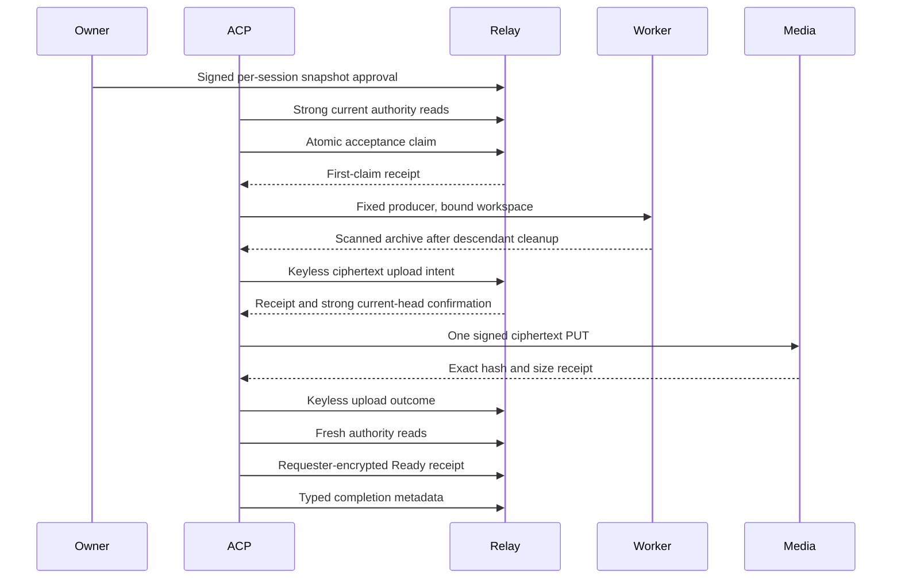

# Agent snapshot export runtime

The ACP harness exports one owner-approved snapshot from its immutable bound workspace.
The Linux service requires owner-only responses, a bound channel thread, and a WSS relay.
It uses the separate snapshot grant type; terminal approvals cannot start exports.

The owner, agent, and requester must retain posting membership in a strongly fetched relay-signed roster.
A gateway requester must retain its live owner delegation and profile.
The service checks the current request and owner approval heads before accepting work.
It checks authority every five seconds with a five-second read deadline.
Failed reads, expiry, deleted approvals, replacement, or lost membership stop work within ten seconds, plus bounded containment cleanup.
Authority monitoring continues while metadata or object storage requests wait.
Socket reads answer relay control frames during idle time, archive creation, and upload.
The service requires enough lease time for the complete five-second worker readiness window before spawning.

The worker runs `/usr/local/bin/buzz-agent-snapshot` with the fixed workspace and a fresh private output file.
The explicit scratch budget is 512 MiB; the producer also enforces its source, object, repository, and scan limits.
It scans all locally available Git history and the included working-tree copy.
It does not fetch history or use checkpoint quarantine.
See [producer limits](sandbox-snapshot-producer.md) and the [worker boundary](sandbox-snapshot-worker.md).

The archive is encrypted with a fresh key before upload.
The upload intent contains only the owner approval, acceptance ID, ciphertext hash, size, and approval expiry.
The intent must be durably saved locally and confirmed on the relay before PUT.
An interrupted or ambiguous PUT records `unconfirmed`; the service never retries that object operation.
A fresh request and owner approval are required for another export.

The service publishes the key-bearing Ready receipt only after exact upload confirmation and a fresh authority check.
Ready receipts never enter the generic replay outbox.
After restart, the service finishes consumed attempts and retries only keyless metadata.
For stale keyless envelopes, a strong head lookup acknowledges an earlier committed write or permits a durably saved fresh envelope.
A failed lookup never permits a refresh.
The original metadata body, owner approval, claim, ciphertext hash, and size remain unchanged.

Local records and cleanup intent live under `$HOME/.local/state/buzz/snapshot/<agent>/<thread>`.
The journal permits one active export and at most 64 retained attempts.
Local cleanup failure retains the record and prevents new work until recovery succeeds.
Unconfirmed process containment is fatal to the harness and prevents checkpoint scans.
Shutdown waits for both terminal and snapshot containment before checkpointing.

The media API has no object deletion or expiry operation.
Ciphertext can remain indefinitely under existing media retention and operator cleanup policies.
Upload limits do not provide a retained-byte quota.
Durable relay metadata identifies possible objects after sandbox loss; it does not promise erasure.
Receipt expiry prevents new protocol transfers and cannot erase downloaded copies.

Use the [snapshot CLI runbook](sandbox-snapshot-cli.md) for request, owner approval, restore, and patch commands.
