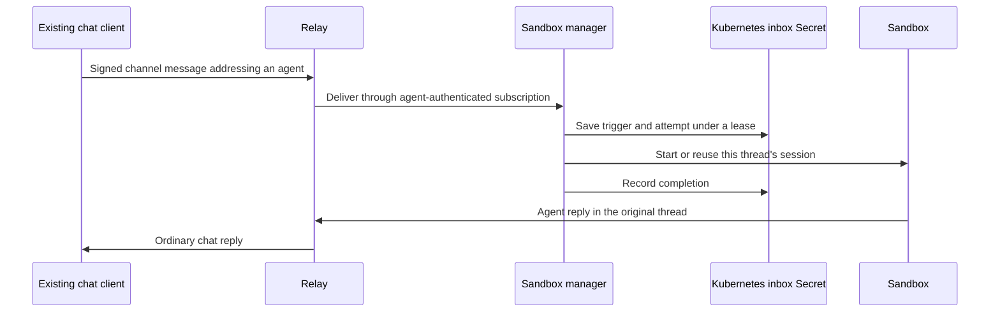

# Start remote agents from an unchanged chat client

Enable server mention launches to start registered Remote workspace agents from ordinary channel messages.
The phone sends its existing signed message. It does not send a launch request or receive agent credentials.



## Contract

Only configured owners can start their registered agents.
The manager verifies signatures, addressed public keys, channel tags, and thread tags.
It connects only to its configured relay, using each registered agent's key and owner attestation.
Relay membership controls which channel events the listener receives.
Before deployment, the manager confirms that the trigger remains readable and checks current channel metadata.
It also requires the owner's current kind 30177 listing to select `voltage.remote-workspace/sandbox`.
Deleting that listing or switching its runtime disables automatic starts, including pending work from an earlier connection.
Saved registrations alone do not override the current listing.
The owner private key stays on the client.

The manager reuses the existing launch registration, provider confinement, and thread session identity.
Replies reuse that session. A new root message selects a separate session.
Ended sessions require desktop recovery or a new thread.
This feature supports channel messages of kinds 9 and 40002, with an addressed `p` tag.
Display-only `mention` tags, edits, DMs, and Solo session management are outside this launch contract.

The feature is disabled by default.
Existing encrypted control requests and modified mobile clients remain supported.
Concurrent desktop and server launches converge through the provider's existing thread identity.

## Durability and limits

Each registration has a separate `buzz-mention-inbox-*` Secret.
It contains a replay cursor, recent completion receipts, and at most one pending signed trigger.
It also retains up to 32 undelivered startup replies separately from launch work.
Secret resource versions fence competing writers. A six-minute lease bounds takeover after a crashed manager.
Registration updates do not replace the inbox.
Registration removal stops its listener on the next successful discovery pass, within approximately 30 seconds.
Each launch also reloads the registration before invoking the provider.
Discovery failures suspend listeners until registry access recovers.

The listener installs live delivery before fetching history.
History uses inclusive timestamp boundaries and pages of 1,000 events.
Only a complete history traversal advances the replay cursor.
Reconnects overlap that cursor by two minutes.
Messages signed before first activation or registration do not launch historical work.
During a disconnect, messages backdated before the replay cursor cannot be recovered through this timestamp-based subscription.
Connected live delivery can receive older timestamps after activation.
This limitation applies to unusually delayed offline sends; it does not remove their chat messages.

The manager limits discovery to 64 registrations and concurrent launches to four per process.
Each launch attempt has a three-minute deadline and at most three persisted attempts.
Each inbox holds at most 4,096 recent receipts and 512 KiB of serialized state.
Triggers larger than 60,000 serialized bytes do not launch agents.
History stops after 16 pages or when one timestamp fills an entire page.
Capacity failures retain the cursor and pending work; they never skip a page to claim recovery.
Operators must resolve capacity failures before relying on further automatic starts.

Startup failures produce ordinary replies signed by the agent.
The inbox saves the signed reply before publication and retains it until relay acceptance.
Lost acknowledgements retry the same event ID.
Each reply gets three delivery attempts; exhausted replies remain in the journal for operator investigation.
An undeliverable reply does not block launches in other channels.
A fresh owner mention creates a new attempt after a terminal failure.
The system never automatically recovers an explicitly ended session.

## Rollout

1. Grant the manager `get`, `list`, `create`, and `update` on Secrets in its configured developer namespaces.
2. Publish and promote the updated manager image through the deployment repository.
3. Enable `manager.mentionLaunch` in the CD chart after promoting the new manager image.
   The chart sets `BUZZ_SANDBOX_MENTION_LAUNCH=true`; standalone managers can use `serve --mention-launch`.
4. Start each agent once from desktop after the registration-capable manager is deployed.
5. Use the same owner identity on the phone and desktop.
6. Add the agent to the test channel before mentioning it.
7. Complete the acceptance test below.

The existing `buzz-mobile-launch-*` registrations retain launch credentials.
Inbox Secrets contain message content; restrict their access like other namespace Secrets.
Neither Secret belongs in logs, source control, or support transcripts.
This code change does not apply Terraform, change deployment settings, or publish an image.

To roll back, disable `BUZZ_SANDBOX_MENTION_LAUNCH` and roll the manager deployment.
Keep registrations and inboxes so later re-enablement retains pending work and receipts.
Deleting an inbox discards its pending work and resets its history boundary.

## Acceptance test

Use the installed phone application without rebuilding it.

1. Start a registered agent from desktop, then close desktop.
2. Wait for registry discovery, approximately 30 seconds.
3. From the phone, create a channel thread: `@Agent reply with phone launch confirmed`.
4. Confirm one Sandbox starts and the agent replies in that thread.
5. Mention it again inside the thread. Confirm the existing Sandbox is reused.
6. Mention it in another new thread. Confirm a separate Sandbox starts.
7. Restart the manager during startup. Confirm the original message remains singular and the launch eventually converges.
8. End a session from desktop. Mention it from the phone and confirm a recovery instruction appears.
9. Mention the agent from another owner's identity. Confirm no Sandbox starts for that message.

Record the application build, community, thread IDs, and observed results.
Automated WebSocket tests exercise the manager with ordinary messages and an in-memory Kubernetes API.
The opt-in real-relay test also checks authentication, private-channel membership, message ingestion, and subscription delivery through Buzz itself.
Run it against an isolated local relay with `BUZZ_ALLOW_NIP_OA_AUTH=true`:

```sh
BUZZ_MENTION_TEST_RELAY=ws://127.0.0.1:13039 cargo test --locked -p buzz-sandbox-reaper \
  unchanged_client_starts_agents_through_real_relay_permissions -- --ignored --nocapture
```

The test creates a private channel and synthetic identities, then checks new threads and same-thread replies.
It refuses non-loopback relay URLs. Kubernetes remains an in-memory API in this test.
These tests do not establish physical-phone, real-cluster, or model-runtime behavior.

## Troubleshooting

| Observation | Action |
|---|---|
| No launch registration | Start the agent once from desktop after upgrading the manager. |
| `registration_invalid` | Check the namespace, configured relay, saved identity, and owner attestation; register again from desktop. |
| `inbox_storage_failed` | Restore namespace Secret permissions or Kubernetes connectivity. Keep the inbox. |
| `inbox_lease_unavailable` | Check for another manager replica. After a crash, allow up to six minutes for takeover. |
| `mention_capacity_exceeded` | Inspect backlog size and registration count without printing Secret contents. Escalate before changing or deleting the journal. |
| `mention_relay_failed` | Check relay connectivity and the agent's channel membership. |
| Ended-session reply | Recover from desktop or begin a new channel thread. |
