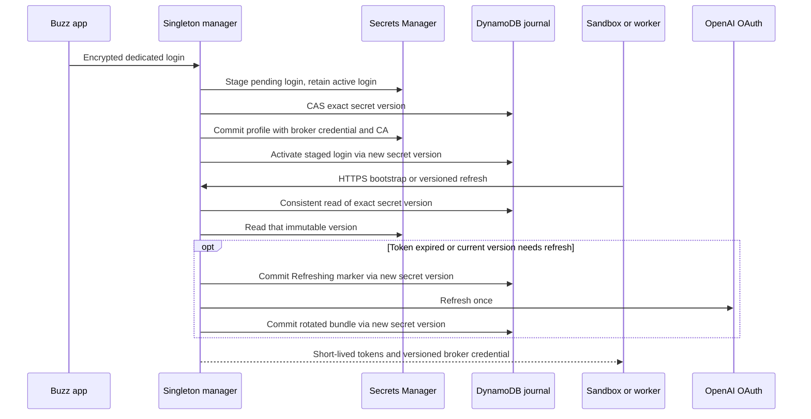

# Shared ChatGPT login for remote agents

DEV-2948 adds a private refresh broker to the Sandbox manager. It prevents concurrent
Sandboxes and workers from rotating one shared OpenAI refresh token independently.
Enrollment remains an owner-signed, NIP-44 encrypted `enroll` request over the relay.
The HTTPS endpoint exists because the pinned native Codex refresh client requires it.

## Ownership and failure handling

| Store | Contents | Readers |
| --- | --- | --- |
| Developer profile secret | Existing accounts, broker URL, public CA, revocable broker credential | That developer's agents and manager |
| `voltage/staging/agents/<id>/codex-login` secret | Active and pending login, real tokens, refresh state | Manager only |
| `voltage-staging-agent-codex-logins` DynamoDB table | Developer ID and committed secret version ID | Manager only |

Every journal read is strongly consistent. A conditional update publishes an exact immutable
secret version; the broker never follows `AWSCURRENT`. An unpublished or temporarily unreadable
version cannot cause the broker to fall back to an older refresh token.
A refresh marker is committed before contacting OpenAI. Cancellation, an uncertain OAuth result,
or a failed result write leaves the login interrupted. The next attempt requires re-enrollment.
This favors an explicit sign-in over risking reuse of a rotated token.

Enrollment and refresh share a per-developer mutex. A failed profile write preserves the prior active
login. Activation follows the profile write; if activation fails, enrollment reports failure and
new sessions refuse the staged credential until enrollment succeeds. Retrying enrollment can activate
the persisted pending login. Disconnect revokes in the journal before changing the profile, so a stale
profile cannot restore access. Already-issued access tokens remain valid until upstream expiry or revocation.
The manager must still run as one replica with `Recreate`: relay replay and idempotency caches are local.

Bodies, upstream replies, wait times, concurrency, certificate reload, and shutdown are bounded.
Error responses and logs never include credentials or provider bodies. Runtime credential files
are private and excluded from checkpoints. Broker grants authorize one developer only.

## Rollout

The chart defaults to `codexLogin.enabled: false`. This change alone enables no live broker.

1. Review and apply the companion voltage-terraform staging-agent change: empty login secrets,
   manager IAM, metadata journal, and agent egress to the manager on TCP 8443. Review the entire plan;
   exclude unrelated existing staging-agent drift from this rollout.
2. Merge the Buzz implementation and let the Voltage images workflow publish both manager and agent
   images for that commit. Use immutable image digests.
3. Pin the agent digest in both the manager's interactive provider configuration (CD values) and the
   Terraform worker template. Apply/sync those changes before enrolling the new profile shape.
   An old bootstrap rejects profiles with `codex_login`.
4. Pin the new manager digest, set `codexLogin.enabled: true`, and retain
   `codexLogin.journalTable: voltage-staging-agent-codex-logins` in staging CD values.
   Review the render, then manually sync `buzz-sandbox-manager`.
   cert-manager issues a private CA and a leaf certificate for
   `codex-refresh.buzz-sandbox-manager.svc.cluster.local`.
5. Check Certificate readiness, Deployment readiness, and the HTTPS health endpoint.
   The manager mounts only the public CA and the leaf key, never the CA private key.
   It reloads the leaf certificate every 60 seconds. CA replacement requires re-enrollment.
6. Build the Voltage GPUI app with `voltage-sandbox`. In the form, sign in with ChatGPT using
   device auth, choose the Voltage workspace, and enroll. Test a fresh interactive session and worker.

Disabling the broker causes enrolled shared-login sessions to fail closed. Before rolling back to
an old manager or agent image, disconnect shared logins and enroll a supported API key or workspace
access token. Do not copy the upstream refresh token into a profile or an agent auth cache.

## Validation before marking DEV-2948 complete

Automated tests use synthetic tokens and a local OAuth issuer; they do not prove a real OpenAI subscription.
Run the native form, cancel and replace a sign-in, confirm the dedicated cache is removed, and enroll.
Start five concurrent Sandboxes plus workers using one login, maintain activity beyond 24 hours,
and retain redacted evidence of successful refreshes without 401/re-login loops. Exercise manager restart,
re-enrollment, and disconnect. A fresh session using a revoked or stale profile must fail before its harness starts.
The issue remains open until this live acceptance test and human app testing succeed.

The native client contract is pinned to Codex 0.159.3: JSON refresh grant, the fixed public client ID,
`CODEX_REFRESH_TOKEN_URL_OVERRIDE`, and file-backed persistence of the returned refresh credential.
OpenAI's [managed-auth guidance](https://developers.openai.com/codex/auth/ci-cd-auth) advises against
sharing an ordinary `auth.json` across concurrent runners. This is a custom broker, not a supported
managed-login sharing mode. Verify the pinned contract before any Codex upgrade.
