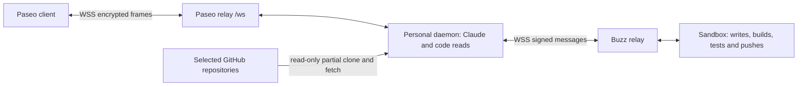

# Paseo personal daemon

One developer's headless Paseo daemon stays available while their laptop is closed.
The image uses unmodified Paseo 0.15.3 and its bundled Claude Code 2.1.246 runtime.
It adds the Buzz CLI, a configuration wrapper, read-only Git helpers, a turn recorder, and a gateway profile plugin.
Codex stays disabled pending its shell and credential review.



The daemon reads code, reviews changes, and sends briefs or suggested diffs as ordinary Buzz messages.
The sandbox decides which suggestions to apply and pushes a branch for review.
User-visible changes should include a sandbox-produced walkthrough video in the thread.
The daemon does not run the site or expose a sandbox development server.

## Identity and access

The manager stores pairing credentials and the distinct gateway key in `paseo-daemon-<developer>` in namespace `buzz-paseo`.
The owner's private key never enters the pod.
The pod has no IAM role, Kubernetes token, or sandbox credentials.
The owner runs `buzz paseo setup` to enroll, create the daemon, and grant the gateway.
Grant and membership are separate: admit the gateway to the workspace and each required channel, including its recording channel.
A gateway grant conveys no delegated access to the owner's DMs, profile, or administrative privileges.

The `buzz-profile` plugin gives the gateway key its own Buzz profile name, so its posts show a name instead of a pubkey prefix.
At startup it reads the display name of `BUZZ_PASEO_OWNER` and publishes `<owner name> (Paseo)`, for example `Taylor (Paseo)`.
The about line names the owner's pubkey. The profile is the gateway's own kind 0 and claims no owner authority.
If the gateway already has that name, the plugin writes nothing; a renamed owner renames the gateway at the next start.
Until the gateway is a relay member, or while the owner has no name, it retries with exponential backoff (1 minute up to 1 hour) for 24 hours.
Without `BUZZ_PASEO_OWNER`, the plugin is disabled.

See [the enrollment runbook](../../remote-agents.md) for the existing commands and pairing password retrieval.

For code reads, the developer supplies a fine-grained GitHub token with `contents: read` and `pull_requests: read` on selected repositories only.
Secret data `github_read_token` maps explicitly to `GITHUB_READ_TOKEN` through Terraform's `secretKeyRef`.
The manager preserves this field; it never copies the sandbox profile's broader GitHub credential.
Configure `GITHUB_READ_TOKEN_REPOSITORIES` separately as a JSON array of repository names, such as `["your-org/private-repo"]`.
The list is nonsecret per-developer configuration, not a token field or a hardcoded image allowlist.
It permits at most 64 unique `owner/repository` entries and 16,384 encoded bytes.
Names match case-insensitively; URLs, traversal, and extra path segments are refused.
The credential helper requires HTTPS `github.com` and an exact configured repository path; Git passes paths through `credential.useHttpPath=true`.
Missing or empty configuration sends no credentials.
Public repositories outside the configured token scope clone and fetch anonymously, even when a token is present.
Private repositories still require a valid token with matching GitHub permissions.
The wrapper refuses broad `gho_` or classic `ghp_` tokens.
Token syntax cannot prove its permissions: the developer must verify the repository and read-only scopes in GitHub.
If the token permits writes, the daemon can push with that token; the runtime does not override its GitHub authority.

**The GitHub token's scope is the security boundary.**
Provider tool restrictions reduce mistakes; they are not a security boundary once a provider has a shell.
The container uses a read-only root filesystem, an unprivileged UID, dropped capabilities, and a one-CPU limit.
It carries no package managers, compilers, build/test tools, or scanners.
Node remains necessary for the upstream daemon and plugin runtime.
Never install packages or execute repository scripts here.

## Read-only code workflow

```bash
paseo-code clone voltagecloud/buzz
paseo-code fetch voltagecloud/buzz review/branch
paseo-code diff voltagecloud/buzz origin/main HEAD
paseo-code show voltagecloud/buzz origin/review/branch
paseo-code view voltagecloud/buzz review/branch
```

Clone and fetch always request `--filter=blob:none` and disable tag fetching.
Clone materializes the initial checkout; Git fetches file contents on demand.
Checkouts live under `$HOME/code/<owner>/<repository>` and disappear with the pod.
Open this directory in Paseo's file and diff views.

At startup, `paseo-workspaces` clones each `GITHUB_READ_TOKEN_REPOSITORIES` entry once and registers it with `paseo project create`.
Paired apps then list those repositories as projects with file trees, with no manual step.
It runs in the background after the daemon answers `paseo project ls`, polling at most 60 times.
It never clones an existing checkout again or registers a project twice.
Before any clone, it registers `~/buzz`, the project of restored conversations without one (see [Conversation restore](#conversation-restore)).
A repository the token cannot read is logged to stderr and skipped; startup never waits for it.
Fetch with a branch updates `origin/<branch>` and detaches the checkout at that fetched branch.
It refuses to overwrite local changes and creates no worktrees.
The developer compares the current branch against `origin/main` in Paseo's diff view.
Fetch without a branch refreshes remote refs without changing the checkout.
View fetches one branch and puts it in a detached worktree at `$HOME/code/<owner>/<repository>@<branch>`, beside the checkout.
It clones the repository first when needed and never moves the main checkout.
A later view of the same branch moves the existing worktree to the fetched head and discards changes to tracked files there.
View accepts only `GITHUB_READ_TOKEN_REPOSITORIES` entries and refuses a branch whose view would nest inside another view.
The PA runs clone, fetch, diff, and show without approval.
`view` is not on the PA's allowlist, so the PA must get the developer's approval for each `paseo-code view`; the bridge, a provider process, is its intended caller.
The bridge passes `--inherit-process-group` so Git stays inside its bounded process group.
Deploy this helper before the file-view bridge; older helpers reject that flag before starting Git.
Claude's Read, Glob, and Grep tools remain available; Write and Edit tools are disabled.
The helper has only clone, fetch, diff, show, and view operations.
The credential helper sends credentials only to configured HTTPS `github.com` repository paths, outside argv, URLs, and repository config.
Git hooks, submodule recursion, automatic maintenance, and non-HTTPS transports are disabled by generated configuration.
Git operations have a three-minute process-group deadline.

The default assistant prompt asks sandbox agents to apply changes, build, test, scan, and push.
Native terminals and workspace script tools are disabled.

## Providers and configuration

`BUZZ_PASEO_AGENTS` adds at most 64 ACP providers:

```json
[{"id":"brokkr","label":"Brokkr","agent":"<64 hex characters>","channel":"<UUID>"}]
```

Each provider runs `buzz acp-bridge --agent <key> --channel <UUID> --owner <owner key>`.
Each provider declares one preselected model, so the model picker does not ask for a choice; the bridge offers no ACP model selection.

New or changed agents need no daemon restart when Terraform mounts the daemon Secret's `BUZZ_PASEO_AGENTS` key at `/etc/paseo-buzz/agents/agents.json`.
`paseo-agents-watch` checks that file every 30 seconds.
When the list changes, it validates the list with the same builder as startup (`providers.mjs`), replaces only the Buzz providers in `config.json`, and runs `paseo reload`.
Kubernetes refreshes the mounted file about a minute after the manager updates the Secret, so a new agent appears within about two minutes.
An invalid list is logged and the current providers stay; a failed reload is retried on the next check.
Without the mount, the watcher does nothing and agents change only at the next restart.
The bridge receives the gateway key and relay URL, without model, pairing, or GitHub credentials.
The bridge in #149 supplies relay-backed session list/load; #154 supplies gateway authority.
The final image must include current #149, #154, and manager #150 through the adopted core stack.
No parked feature is required.

| Variable | Contract |
| --- | --- |
| `PASEO_PASSWORD` | Required, at least 16 characters. |
| `PASEO_SERVER_ID` | Required stable `srv_` identifier. |
| `PASEO_DAEMON_KEYPAIR` | Required matching Curve25519 `{v:2,publicKeyB64,secretKeyB64}`. Written mode 0600, then removed from the environment. |
| `BUZZ_PRIVATE_KEY` | Required gateway signing key. Never the owner or sandbox key. |
| `BUZZ_PASEO_OWNER` | Owner public key; required with remote providers. Missing disables relay memory. |
| `BUZZ_PASEO_AGENTS` | Optional JSON array above. Missing or `[]` enables no remote providers. |
| `CLAUDE_CODE_OAUTH_TOKEN` | Optional Claude credential. Missing starts without a native assistant. |
| `GITHUB_READ_TOKEN` | Optional fine-grained `github_pat_...` credential. Missing still permits anonymous public clone/fetch. |
| `GITHUB_READ_TOKEN_REPOSITORIES` | Nonsecret JSON list of token-scoped `owner/repository` paths; default `[]`, at most 64 entries and 16,384 bytes. |
| `BUZZ_RELAY_URL` | Default `wss://buzz.voltage.cloud`; WSS only. |
| `PASEO_RELAY_ENDPOINT` | Default `buzz.voltage.cloud:443`, without a scheme or path. |
| `PASEO_RELAY_PUBLIC_ENDPOINT` | Defaults to the relay endpoint and appears in pairing offers. |
| `PASEO_RELAY_ENABLED` | Must be `true`. |
| `PASEO_RELAY_USE_TLS`, `PASEO_RELAY_PUBLIC_USE_TLS` | Both must be `true`. |
| `BUZZ_PASEO_RECORD_CHANNEL` | Optional channel UUID. Missing disables recording with a startup diagnostic. |
| `BUZZ_MANAGER_PUBKEY`, `BUZZ_MANAGER_CHANNEL` | Optional manager identity and channel; set both or neither. |
| `PASEO_LISTEN` | Default `127.0.0.1:6767` for in-container tools and health checks. |
| `HOME`, `PASEO_HOME` | Defaults `/home/paseo` and `$HOME/.paseo`. |
| `PASEO_WEB_UI_ENABLED`, `PASEO_DICTATION_ENABLED` | Disabled; generated configuration also disables voice. |
| `DISABLE_AUTOUPDATER`, `CLAUDE_CODE_DISABLE_NONESSENTIAL_TRAFFIC` | Defaults `1`. |

Malformed present values refuse startup with exit code 64, without printing secrets.
`CODEX_ACCESS_TOKEN` is removed from the environment and never enables a provider.
The obsolete host-tools switch has no effect; terminals stay disabled.
Pairing links use `https://app.paseo.sh` even when the daemon's local web UI is disabled.
Desktop, mobile, and web clients use the relay endpoint embedded in the offer.

## Conversation restore

The daemon's home is pod-local, so a new pod starts with no Paseo agents, but every remote-agent conversation is still a Buzz thread.
`paseo-agents-watch` restores each configured Buzz provider at startup, and each provider that a later reload adds.
It starts when the daemon answers `paseo project ls` with `~/buzz` registered, and does not wait for repository clones.
For each provider, `restore.mjs` does these steps:

1. It restores the provider only when `$PASEO_HOME/agents` has no record of it, active or archived. It checks before and after the listing.
2. It starts the provider's own bridge command with the provider's environment and sends ACP `initialize` and `session/list`.
3. It keeps the 20 newest sessions updated in the last 14 days, reading at most 10 pages. When a later page fails, it keeps the earlier pages.
4. It runs `paseo import --provider <id> --cwd <dir> -- <session>`, newest first, with the provider's environment.

Restore applies only to a fresh home for that provider.
A conversation started in Paseo stores the bridge's own session id, not the thread id that `session/list` reports.
So a provider with any record (a kept home after a container restart, or a conversation started in Paseo) is left alone, and restore never imports a duplicate.
A provider whose entry changes in a reload is not restored again.

The directory is the listed `cwd` when it is an existing directory under `$HOME`, outside hidden directories and reached without symlinks.
Otherwise it is `~/buzz`, a project registered at startup; today's bridge lists `/` for every session.
A conversation whose repository is not cloned yet also goes to `~/buzz`.

| Bound | Value |
| --- | --- |
| ACP request | 30 seconds |
| One provider's bridge, spawn to kill | 60 seconds |
| One `paseo import` | 60 seconds |
| Whole run | 5 minutes |
| Bridges or imports at once | 2 |
| Non-archived agents of Buzz providers, restored or started in Paseo | 40; restore imports nothing above it |
| Bridge stdout | 4 MiB, at most 1 MiB per line |
| Daemon readiness wait | 60 polls, 2 seconds apart |
| Attempts per provider | 3: at startup, after 5 minutes, after 10 more minutes |

Each bridge and import runs in its own process group, which is killed at completion or at its deadline.
Each live Paseo agent can keep its own idle bridge process (about 7 MiB RSS each, measured without a relay connection).
The cap counts the live agents of all Buzz providers, so restored agents stay at most 40, about 280 MiB of bridges, over any number of runs.
A failure is logged to stderr and never blocks or stops the daemon.
When the daemon is not ready, a listing fails, or an import fails or misses the run deadline, the restorer tries that provider again after the backoff.
A retry after a failed import imports only the failed sessions and skips any session that Paseo has meanwhile.
After the third failed attempt, it logs `gave up restoring <provider>` and stops.
The developer then imports the remaining conversations by hand: choose **Import session → Show all**, then select the remote provider and conversation.
The same sheet opens older conversations and those above the cap.
Paseo's [upstream import sheet](https://github.com/getpaseo/paseo/blob/v0.15.3/packages/app/src/components/import-session-sheet.tsx) supports this global view without a fork.
`node restore.mjs [provider…]` runs one attempt without retries, and exits 1 when something failed.
The image test imports a listed session through the real daemon and checks that a second run leaves the provider alone.
Visual client interaction remains part of the human acceptance test.

## State and replacement

| State | Store | New pod behavior |
| --- | --- | --- |
| Pairing key, server ID, password, gateway key, narrow GitHub token | Per-developer Kubernetes Secret | Regenerate files from the same identity. |
| Remote-agent conversations | Buzz relay | Startup imports each provider's 20 newest conversations from the last 14 days; older ones through **Import session**. |
| Accepted assistant transcript messages | Buzz recording channel | New assistant session reads the latest 20 records for context. |
| Assistant memory (rules, preferences, lessons) | NIP-AE engrams on the Buzz relay, written by the gateway key for the owner | New assistant session reads `core` and follows its `[[mem/…]]` links. |
| Unsent transcript intents and dead letters | Pod-local `$PASEO_HOME/buzz-recording` | Lost on pod replacement. |
| Native Claude sessions | Pod-local home | Start a new native assistant session. No v1 restore. |
| Paseo's agent list and project registry | Pod-local `$PASEO_HOME` | Rebuilt at startup: token repositories and `~/buzz` as projects, restored remote-agent conversations as agents. |
| Branch views | Pod-local `$HOME/code/<owner>/<repository>@<branch>` | `paseo-code view` again on demand. |
| Git checkout | Pod-local `$HOME/code` | Partial clone again on demand. |
| Paseo config and instructions | Generated from env and this image | Regenerate at startup. |
| Local schedules and heartbeats | Disabled | No persistence promised. |
| Approved scheduled Buzz workflows | Buzz relay | Continue without the daemon, under the narrowed #161 authority contract. |

The assistant reads recorded context as historical data, not fresh instructions.
Memory reads (`buzz mem ls`, `get`, `hash`) run without approval. Every write (`set`, `patch`, `rm`) needs the developer's approval, and the assistant is told to pass memory text inline so the approval shows the exact bytes. Tool permissions are not a security boundary for a provider with shell access, so this reduces mistakes rather than guaranteeing that a prompt-injected assistant cannot persist text: read what you approve.
Memory is tied to the gateway key: its addresses and encryption derive from it, so a new gateway key starts with empty memory. The owner can still read the old entries with `buzz mem ls --agent <old gateway pubkey>`.
Rules you paste into the assistant chat to seed memory are developer messages, which the recorder posts to the recording channel; do not paste anything you would not post there.
The developer can audit the memory with their own key: `buzz mem ls --agent <gateway pubkey>`, then `buzz mem get <slug> --agent <gateway pubkey>`.
It does not reconstruct provider session files or claim complete native-session recovery.
A Kubernetes Secret survives pod deletion; neither an `emptyDir` nor container disk does.

Local schedule and heartbeat tools are disabled for the assistant.
Any schedule created manually through a paired client remains pod-local and disappears on replacement.
For recurring tasks, the assistant proposes a Buzz workflow with a schedule trigger and literal prompt.
Paseo asks for approval on every workflow create, update, and trigger command.
The assistant can list workflows and delete them on request.

Paseo also asks for approval on every `buzz messages send`, so the developer sees each post before it is published.
The assistant can read files only under `~/code`; reads of `/proc`, `/sys`, `/etc`, `/run`, `~/.paseo`, `~/.claude`, `~/.config`, and Git or SSH credentials are denied.
These rules reduce what a prompt-injected assistant can leak; they are not a hard boundary, because the `buzz` CLI and the Git helper need the gateway key and the read token in the daemon's environment.
The gateway key's limited, revocable delegation and the read-only token are the boundary.

## Recorder bounds and loss

The directory plugin records every developer prompt and assistant message in one ordinary Buzz thread per native Claude session.
It uses before/after-turn hooks and projected timeline reads; complete assistant messages publish when the turn ends.
No tool calls, names, statuses, outputs, or reasoning enter the transcript.
Remote providers already write to Buzz and are excluded.

Each part carries `t=paseo:developer` or `t=paseo:assistant` and a validated `paseo` correlation tag.
Both roles are signed by the gateway key; role tags describe transcript content.
The correlation records session, message, part count, and sequence.
Replies point directly to the session root, so thread depth stays constant.
Each part receives its own wall-clock second for ordinary-client chronological ordering.
Long UTF-8 text splits into parts without truncation.

The recording channel must contain no `message_posted` workflows.
Do not configure an agent to consume every message in this channel.
Copied mentions, Nostr URIs, and emoji shortcodes remain literal text.
Transcript publication emits no `p`, wake, broadcast, media, or emoji tags.
Role tags do not grant authority or trigger a special relay path.

Known environment secrets and credential-shaped values omit the whole affected field.
Public 64-hex event IDs and pubkeys remain usable; known secret-key values are still omitted.
This reduces accidental disclosure and cannot classify every possible secret.
Use a dedicated membership-gated recording channel.

The recorder persists an intent before reading the timeline.
Before publication, it freezes the text, timestamp, thread metadata, and stable message identity.
Ambiguous acknowledgement retries produce the same signed event ID.
Only explicit `accepted: true` advances the journal.
A persisted session cursor prevents before/after hooks from duplicating already recorded entries.
Session cursors are bounded to 256 sessions and remain pod-local. At the limit, the least recently used cursor of a session with no pending job is evicted; a later turn of that session starts a new recording thread.

Each flush attempts eight session heads, preserving order within each session.
Failures rotate across sessions and keep retrying, at most once a minute, for 24 hours, so relay rollouts and failovers lose nothing.
A job that still fails after that becomes `<id>.dead.json`. Dead letters do not count toward the 256-job cap; the newest 32 are kept and older ones are deleted. A recording channel the gateway cannot post to shows up as repeated failures in the daemon log.
The spool reserves seven MiB for journals and one MiB for atomic replacement, including session cursors.
Each turn job is limited to one MiB including frozen metadata; overflow fails explicitly and never truncates text.
At most 256 capture identities wait in memory.
Timeline requests have five-second deadlines and scan at most 1,000 projected entries.
Publisher process groups have 15-second deadlines and bounded output.
Unsupported old summary jobs remain as dead letters rather than being published as transcripts.

SIGTERM stops admission and starts a 1.5-second final flush budget.
Each remaining active job gets at most one shutdown attempt while that budget remains.
Upstream signals plugin shutdown after two seconds and kills it after four seconds.
The plugin budget finishes before that first force signal.
The pod uses a 60-second termination grace period.
Timeouts retain unacknowledged files, but pod deletion can lose the bounded local spool.
SIGKILL and node loss have no flush opportunity.
Messages already accepted by the relay survive.
A dead-lettered turn can leave a gap; inspect it rather than assuming a complete transcript.

## Build and validation

```bash
docker build -f voltage/images/paseo-daemon/Dockerfile -t paseo-daemon:local .
bash voltage/images/paseo-daemon/test-image.sh paseo-daemon:local
node voltage/images/paseo-daemon/test-recorder.mjs
node voltage/images/paseo-daemon/test-code.mjs
node voltage/images/paseo-daemon/test-restore.mjs
```

The image contract uses synthetic credentials, no network, a read-only root, UID 1000, and dropped capabilities.
It checks identity, TLS refusal, Claude-only selection, tool policy, runtime inventory, recorder loading, and bounded retries.
Separate runtime evidence covers same-Secret replacement and real relay session list/load.
A developer must still perform the staging acceptance steps in the shared runbook.

### Resource observations

The 2026-11-10 owning-layer measurements used one CPU, a 2 GiB observation limit, disk-backed home, and two live bridge processes.
The bridges imported actual relay conversations through upstream Paseo discovery and import APIs.
Only the local TLS provider fixture used an additional native-root feature; production bridge source was unchanged.
The normal image CLI and Git helper performed transcript publication and public repository reads.
The clone candidate was `sha256:236157bd565b321ca1bc931247f5100850499bb184dca90b46697276b0cdfa4e`.
Its Git helper SHA-256 was `89e173a267f9e4ca77e4cc195ef838fc0a199d2c60ab7cd2dfd705eb8a8576e9`.
The earlier confirmed Claude turn used candidate `sha256:4c2a87d65d2a9c449e16491f1bfcc9c59face5969e7e21a90e08f1234b02c7d7`.
Both used unmodified Paseo 0.15.3 and the private native-root ACP provider built from production source `6ae1e67868891ec5a9b207a2b26cb252a911b5f1`.

| Operation | Wall time | Container memory peak | Home disk after operation |
| --- | --- | --- | --- |
| Confirmed Claude turn reading relay context | 6.472 seconds | 734.6 MiB | 900 KiB |
| Anonymous `voltagecloud/buzz` partial clone | 10.865 seconds | 722.1 MiB | 275,700 KiB |
| `lightningnetwork/lnd` partial clone, retaining Buzz checkout | 8.829 seconds | 775.5 MiB | 348,476 KiB |

Both clones used `blob:none` without shallow history.
The lnd clone had a synthetic token present, scoped through configuration to private repositories elsewhere.
Actual TLS Git traces showed no outgoing Authorization header for either public repository.
Neither clone reached its memory limit or generated an OOM event.
The Claude turn and clones were separate observations; no additional model turn ran after the credential-scope fix.
Authenticated private reads remain unproven until the developer supplies the approved token.
Taylor explicitly accepted that limitation without blocking review readiness.

Recommended starting resources are 250m CPU and 768 MiB memory requests, with one CPU and 2 GiB memory limits.
Allow 2 GiB for home and 256 MiB for temporary files, with 1 GiB ephemeral request and 3 GiB ephemeral limit.
These allowances include headroom for model activity alongside checkout growth; they do not promise unlimited branch caches.

The image workflow publishes staging ECR only after merge; its summary gives the manifest digest.
Keep Terraform's image value empty until the manager and preceding core PRs are deployed in the authorized rollout.
The final aggregate package still requires a rebuild from the adopted core stack and its applicable validation gates.
No apply, sync, deployment, or registry push is part of this change.
