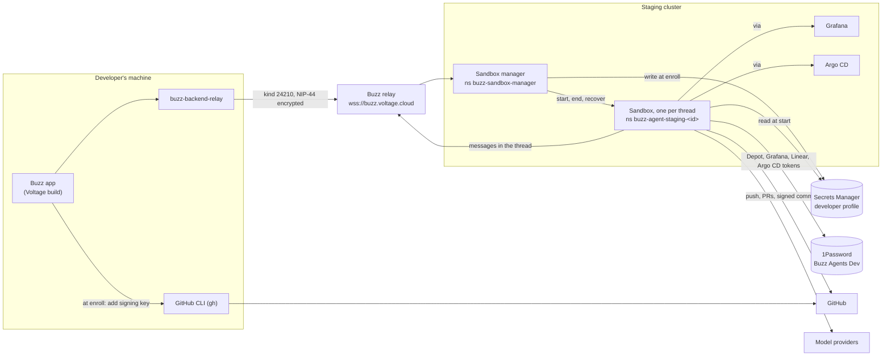
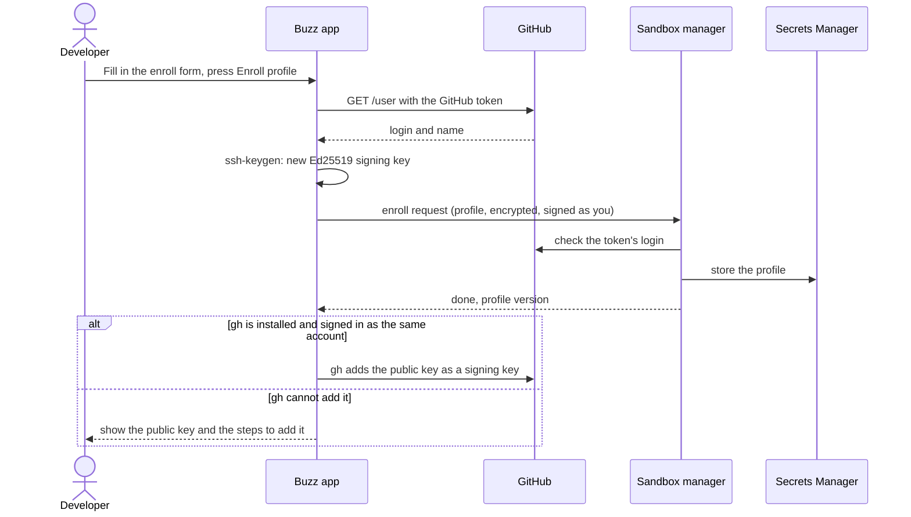
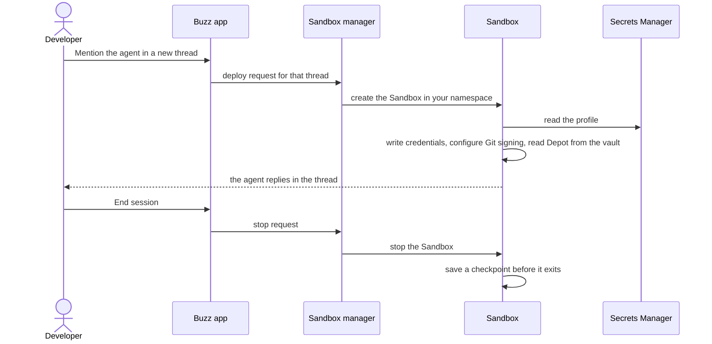
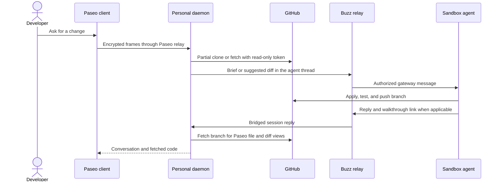

# Run Buzz agents in staging Sandboxes

A Remote workspace agent runs each thread in its own Kubernetes Sandbox in the staging cluster.
You need only your Buzz identity. You do not need AWS, Kubernetes, or VPN access.
Your agents use your GitHub account, your model subscriptions, and a shared set of team tools.
Every commit an agent makes is signed with a key that is on your GitHub account, so GitHub shows it as **Verified**.

- **Admins:** start at [Onboard a developer](#onboard-a-developer).
- **Developers:** start at [Set up your agents](#set-up-your-agents).

A Paseo daemon uses its own gateway key. Follow
[Gateway keys](../docs/agent-gateway-key.md) to admit that key and grant access
to your agents. The daemon never needs your main Nostr secret.

## How it works

An unchanged phone app can trigger registered agents through [server mention launches](../docs/server-mention-launch.md).
This requires the manager feature to be enabled; no mobile rebuild is required.

The diagrams and steps below describe the Voltage desktop app's explicit control-request path.
For the unchanged phone app, follow the server mention launch guide linked above.



- **The Buzz app** sends requests as you. Each request is a Nostr event of kind 24210. Its content is encrypted to the Sandbox manager with NIP-44.
- **The Sandbox manager** accepts requests only from owner keys in its developer list. It starts a Sandbox in your namespace for each thread.
- **You choose** the harness, model, effort, and fast mode for each agent. **The manager sets** where your profile and checkpoints are, so a request cannot choose them.
- **The Sandbox** loads your profile, starts the harness you chose, and replies in the thread as your agent.
- **The reaper** removes Sandboxes after their sessions end.

### Enroll once

You enroll one profile. All of your Remote workspace agents use it.



### Start a session



### Where each credential lives

| Credential | You enter it | Stored in | Used by |
|---|---|---|---|
| Buzz identity | Buzz app sign-in | Your machine | The app, to sign requests |
| GitHub token | Enroll form | Profile (Secrets Manager) | The Sandbox: clone, push, PRs |
| Agent signing key | Created by the app | Profile; public half on GitHub | The Sandbox: sign commits |
| 1Password service account token | Enroll form | Profile | The Sandbox: read the Buzz Agents Dev vault |
| Claude, OpenAI, OpenRouter credentials and Codex access tokens | Enroll form | Profile | The harness in the Sandbox |
| ChatGPT refresh token | Dedicated sign-in button | Manager-only Secrets Manager secret | Manager refresh broker |
| Depot, Grafana, Linear, Argo CD tokens | Nobody: admins keep them in the vault | 1Password Buzz Agents Dev | The Sandbox, through `via` |
| Paseo pairing: password, server ID, daemon keypair | Nobody: the manager generates it at enroll | Only the Secret `paseo-daemon-<id>` in `buzz-paseo` | Your Paseo daemon |
| Claude subscription token, for the Paseo daemon | Enroll form (the same token as above) | Profile; copied to the Secret `paseo-daemon-<id>` | Your Paseo daemon's own agent (Claude only) |
| Paseo GitHub read token: fine-grained, selected repositories, Contents and Pull requests read-only | Enroll form, **Paseo GitHub read token** (optional) | Only the Secret `paseo-daemon-<id>`, never the profile | Your Paseo daemon, to read code |

The app removes the dedicated ChatGPT login cache after enrollment or cancellation. Other enrollment credentials are held in memory only. The profile is encrypted in transit and at rest. Checkpoints never include the credential files the Sandbox writes. If a final checkpoint fails, for example because the secret scan found a token the agent wrote into the repository, the Sandbox stores an unscanned *quarantine* copy in your checkpoint prefix so the work is not lost; **Recover from checkpoint** restores it.

## Onboard a developer

Do these steps once for each new developer. You need the staging VPN for step 2.

1. **Add the developer to Terraform.** In voltage-terraform, add an entry to `developers` in `v2/environments/staging-agent/terraform.tfvars`:

   ```hcl
   developers = {
     <developer-id> = { owner_pubkey = "<their Buzz owner public key, 64 lowercase hex>" }
   }
   ```

   The developer ID has 1 to 32 lowercase letters, digits, or hyphens. Each owner key can appear only once.
2. **Apply it locally.** Merge the PR, then run `make plan` and `make apply` in `v2/environments/staging-agent`.
   CI cannot apply this module, because its Kubernetes identity is read-only.
   The apply creates the namespace `buzz-agent-staging-<developer-id>`, the profile secret, and the developer's permissions.
   With `paseo_daemon_image` set, it also turns on `paseo_daemons` in the manager config and creates the developer's Paseo daemon Deployment in `buzz-paseo`. The daemon waits for its Secret, which the manager writes at the developer's next enroll.
3. **Restart the manager and the reaper.** Both read the developer list only at startup:

   ```sh
   kubectl --context voltage-staging -n buzz-sandbox-manager rollout restart deploy/buzz-sandbox-manager
   kubectl --context voltage-staging -n buzz-sandbox-reaper rollout restart deploy/buzz-sandbox-reaper
   ```
4. **Give the developer vault access.** Make sure they are in the 1Password **Engineering** group, which can read **Buzz Agents Dev**.
   If they cannot create a service account, create one for them. See [1Password service account](#1password-service-account).
5. **Check their model seats.** Codex access tokens need a ChatGPT Business or Enterprise seat. The workspace owner must allow access tokens. Claude needs a Claude seat.

The developer's Buzz identity must be a member of the `buzz.voltage.cloud` community.

## Set up your agents

### 1. Install the Buzz app (Voltage build)

Remote workspace agents need the Voltage build of the Buzz app.
Download it from the [latest release](https://github.com/voltagecloud/buzz/releases/latest). Every package in a release is a Voltage build.

| System | Download | Install |
|--------|----------|---------|
| macOS, Apple silicon | `Buzz-<version>-macos-arm64.dmg` | Open the image and drag Buzz to Applications. |
| macOS, Intel | `Buzz-<version>-macos-x86_64.dmg` | Open the image and drag Buzz to Applications. |
| Ubuntu 24.04 or Debian 13 and later, x86_64 | `buzz-gpui_<version>_amd64.deb` | `sudo apt install ./buzz-gpui_<version>_amd64.deb` |
| Ubuntu 24.04 or Debian 13 and later, ARM64 | `buzz-gpui_<version>_arm64.deb` | `sudo apt install ./buzz-gpui_<version>_arm64.deb` |
| Other Linux (glibc 2.39 or later) | `Buzz-<version>-linux-x86_64.AppImage` (ARM: `-aarch64`) | `chmod +x` the file, then run it. |
| NixOS, or Nix on any Linux | The flake's `buzz-gpui-voltage-bin` | See [Nix and NixOS](#nix-and-nixos). |

The macOS build is not yet signed with a Developer ID. The first time, right-click Buzz in Applications and choose **Open**. If macOS still refuses, run `xattr -dr com.apple.quarantine /Applications/Buzz.app`.

The app checks this repository's releases and offers each new version: the `.deb` installs it in place, and the other packages download it.

#### Nix and NixOS

On Linux (x86_64 or aarch64), the flake's `buzz-gpui-voltage-bin` package is the latest release, prebuilt: it runs the release AppImage in nixpkgs' `appimageTools` environment, so nothing compiles and NixOS needs no `nix-ld`.
After each release, the release workflow opens a pull request that pins the new AppImages. Once that is merged, `main` installs the new release.

```sh
nix run 'github:voltagecloud/buzz?dir=apps/buzz-gpui#buzz-gpui-voltage-bin'
```

The `buzz-gpui-voltage` package builds the same app from source, on Linux and macOS. It needs only Nix, but it compiles the app and its dependencies.

```sh
nix run 'github:voltagecloud/buzz/<commit on main>?dir=apps/buzz-gpui#buzz-gpui-voltage'
```

To install it on NixOS, add the flake input and install the package. On nix-darwin, install `buzz-gpui-voltage` instead.

```nix
# flake.nix inputs
buzz-gpui.url = "github:voltagecloud/buzz?dir=apps/buzz-gpui";

# configuration.nix or darwin-configuration.nix
environment.systemPackages = [ buzz-gpui.packages.${system}.buzz-gpui-voltage-bin ];
```

A Nix install updates when you update the flake input (`nix flake update buzz-gpui`), not through the app's update notice.

On macOS, the Nix build runs from the terminal, not from an app bundle, so the app does not show system notifications. Install the `.dmg` to get them.

Sign in with your Buzz identity and join the `buzz.voltage.cloud` community.
Install the GitHub CLI (`gh`) and sign in with `gh auth login`, so the app can add your signing key to GitHub.

### 2. Get your credentials

Paste credentials only into the enroll form. Never put them in chat, tickets, or Git.

#### GitHub token

Create a fine-grained token in GitHub under **Settings → Developer settings → Fine-grained tokens**.

| Setting | Value |
|---|---|
| Resource owner | `voltagecloud` |
| Repository access | All repositories |
| Contents | Read and write |
| Pull requests | Read and write |
| Workflows | Read and write, only if agents can change `.github/workflows` |
| Issues | Read and write (optional) |
| Actions, Commit statuses | Read (optional) |
| Account permissions | None |

If the organization requires approval, the token stays **pending** until an owner approves it.

#### 1Password service account

Agents read team secrets from the **Buzz Agents Dev** vault through a 1Password service account. A service account is a login for software, and its token can read only the vaults you give it. Create one for each developer, so that you can revoke each one separately.

1Password owners and administrators can create service accounts. Other members need that permission from an admin. If you do not have it, ask an admin to create the account and share the token through 1Password.
If the menus below differ, use 1Password's [service account guide](https://developer.1password.com/docs/service-accounts/get-started/).

To create it in the web app at [teamvoltage.1password.com](https://teamvoltage.1password.com):

1. Open **Developer**, then **Directory**.
2. Under **Infrastructure Secrets Management**, select **Other**, then **Service Account**.
3. Enter a name, for example `buzz-agents-<developer-id>`.
4. Select only the **Buzz Agents Dev** vault, with **Read items**.
5. Leave the expiry at **Never**. When a developer leaves, delete their service account.
6. Select **Create Account**. Then select **Save in 1Password**, because the token shows only once.

To create it with the 1Password CLI instead:

```sh
op service-account create "buzz-agents-<developer-id>" --vault "Buzz Agents Dev:read_items"
```

Without `--expires-in`, the token does not expire.

To check the token, run this command. The output must show **Buzz Agents Dev** and no other vault.

```sh
OP_SERVICE_ACCOUNT_TOKEN='ops_…' op vault list
```

#### Shared ChatGPT login for remote Codex agents

Requires the DEV-2948 app, agent image, and manager rollout described in
[the deployment guide](images/buzz-sandbox-reaper/codex-login.md).
Install the Codex CLI locally and enable device-code sign-in in your ChatGPT workspace.

1. In the Remote workspace enrollment form, select **Sign in with ChatGPT**.
2. Open the displayed OpenAI device page and enter the one-time code. Choose the Voltage workspace.
3. Return to Buzz and select **Enroll profile**. A completed browser sign-in is staged until you enroll.

Buzz uses a dedicated temporary Codex cache. Your normal local Codex login remains separate.
The encrypted owner-signed enrollment sends the login to the manager.
The manager alone stores and rotates the upstream refresh token. Each Sandbox and worker receives
short-lived access tokens and a revocable broker credential through private HTTPS.
Starting a session checks that credential with the manager before launching the harness.

To replace the login, sign in again and enroll. To revoke it, select **Disconnect ChatGPT login**
and enroll. New sessions and future refreshes are then refused, including sessions with a stale profile.
Already-issued access tokens remain usable until OpenAI expires or revokes them; stop existing sessions
when immediate termination is required. An OpenAI API key or Codex access token also replaces this login.

If a manager restart interrupts a refresh whose outcome is uncertain, sign in and enroll again.
The manager refuses to retry a potentially consumed upstream refresh token.
This broker uses refresh behavior specific to the pinned Codex version; verify it before upgrading.

#### Codex access token (ChatGPT Business or Enterprise)

1. On chatgpt.com, switch to the **Voltage** workspace.
2. Open [chatgpt.com/admin/access-tokens](https://chatgpt.com/admin/access-tokens) and select **Create**.
3. Enter a name, select the Codex scope if the dialog shows it, and select the longest validity.
4. Copy the token (`at-…`). It shows only once.

The token does not refresh, so all of your Sandboxes can use it at the same time. Before it expires, create a new one and enroll again.
A personal ChatGPT Plus or Pro account cannot create these workspace access tokens. Use the shared-login flow above or an OpenAI API key instead.

#### Claude subscription token (Claude Pro, Max, Team, or Enterprise)

Run this command in your own terminal:

```sh
claude setup-token
```

In the browser, sign in to claude.ai with your Voltage account, then approve. The terminal shows the token (`sk-ant-oat01-…`). The token is valid for one year.

#### OpenRouter API key (optional)

Create a key at [openrouter.ai/keys](https://openrouter.ai/keys). The **Buzz agent** harness can use it to run any OpenRouter model.

### 3. Create an agent

1. In the Buzz app, open **Agents → Your agents**.
2. Select **Create agent**, then select **Remote workspace** in the agent type list.
   To move a team or several existing agents, select **Agents → Your agents → Move to remote**.
   Choose a team or individual agents, use a new or existing remote configuration, and review the batch.
   Already-remote agents remain unchanged.
   See [Move existing agents to Remote workspace](../apps/buzz-gpui/docs/remote-agent-migration.md) for preservation and recovery details.
   For one agent, you can also select **Remote workspace** under **Settings → Provider**.
3. Fill in **Settings**, then select **Save**.

| Field | Value |
|---|---|
| Harness | **Claude Code**, **Codex**, or **Buzz agent** |
| Model | Optional for Claude Code and Codex, for example `claude-opus-5-5`. Required for Buzz agent, for example `qwen/qwen3-coder`. |
| Effort | How hard the model thinks, for example **Extra high**. Models without effort levels ignore it. |
| Fast mode | **On** gives faster output with higher usage, on models that support it. |
| Instructions | The agent's system prompt |
| Environment | Leave empty: `{}`. Never put secrets here. |

Every agent asks the Voltage Sandbox manager on its community, so there is nothing to choose about where it runs.

### 4. Enroll your profile

Do this once, on any of your Remote workspace agents. To change a credential later, see [Change one credential](#change-one-credential).

| Field | Value |
|---|---|
| GitHub token | The fine-grained token from step 2 |
| Git email | A verified email on your GitHub account. The app fills in `git config --global user.email`. |
| via profile | The [shared via profile](#shared-via-profile) |
| 1Password service account token | `ops_…` |
| Codex access token | `at-…` (optional) |
| Claude subscription token | `sk-ant-oat01-…` (optional) |
| OpenAI API key, Anthropic API key | Optional. Leave each empty if you use the matching subscription token. |
| OpenRouter API key | Optional |
| Paseo GitHub read token | Optional. A separate fine-grained token for selected repositories, with Contents and Pull requests set to Read-only. Only your Paseo daemon gets it. |

Select **Enroll profile**. The app shows **Enrolled. Profile version …**, then one of these results:

- **Added your agents' signing key to your GitHub account.** `gh` added the key. Your agents' commits show as **Verified**.
- **Add your agents' signing key to GitHub.** The app tells you why `gh` could not add the key. Select **Copy key**. On GitHub, open **Settings → SSH and GPG keys → New SSH key**, set **Key type** to **Signing Key**, paste the key, and save it.

The app finds your GitHub login and name from the token. The manager finds your developer ID from your Buzz identity.

To stop your agents from signing commits as you, delete the **Buzz agents** key under **Settings → SSH and GPG keys** on GitHub.

#### Change one credential

The enroll form shows what is **On file**: your GitHub login, Git email, and the credentials you enrolled, by name only. It never shows a credential value.

1. Fill in only the fields to change. A field marked **On file · leave blank to keep** keeps its stored value.
2. To remove a stored model credential, select **Remove** next to it.
3. Select **Enroll profile**.

You need a GitHub token only to change it. The signing key stays the same, unless you select **Replace the signing key**. Then the app adds the new key to GitHub, as in the first enrollment.

Entering a Codex access token replaces a stored OpenAI API key, and entering a Claude subscription token replaces a stored Anthropic API key. The same applies the other way round, because an agent can use only one of each pair.

#### Pair a Paseo app

Follow [Use a Paseo daemon](#use-a-paseo-daemon) for enrollment, pairing, gateway grants, and credential rotation.
That section defines the core Claude-only daemon and its separate selected-repository Git token.

### 5. Start a session

1. Mention the agent in a new thread, for example `@my-agent summarize the open PRs in voltagecloud/cd`.
2. Wait for the reply. The first session can take a few minutes, because a staging agent node starts.
3. Reply in the same thread to continue the session.
4. Select **End session** in the thread banner to save a checkpoint and stop the Sandbox. Select **Recover from checkpoint** to continue from that checkpoint later.

When you or your delegated Paseo gateway mention the agent in a thread whose session ended, the manager restores the last checkpoint and the agent answers that mention.
If the session has no checkpoint, the agent replies that it cannot be restored; mention it in a new thread.
Teammates who use the agent through sharing, and scheduled workflow prompts, cannot restore an ended session.
When a mention fails because its session ended, desktop recovery replays that mention after restoring or starting the workspace.
This requires an updated desktop and host; existing clients retain their earlier recovery behavior.
The replay timestamp belongs to that recovery request and does not change the saved agent configuration.

Each thread gets its own Sandbox, so threads run in parallel. Namespace quotas bound capacity; current staging settings allow ten primary sessions and five workers per developer. A session stops after 12 hours.

### Coordinate a team

Use Brokkr as the main builder and coordinator.
Run quality and security reviews with `buzz-subagent review`; see [the review guide](images/buzz-agent/subagents.md).
These reviews return results to Brokkr and run inside its Pod.
They do not start the saved Tyr or Loki agents.
Use Frigg for planning, Bifrost for additional implementation, and Forseti for another opinion when needed.
Use Heimdall for requested external PR reviews.

Each directly mentioned saved agent starts a separate primary session in that thread.
Each primary session consumes one agent-and-thread pair, even when several pairs use the same saved agent.
To stop a session, use **End session** and preserve its checkpoint.

Thread Sandboxes require authorized prompts and immutable thread bindings.
A live gateway delegation admits the owner's daemon; channel sharing requires its separate opt-in grant and current membership.
Teammates' agents as separate Paseo providers remain an approved follow-up after the core review gates.
The review command preserves the current message boundary.
Publish and promote the new image before asking Brokkr to use the review command.

## Use a Paseo daemon

Each developer has one daemon in staging when an operator enables the core Paseo rollout.
The daemon reads selected repositories and coordinates work through ordinary Buzz threads.
Sandbox agents make changes, build, test, scan, and push branches.
The daemon stays available when your laptop closes.



### Pair one developer

Complete the reviewed infrastructure rollout before these steps.
Rebuild and promote the Sandbox agent image containing this slice's authenticated `buzz media get` instruction before testing image prompts.
Start a new Sandbox from that digest; an older running Sandbox does not acquire the new instruction.
Use your owner identity for enrollment and gateway grants; never copy its private key into the daemon.

You need only the `buzz` CLI and a Paseo app; the Buzz app is optional.

1. Set your owner identity and the community relay, then run setup from an interactive terminal:

   ```sh
   export BUZZ_PRIVATE_KEY=...            # your own Buzz key (nsec or hex); it never leaves this machine
   export BUZZ_RELAY_URL=https://buzz.voltage.cloud
   # The staging Sandbox manager (also the Buzz app's MANAGER_PUBKEY, apps/buzz-gpui/
   # crates/app/src/agent_plugins/remote_workspace/config.rs):
   export BUZZ_MANAGER_PUBKEY=1881c0c6186c81c00e607f9dcd9b6c655c49cd9a0227054e764a78e6829d31fd
   buzz paseo setup
   ```

   To keep the key out of shell history, run `read -rs BUZZ_PRIVATE_KEY && export BUZZ_PRIVATE_KEY`
   and paste it.

2. Answer the prompts. Setup asks only for what is missing, and explains where to get each value:
   - No stored profile: a GitHub token, Git name and email (prefilled from GitHub and `git config`),
     a 1Password service account token, and model credentials. Setup creates your agents' signing
     key and adds it to GitHub with `gh`, waiting at most one minute (or shows the manual steps).
     If that key never reached GitHub, run `buzz paseo setup --replace-signing-key` for a new one. It enrolls the shared via
     profile; pass `--via-profile <file>` to enroll another.
   - A stored profile without a Claude credential: a Claude subscription token, which the Paseo
     assistant needs. Press Enter to skip.
   - The first time it creates your daemon: the optional Paseo GitHub read token.
   - With `--team <snapshot>`: your agent team. Export a team from the Buzz app (a
     `buzz-team-snapshot` file such as `asgard.team.json`), or run
     `buzz paseo import-team <snapshot>` on its own later. Each persona becomes a Remote
     workspace agent with its own key, profile, and listing, joins a private team channel,
     and starts once there to say hello. After that, a mention launches it in any channel
     it joins. Use `--model` to choose a model; by default each harness picks. A runtime
     containing `codex` uses Codex, `buzz-agent` the Buzz agent, and anything else Claude
     Code. Rerunning resumes: progress and the agent keys are kept in an owner-only file
     under `~/.config/buzz/paseo-teams/`, and no member gets a second identity. Each agent's
     welcome message and deploy request ID are saved before they are sent, so a retry after a
     lost reply reuses them rather than starting a second Sandbox. One import of a team runs at
     a time; a stale `.lock` file next to the journal names itself in the error. Setup shares
     the new team channel with your daemon. A `warnings` entry means the agent runs but your
     daemon's agent list was not refreshed; run `buzz paseo setup --update` and press Enter at
     each prompt, which enrolls again and rebuilds the list.
3. Scan the QR code with the Paseo app, or open the printed link. The connection link includes
   the pairing password, so no separate password entry is needed. Both are private terminal
   output; `buzz paseo pairing --manager <key>` shows them again.
4. Confirm that the connection uses `wss://buzz.voltage.cloud/ws`.
5. From **New workspace**, open **Import session** and choose the remote provider's session.
6. If an existing workspace filters the list, select **Show all**.

Run `buzz paseo setup` again at least every 90 days: it renews the daemon's grant and shows the
pairing again without asking anything. To replace credentials, run `buzz paseo setup --update`;
Enter keeps each stored value. `--update --via-profile <file>` replaces the stored via profile. Credentials go only into the encrypted `enroll` request; setup
never writes them to disk, JSON output, or logs. Its JSON output contains only public fields.
`buzz paseo pairing` prints the pairing again without enrolling or granting.

Setup also shares your channels with the daemon: it adds the daemon's gateway key to every
stream and forum channel you are in, open or private. Direct messages, system channels, and
archived channels are never shared. Keep a channel out with `--exclude <name or UUID>`
(repeatable; pass it on every run, because setup does not store it, and a value that matches
none of your channels is an error). Rerun setup after you join channels. Setup never removes
the daemon from a channel: an excluded channel it already belongs to is listed under
`channels.excluded_but_present`; use `buzz channels remove-member` for that. A channel that refuses
the daemon is listed under `channels.failed`, and setup exits nonzero.

Before it can share channels, a relay operator admits the daemon to the community once. Until
then, setup prints the exact command to send them, then rerun setup:

```sh
buzz-admin add-member --pubkey "$GATEWAY_PUBKEY" --role member   # relay operator
```

Granting authority and joining channels are separate operations.
The gateway needs current authorization and channel membership to drive agents.
To revoke authority, run `buzz gateway revoke "$GATEWAY_PUBKEY"` with the owner identity.
Previously started sandbox work can finish; revocation prevents further delegated prompts and launches.
The manager also refuses current managed daemon keys as ordinary shared-task requesters.
This check uses the existing narrow Secrets and fails closed when those identity reads fail.
When adding a developer, update the daemon Secret Role and RoleBinding before activating the expanded manager configuration.
A missing Secret returns 404 and is skipped; a missing permission returns 403 and refuses shared admission.
Terraform orders the Role and binding before the manager ConfigMap; restart the manager only after the apply completes.

Before rotating or deleting a daemon Secret, revoke the old gateway grant and have an operator retire the old gateway's community membership.
Then delete the Secret and enroll again, entering the **Paseo GitHub read token** again: deleting the Secret removed it, and a blank field cannot restore it.
Ask an operator to restart the daemon (`kubectl --context voltage-staging -n buzz-paseo rollout restart deploy/paseo-daemon-<id>`) so it reads the new Secret, then admit and grant the new public key and pair your apps again.
Do not delete the old identity record while its key retains community access.
Generic gateway keys outside the managed daemon registry retain their separate ordinary-member permissions.

### Give the daemon read-only Git access

Create a fine-grained GitHub token for selected repositories only.
Grant `contents: read` and `pull_requests: read`; grant no write permissions.
Never reuse the sandbox profile's GitHub token or a broad `gh` OAuth token.
In the existing enrollment form, enter it in **Paseo GitHub read token**, then select **Enroll profile**.
Configure the token's repository paths separately in `developers.<id>.paseo_git_token_repositories` in Terraform.
The Deployment maps that nonsecret list to `GITHUB_READ_TOKEN_REPOSITORIES`; it does not contain the token value.
The helper sends the token only to configured GitHub repository paths.
Public repositories outside that list clone anonymously, even when the token is present.
The empty default list sends no credentials; private repository reads need both the configured path and matching token permissions.
A blank field keeps the existing daemon token.
The manager receives the token in the encrypted enrollment request and writes only the narrow daemon Secret.
The Secret key is `github_read_token`; Terraform references it as `GITHUB_READ_TOKEN` without reading its value.
The daemon reads Secret values at startup, so an operator must restart it after credential changes.

Read-only access depends on the token permissions the developer selects in GitHub.
If the token permits writes, the daemon can push with that token.
The manager checks token syntax, not GitHub permissions.
Tool filters cannot enforce that boundary once an assistant has a shell.
Use the [read-only code workflow](images/paseo-daemon/README.md#read-only-code-workflow) to clone and review branches.

### Replace the pod

Pairing identity and the gateway key survive in the developer's Secret.
Remote conversations survive on the Buzz relay and reload through `session/list` and `session/load`.
In Paseo 0.15.3, open **New workspace → Import session** after replacement.
If an existing workspace filters the list, select **Show all**.
The fresh daemon has no imported managed sessions until you import them again.
The new assistant starts a fresh native session and reads recent recorded turns for context.
Git checkouts are fetched again on demand.

The recorder attempts a 1.5-second shutdown flush before upstream's forced plugin shutdown.
The pod has a 60-second termination grace period; the plugin cannot use that entire window.
A forced kill or replacement can lose the unsent spool, including dead-letter records.
The spool holds at most 256 jobs and 8 MiB; it is not durable storage.
See the [state inventory](images/paseo-daemon/README.md) for exact recovery limits and the replacement test.

### Measured resource envelope

Separate owning-layer observations used one CPU, a 2 GiB observation limit, disk-backed home, and two live upstream-imported bridges.

| Operation | Wall time | Container memory peak | Home disk |
| --- | --- | --- | --- |
| Confirmed Claude turn reading relay context | 6.472 seconds | 734.6 MiB | 900 KiB |
| Anonymous public Buzz partial clone | 10.865 seconds | 722.1 MiB | 275,700 KiB |
| Public lnd partial clone with Buzz checkout retained | 8.829 seconds | 775.5 MiB | 348,476 KiB |

The Claude turn and clones did not run concurrently.
Both clones used `--filter=blob:none`, retained full history, and sent no Authorization header.
The lnd clone had a synthetic token present, configured for different private repositories.
The clone candidate was `sha256:236157bd565b321ca1bc931247f5100850499bb184dca90b46697276b0cdfa4e`.
Its Git helper SHA-256 was `89e173a267f9e4ca77e4cc195ef838fc0a199d2c60ab7cd2dfd705eb8a8576e9`.
The [image resource observations](images/paseo-daemon/README.md#resource-observations) identify both candidates and the private TLS provider substitution.

Start with 250m CPU and 768 MiB memory requests, and one CPU and 2 GiB memory limits.
Allow 2 GiB for home, 256 MiB for temporary files, and ephemeral storage requests/limits of 1 GiB/3 GiB.
These settings include conservative headroom for model activity and checkout growth; the final aggregate image still needs validation.
Authenticated reads of `voltagecloud/backend` and `voltagecloud/frontend-turbo` remain unproven until Taylor supplies the approved narrow token.
Taylor accepted that limitation without blocking review readiness.

### Schedule work

Paseo's local schedules and heartbeats are disabled because their state would disappear with the pod.
Ask the assistant to create a Buzz workflow with a schedule trigger and a fixed prompt.
Paseo must ask for your approval before workflow creation, update, or manual triggering.
The relay owns the approved schedule, so it survives daemon replacement.
Ask the assistant to list or delete workflows when needed.

Only scheduled, literal workflow prompts can drive an agent through the gateway.
Message, reaction, diff, and webhook triggers do not gain that authority.
Revocation, delegation expiry, or gateway channel removal stops further delegated prompting.
The minimum interval and overlapping-run behavior remain subject to the narrowed #161 implementation and validation.

For user-visible work, ask the sandbox agent to post a walkthrough video in its thread.
The daemon never runs the site or exposes a sandbox development server.
Buzz media currently requires authentication; a video link does not provide unauthenticated viewing from Paseo.

## Reference

### Shared via profile

Paste this profile into the enroll form. It contains only `op://` references, not secret values.

```toml
version = 1

[providers.onepassword]
type = "1password"
account = "teamvoltage.1password.com"

[services.grafana-staging]
description = "Staging Grafana HTTP API access through a service account token"
hint = "via grafana-staging api /api/org"
provider = "onepassword"

[services.grafana-staging.secrets]
token = "op://Buzz Agents Dev/Via Grafana Staging/via-token"

[services.grafana-staging.commands.api]
description = "Call the staging Grafana HTTP API with a service account token."
mode = "rest"
base_url = "http://grafana.monitoring.svc.cluster.local"
method_default = "GET"

[services.grafana-staging.commands.api.auth]
type = "bearer"
secret = "token"

[services.grafana-staging.commands.api.headers]
Accept = "application/json"

[services.linear]
description = "Linear app-actor API access through OAuth"
hint = "via linear api POST /graphql --json '{\"query\":\"{ viewer { id name } }\"}'"
provider = "onepassword"

[services.linear.secrets]
oauth = "op://Buzz Agents Dev/Via Linear App Voltage/text"

[services.linear.commands.api]
description = "Call configured Linear API endpoints with an app-actor OAuth bearer token."
mode = "rest"
base_url = "https://api.linear.app"
method_default = "GET"

[services.linear.commands.api.auth]
type = "oauth"
credential = "oauth"

[services.depot]
description = "Depot build cache (sccache, Turborepo, Go) shared by every developer's agents"
provider = "onepassword"

[services.depot.secrets]
organization = "op://Buzz Agents Dev/Depot/organization"
token = "op://Buzz Agents Dev/Depot/credential"

[services.argocd-staging]
description = "Staging Argo CD API: every app's status, resource tree and logs; sync and restart in application projects"
hint = "via argocd-staging api /api/v1/applications --query fields=items.metadata.name,items.spec.project,items.status.sync.status,items.status.health.status"
provider = "onepassword"

[services.argocd-staging.secrets]
token = "op://Buzz Agents Dev/Argo CD Staging/credential"

[services.argocd-staging.commands.api]
description = "Call the staging Argo CD API with the buzz-agents account token."
mode = "rest"
base_url = "http://argocd-server.argo.svc.cluster.local"
method_default = "GET"

[services.argocd-staging.commands.api.auth]
type = "bearer"
secret = "token"
```

### What an agent can reach

| An agent can | An agent cannot |
|---|---|
| Reach the public internet: GitHub, package registries, model APIs, Linear, Depot | Reach databases or other private services |
| Read staging logs and metrics in Grafana, with `via grafana-staging` | Reach internal ingresses, VPN-only hosts, or other pods |
| Read every staging Argo CD app and its logs, with `via argocd-staging` | Delete, edit, or exec into Argo CD apps |
| Sync and restart apps in the application projects: `admin-app`, `auth-service`, `backend`, `billing`, `feerate`, `frontend-turbo`, `nostr-server`, `sanctions-list`, `surge-coinprice`, `voltage-cash`, `webhook-proxy` | Sync or restart infrastructure projects |
| Push to your GitHub repositories, with your token's permissions. Branch protection still applies. | Use AWS or Kubernetes outside its own namespace |
| Use the shared Depot build cache | Reach production |

CAUTION: An agent runs with full tool access in its Sandbox, and it reads untrusted content from repositories, issues, and the web. Give your tokens only the access an agent needs.

## Troubleshooting

| What you see | What to do |
|---|---|
| *This Buzz identity is not a configured developer.* | Ask an admin to do [Onboard a developer](#onboard-a-developer), including the restart in step 3. |
| *Join the community at the relay to enroll through it.* | Join `buzz.voltage.cloud` in the app, then enroll again. |
| *GitHub did not accept the token.* | Make a new fine-grained token, then enroll again. |
| *The GitHub token belongs to a different login.* | Use a token from your own GitHub account. |
| *Use a Codex access token (at-...)* | Put an OpenAI API key in **OpenAI API key**, not in **Codex access token**. |
| *Choose either an OpenAI API key or a Codex access token* | Clear one of the two fields. The same applies to the two Claude fields. |
| *via profile requires providers and services* | Paste the complete [shared via profile](#shared-via-profile). |
| `op service-account create` fails with *(403) Forbidden* | You are not a 1Password owner or administrator. Ask one to create the service account and share the token with you through 1Password. |
| *Could not run ssh-keygen. Install OpenSSH.* | Install OpenSSH, then enroll again. |
| The app says *gh needs the admin:ssh_signing_key scope* | Run `gh auth refresh -h github.com -s admin:ssh_signing_key`, then enroll again. Or add the key yourself with **Copy key**. |
| Commits show as **Unverified** on GitHub | Add the signing key on GitHub, and make sure **Git email** is a verified email on your account. |
| *The Sandbox manager did not answer within 60 seconds.* | Ask an admin. The admin checks `kubectl --context voltage-staging -n buzz-sandbox-manager logs deploy/buzz-sandbox-manager`. |
| The agent does not reply after 10 minutes | Check that you enrolled. If you did, an admin checks the Sandbox: `kubectl --context voltage-staging -n buzz-agent-staging-<developer-id> get sandboxes,pods`. |
| The Sandbox log shows *Developer profile refused while …* | The text after *while* names the startup step that failed, and the text after the colon names the reason. Credentials are never printed. Ask an admin, and include that line. |

## Related

- Design: [docs/remote-agents.md](../docs/remote-agents.md)
- Agent image: [voltage/images/buzz-agent](images/buzz-agent/README.md)
- Infrastructure: voltage-terraform `v2/environments/staging-agent`
- Deployment: voltagecloud/cd `charts/buzz-sandbox-manager` and `staging/values/infra-utils`
- Tracking: Linear DEV-2884 (remote agents), DEV-2948 (one ChatGPT login for all of a developer's agents), DEV-2949 (staging Argo CD config in Git)

## Direct messages and launch recovery

A remote agent uses one workspace for an entire direct-message conversation.
In a one-on-one owner/agent DM, plain owner messages start the agent without
an explicit mention. Starting an agent in a group DM requires a mention.
Channel work stays isolated to the mentioned thread. Only the verified owner can start
these workspaces or send their harness work; this does not enable channel sharing.
If a DM workspace has ended, use the recovery buttons above its composer.
Both recovery modes replay the message that failed to start it.

Deploy the matching agent image and Sandbox manager before installing a client
that sends the new DM scope. Older binaries reject that scope. Existing channel
thread names and checkpoints keep their current format. The old workspaces
created for individual DM messages are separate sessions; end them through the
normal checkpoint lifecycle after confirming they contain no active work.

To validate the rollout, send a plain message to your agent in its DM and wait
for a reply. Send a second message and confirm that the same Sandbox is reused.
End that session, send another message, then recover it from the banner. The
agent must answer that pending message without another mention. A different DM,
channel thread, or person's identity must not join that workspace.
