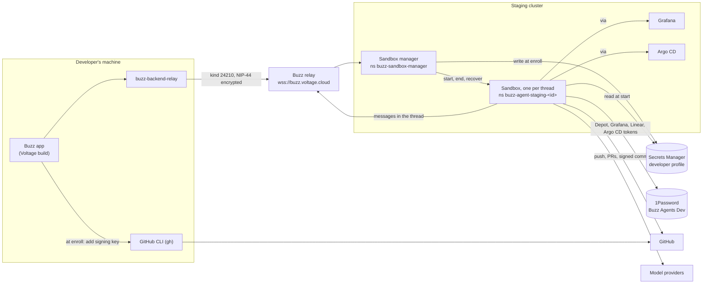
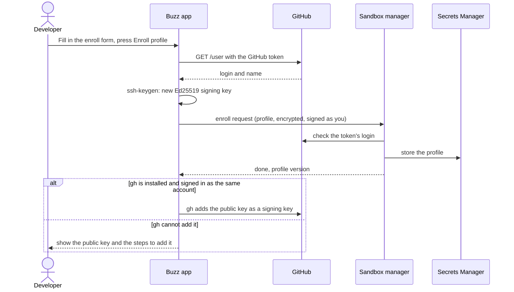
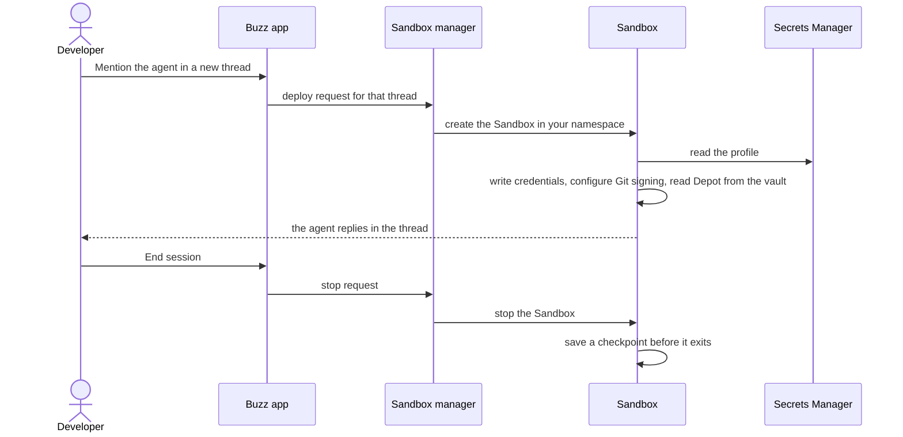

# Run Buzz agents in staging Sandboxes

A Remote workspace agent runs each thread in its own Kubernetes Sandbox in the staging cluster.
You need only your Buzz identity. You do not need AWS, Kubernetes, or VPN access.
Your agents use your GitHub account, your model subscriptions, and a shared set of team tools.
Every commit an agent makes is signed with a key that is on your GitHub account, so GitHub shows it as **Verified**.

- **Admins:** start at [Onboard a developer](#onboard-a-developer).
- **Developers:** start at [Set up your agents](#set-up-your-agents) to use the Buzz app, or at [Set up with Paseo (no Buzz app)](#set-up-with-paseo-no-buzz-app) to use one terminal command.

A Paseo daemon uses its own gateway key. Follow
[Gateway keys](../docs/agent-gateway-key.md) to admit that key and grant access
to your agents. The daemon never needs your main Nostr secret.

## How it works

An unchanged phone app can trigger registered agents through [server mention launches](../docs/server-mention-launch.md).
This requires the manager feature to be enabled; no mobile rebuild is required.

The diagrams and steps below describe the Voltage desktop app's explicit control-request path.
For the unchanged phone app, follow the server mention launch guide linked above.



- **The Buzz app** sends requests as you. Each request is a Nostr event of kind 24210. Its content is encrypted to the Sandbox manager with NIP-44.
- **The Sandbox manager** accepts requests only from owner keys in its developer list. It starts a Sandbox in your namespace for each thread.
- **You choose** the harness, model, effort, and fast mode for each agent. **The manager sets** where your profile and checkpoints are, so a request cannot choose them.
- **The Sandbox** loads your profile, starts the harness you chose, and replies in the thread as your agent.
- **The reaper** removes Sandboxes after their sessions end.

### Enroll once

You enroll one profile. All of your Remote workspace agents use it.



### Start a session



### Where each credential lives

| Credential | You enter it | Stored in | Used by |
|---|---|---|---|
| Buzz identity | Buzz app sign-in, or `buzz onboard` | Your machine (`buzz onboard`: `~/.config/buzz/identity.nsec`, mode `0600`) | The app or `buzz`, to sign requests |
| GitHub token | Enroll form | Profile (Secrets Manager) | The Sandbox: clone, push, PRs |
| Agent signing key | Created by the app | Profile; public half on GitHub | The Sandbox: sign commits |
| 1Password service account token | Enroll form | Profile | The Sandbox: read the Buzz Agents Dev vault |
| Claude, OpenAI, OpenRouter credentials and Codex access tokens | Enroll form | Profile | The harness in the Sandbox |
| ChatGPT refresh token | Dedicated sign-in button | Manager-only Secrets Manager secret | Manager refresh broker |
| Depot, Grafana, Linear, Argo CD tokens | Nobody: admins keep them in the vault | 1Password Buzz Agents Dev | The Sandbox, through `via` |

The app removes the dedicated ChatGPT login cache after enrollment or cancellation. Other enrollment credentials are held in memory only. The profile is encrypted in transit and at rest. Checkpoints never include credentials.

## Onboard a developer

Do these steps once for each new developer. You need the staging VPN for step 2.

1. **Add the developer to Terraform.** In voltage-terraform, add an entry to `developers` in `v2/environments/staging-agent/terraform.tfvars`:

   ```hcl
   developers = {
     <developer-id> = { owner_pubkey = "<their Buzz owner public key, 64 lowercase hex>" }
   }
   ```

   The developer ID has 1 to 32 lowercase letters, digits, or hyphens. Each owner key can appear only once.
2. **Apply it locally.** Merge the PR, then run `make plan` and `make apply` in `v2/environments/staging-agent`.
   CI cannot apply this module, because its Kubernetes identity is read-only.
   The apply creates the namespace `buzz-agent-staging-<developer-id>`, the profile secret, and the developer's permissions.
3. **Restart the manager and the reaper.** Both read the developer list only at startup:

   ```sh
   kubectl --context voltage-staging -n buzz-sandbox-manager rollout restart deploy/buzz-sandbox-manager
   kubectl --context voltage-staging -n buzz-sandbox-reaper rollout restart deploy/buzz-sandbox-reaper
   ```
4. **Give the developer vault access.** Make sure they are in the 1Password **Engineering** group, which can read **Buzz Agents Dev**.
   If they cannot create a service account, create one for them. See [1Password service account](#1password-service-account).
5. **Check their model seats.** Codex access tokens need a ChatGPT Business or Enterprise seat. The workspace owner must allow access tokens. Claude needs a Claude seat.

The developer's Buzz identity must be a member of the `buzz.voltage.cloud` community.

## Set up with Paseo (no Buzz app)

Use this path if you use [Paseo](https://paseo.sh) as your interface. You need Paseo and one terminal command, `buzz onboard`. You do not need the Buzz app.
The command sends the same events and Sandbox manager requests as the Buzz app. Agents, profiles, and channels that you create with it appear in the Buzz apps, and agents that you create in a Buzz app appear to `buzz onboard`. You can change to the Buzz app at any time.

Before you start:

1. An admin must do [Onboard a developer](#onboard-a-developer) for your Buzz owner key. If you do not have a key yet, run `buzz onboard` once. It creates a key and shows the hex public key to give to your admin.
2. Get an invite to `buzz.voltage.cloud`, if your key is not a member yet.
3. Get your credentials: see [Get your credentials](#2-get-your-credentials). Install `gh` and run `gh auth login`, so that the command can add your agents' signing key to GitHub.

Install the CLI and run the wizard:

```sh
cargo install --locked --git https://github.com/voltagecloud/buzz buzz-cli
buzz onboard
```

The wizard asks one question at a time, and hides each secret as you type it. It does these steps:

| Step | What it does | Same as in the Buzz app |
|---|---|---|
| 1. Identity | Creates a key, or imports your Buzz app key with `--import-key`. Joins the community with your invite. Publishes your profile. | Sign in, join a community |
| 2. GitHub | Reads your token from `gh auth token`, or asks for one. Reads your Git email. Creates the agent-only Ed25519 signing key with `ssh-keygen`. | Enroll form: GitHub token, Git email |
| 3. Models | Can run `claude setup-token`. Asks for a Claude subscription token, a Codex access token, and an OpenRouter API key. Checks them with the enroll form's rules. | Enroll form: model credentials |
| 4. 1Password | Asks for the service account token. Uses the [shared via profile](#shared-via-profile). | Enroll form: 1Password token, via profile |
| 5. Agents | Creates agents from presets (Brokkr, Frigg, Bifrost, Forseti, or an OpenRouter agent), lists them, and adds them to a private workspace channel. | **Create agent → Remote workspace** |
| 6. Enroll | Sends the encrypted enroll request. Adds the signing key to GitHub with `gh`. Starts each new agent once, so that the Sandbox manager registers it. Shows your Paseo pairing. | **Enroll profile**, then the first mention |
| 7. Gateway | Checks the daemon’s public gateway key and prints the grant command until the gateway SDK is available. | Owner delegation |
| 8. Next steps | Shows pairing for desktop, web, and mobile, workflow commands, and the Buzz app path. | |

Each step is saved when it completes. If a step fails, the wizard tells you why. Run `buzz onboard` again: it does only the steps that are not complete.
The command never saves or shows your credentials. It sends them only in the encrypted enroll request. It keeps your key and its progress in `~/.config/buzz` (mode `0700`; files mode `0600`). Each agent's key is in `onboard.json`, as the Buzz app keeps agent keys on its device.

### Pair Paseo

If an admin enabled Paseo daemons, the final step shows your daemon's password, an offer link (`https://app.paseo.sh/#offer=…`), and the same link as a QR code. If not, it says that Paseo is not provisioned yet. Run `buzz onboard` again after an admin enables it.

- **Paseo desktop:** open the offer link on that computer, then enter the password.
- **Paseo web:** open the offer link in a browser at `app.paseo.sh`, then enter the password.
- **Paseo mobile:** scan the QR code, then enter the password.

The command does not save the password. To show it again, run `buzz onboard`.

### Run without prompts

Use `--yes` to never prompt. Give secrets in environment variables, never in flags:

```sh
BUZZ_ONBOARD_INVITE='https://buzz.voltage.cloud/invite/v2.…' \
BUZZ_ONBOARD_GITHUB_TOKEN='github_pat_…' \
BUZZ_ONBOARD_OP_TOKEN='ops_…' \
BUZZ_ONBOARD_CLAUDE_TOKEN='sk-ant-oat01-…' \
buzz onboard --yes --name 'Your Name' --git-email you@example.com --agents brokkr,bifrost
```

The other secret variables are `BUZZ_ONBOARD_CODEX_TOKEN`, `BUZZ_ONBOARD_OPENROUTER_KEY`, `BUZZ_ONBOARD_OPENAI_API_KEY`, and `BUZZ_ONBOARD_ANTHROPIC_API_KEY`. Run `buzz onboard --help` for every flag.

### Use the Buzz app with the same agents

- Sign in to the Buzz app with the key in `~/.config/buzz/identity.nsec`. Your agents appear under **Agents**. Mention one in your workspace channel to start a session.
- The app shows agents from `buzz onboard` as running on another device, because their keys are not in the app. The Sandbox manager starts them for your mentions from any Buzz app.
- `buzz onboard` lists agents that you created in the app, and does not create a second agent with the same name.
- To change one credential later, run `buzz onboard --reenroll` and fill in only what changes. Or use the enroll form in the app.

### Gateway authorization and workflows

The manager returns the daemon's public gateway key with its pairing. The owner's private key stays on this computer.
The wizard defaults to a 90-day grant lifetime; `--gateway-expires 2w` selects a shorter lifetime. The maximum is 90 days.
Until the gateway SDK is included, this build prints `buzz gateway grant <pubkey> --expires 90d` under **Action needed**.
It does not publish a grant or claim the daemon is authorized. Run that command after installing a build with gateway support.
Use `--skip-gateway-grant` to defer this step explicitly.

The gateway is a separate community member. Before granting, ask an administrator to run:

```sh
buzz-admin add-member --pubkey <gateway-pubkey> --role member
```

As the channel owner, add that public key to your workspace channel:

```sh
buzz channels add-member --channel <channel-id> --pubkey <gateway-pubkey>
```

A delegation grants authority over your remote agents; it does not admit a key to the community or a channel.

Each new agent starts once in a channel thread. This registers its launch with the manager and adds it to the daemon's agent list.
With `--skip-first-start`, mentions cannot start an unregistered agent, and the daemon cannot list it. Rerun without that flag to finish registration.
Agents added later appear after the daemon restarts.

Use `buzz workflows --help` to create and manage channel workflows. The final step prints the command for your workspace channel.
Ask the Paseo assistant to use those commands for automations. Workflows run on Buzz, with their history on the relay.

## Set up your agents

### 1. Install the Buzz app (Voltage build)

Remote workspace agents need the Voltage build of the Buzz app.
Download it from the [latest release](https://github.com/voltagecloud/buzz/releases/latest). Every package in a release is a Voltage build.

| System | Download | Install |
|--------|----------|---------|
| macOS, Apple silicon | `Buzz-<version>-macos-arm64.dmg` | Open the image and drag Buzz to Applications. |
| macOS, Intel | `Buzz-<version>-macos-x86_64.dmg` | Open the image and drag Buzz to Applications. |
| Ubuntu 24.04 or Debian 13 and later, x86_64 | `buzz-gpui_<version>_amd64.deb` | `sudo apt install ./buzz-gpui_<version>_amd64.deb` |
| Ubuntu 24.04 or Debian 13 and later, ARM64 | `buzz-gpui_<version>_arm64.deb` | `sudo apt install ./buzz-gpui_<version>_arm64.deb` |
| Other Linux (glibc 2.39 or later) | `Buzz-<version>-linux-x86_64.AppImage` (ARM: `-aarch64`) | `chmod +x` the file, then run it. |
| NixOS, or Nix on any Linux | The flake's `buzz-gpui-voltage-bin` | See [Nix and NixOS](#nix-and-nixos). |

The macOS build is not yet signed with a Developer ID. The first time, right-click Buzz in Applications and choose **Open**. If macOS still refuses, run `xattr -dr com.apple.quarantine /Applications/Buzz.app`.

The app checks this repository's releases and offers each new version: the `.deb` installs it in place, and the other packages download it.

#### Nix and NixOS

On Linux (x86_64 or aarch64), the flake's `buzz-gpui-voltage-bin` package is the latest release, prebuilt: it runs the release AppImage in nixpkgs' `appimageTools` environment, so nothing compiles and NixOS needs no `nix-ld`.
After each release, the release workflow opens a pull request that pins the new AppImages. Once that is merged, `main` installs the new release.

```sh
nix run 'github:voltagecloud/buzz?dir=apps/buzz-gpui#buzz-gpui-voltage-bin'
```

The `buzz-gpui-voltage` package builds the same app from source, on Linux and macOS. It needs only Nix, but it compiles the app and its dependencies.

```sh
nix run 'github:voltagecloud/buzz/<commit on main>?dir=apps/buzz-gpui#buzz-gpui-voltage'
```

To install it on NixOS, add the flake input and install the package. On nix-darwin, install `buzz-gpui-voltage` instead.

```nix
# flake.nix inputs
buzz-gpui.url = "github:voltagecloud/buzz?dir=apps/buzz-gpui";

# configuration.nix or darwin-configuration.nix
environment.systemPackages = [ buzz-gpui.packages.${system}.buzz-gpui-voltage-bin ];
```

A Nix install updates when you update the flake input (`nix flake update buzz-gpui`), not through the app's update notice.

On macOS, the Nix build runs from the terminal, not from an app bundle, so the app does not show system notifications. Install the `.dmg` to get them.

Sign in with your Buzz identity and join the `buzz.voltage.cloud` community.
Install the GitHub CLI (`gh`) and sign in with `gh auth login`, so the app can add your signing key to GitHub.

### 2. Get your credentials

Paste credentials only into the enroll form. Never put them in chat, tickets, or Git.

#### GitHub token

Create a fine-grained token in GitHub under **Settings → Developer settings → Fine-grained tokens**.

| Setting | Value |
|---|---|
| Resource owner | `voltagecloud` |
| Repository access | All repositories |
| Contents | Read and write |
| Pull requests | Read and write |
| Workflows | Read and write, only if agents can change `.github/workflows` |
| Issues | Read and write (optional) |
| Actions, Commit statuses | Read (optional) |
| Account permissions | None |

If the organization requires approval, the token stays **pending** until an owner approves it.

#### 1Password service account

Agents read team secrets from the **Buzz Agents Dev** vault through a 1Password service account. A service account is a login for software, and its token can read only the vaults you give it. Create one for each developer, so that you can revoke each one separately.

1Password owners and administrators can create service accounts. Other members need that permission from an admin. If you do not have it, ask an admin to create the account and share the token through 1Password.
If the menus below differ, use 1Password's [service account guide](https://developer.1password.com/docs/service-accounts/get-started/).

To create it in the web app at [teamvoltage.1password.com](https://teamvoltage.1password.com):

1. Open **Developer**, then **Directory**.
2. Under **Infrastructure Secrets Management**, select **Other**, then **Service Account**.
3. Enter a name, for example `buzz-agents-<developer-id>`.
4. Select only the **Buzz Agents Dev** vault, with **Read items**.
5. Leave the expiry at **Never**. When a developer leaves, delete their service account.
6. Select **Create Account**. Then select **Save in 1Password**, because the token shows only once.

To create it with the 1Password CLI instead:

```sh
op service-account create "buzz-agents-<developer-id>" --vault "Buzz Agents Dev:read_items"
```

Without `--expires-in`, the token does not expire.

To check the token, run this command. The output must show **Buzz Agents Dev** and no other vault.

```sh
OP_SERVICE_ACCOUNT_TOKEN='ops_…' op vault list
```

#### Shared ChatGPT login for remote Codex agents

Requires the DEV-2948 app, agent image, and manager rollout described in
[the deployment guide](images/buzz-sandbox-reaper/codex-login.md).
Install the Codex CLI locally and enable device-code sign-in in your ChatGPT workspace.

1. In the Remote workspace enrollment form, select **Sign in with ChatGPT**.
2. Open the displayed OpenAI device page and enter the one-time code. Choose the Voltage workspace.
3. Return to Buzz and select **Enroll profile**. A completed browser sign-in is staged until you enroll.

Buzz uses a dedicated temporary Codex cache. Your normal local Codex login remains separate.
The encrypted owner-signed enrollment sends the login to the manager.
The manager alone stores and rotates the upstream refresh token. Each Sandbox and worker receives
short-lived access tokens and a revocable broker credential through private HTTPS.
Starting a session checks that credential with the manager before launching the harness.

To replace the login, sign in again and enroll. To revoke it, select **Disconnect ChatGPT login**
and enroll. New sessions and future refreshes are then refused, including sessions with a stale profile.
Already-issued access tokens remain usable until OpenAI expires or revokes them; stop existing sessions
when immediate termination is required. An OpenAI API key or Codex access token also replaces this login.

If a manager restart interrupts a refresh whose outcome is uncertain, sign in and enroll again.
The manager refuses to retry a potentially consumed upstream refresh token.
This broker uses refresh behavior specific to the pinned Codex version; verify it before upgrading.

#### Codex access token (ChatGPT Business or Enterprise)

1. On chatgpt.com, switch to the **Voltage** workspace.
2. Open [chatgpt.com/admin/access-tokens](https://chatgpt.com/admin/access-tokens) and select **Create**.
3. Enter a name, select the Codex scope if the dialog shows it, and select the longest validity.
4. Copy the token (`at-…`). It shows only once.

The token does not refresh, so all of your Sandboxes can use it at the same time. Before it expires, create a new one and enroll again.
A personal ChatGPT Plus or Pro account cannot create these workspace access tokens. Use the shared-login flow above or an OpenAI API key instead.

#### Claude subscription token (Claude Pro, Max, Team, or Enterprise)

Run this command in your own terminal:

```sh
claude setup-token
```

In the browser, sign in to claude.ai with your Voltage account, then approve. The terminal shows the token (`sk-ant-oat01-…`). The token is valid for one year.

#### OpenRouter API key (optional)

Create a key at [openrouter.ai/keys](https://openrouter.ai/keys). The **Buzz agent** harness can use it to run any OpenRouter model.

### 3. Create an agent

1. In the Buzz app, open **Agents → Your agents**.
2. Select **Create agent**, then select **Remote workspace** in the agent type list.
   To move a team or several existing agents, select **Agents → Your agents → Move to remote**.
   Choose a team or individual agents, use a new or existing remote configuration, and review the batch.
   Already-remote agents remain unchanged.
   See [Move existing agents to Remote workspace](../apps/buzz-gpui/docs/remote-agent-migration.md) for preservation and recovery details.
   For one agent, you can also select **Remote workspace** under **Settings → Provider**.
3. Fill in **Settings**, then select **Save**.

| Field | Value |
|---|---|
| Harness | **Claude Code**, **Codex**, or **Buzz agent** |
| Model | Optional for Claude Code and Codex, for example `claude-opus-5-5`. Required for Buzz agent, for example `qwen/qwen3-coder`. |
| Effort | How hard the model thinks, for example **Extra high**. Models without effort levels ignore it. |
| Fast mode | **On** gives faster output with higher usage, on models that support it. |
| Instructions | The agent's system prompt |
| Environment | Leave empty: `{}`. Never put secrets here. |

Every agent asks the Voltage Sandbox manager on its community, so there is nothing to choose about where it runs.

### 4. Enroll your profile

Do this once, on any of your Remote workspace agents. To change a credential later, see [Change one credential](#change-one-credential).

| Field | Value |
|---|---|
| GitHub token | The fine-grained token from step 2 |
| Git email | A verified email on your GitHub account. The app fills in `git config --global user.email`. |
| via profile | The [shared via profile](#shared-via-profile) |
| 1Password service account token | `ops_…` |
| Codex access token | `at-…` (optional) |
| Claude subscription token | `sk-ant-oat01-…` (optional) |
| OpenAI API key, Anthropic API key | Optional. Leave each empty if you use the matching subscription token. |
| OpenRouter API key | Optional |

Select **Enroll profile**. The app shows **Enrolled. Profile version …**, then one of these results:

- **Added your agents' signing key to your GitHub account.** `gh` added the key. Your agents' commits show as **Verified**.
- **Add your agents' signing key to GitHub.** The app tells you why `gh` could not add the key. Select **Copy key**. On GitHub, open **Settings → SSH and GPG keys → New SSH key**, set **Key type** to **Signing Key**, paste the key, and save it.

The app finds your GitHub login and name from the token. The manager finds your developer ID from your Buzz identity.

To stop your agents from signing commits as you, delete the **Buzz agents** key under **Settings → SSH and GPG keys** on GitHub.

#### Change one credential

The enroll form shows what is **On file**: your GitHub login, Git email, and the credentials you enrolled, by name only. It never shows a credential value.

1. Fill in only the fields to change. A field marked **On file · leave blank to keep** keeps its stored value.
2. To remove a stored model credential, select **Remove** next to it.
3. Select **Enroll profile**.

You need a GitHub token only to change it. The signing key stays the same, unless you select **Replace the signing key**. Then the app adds the new key to GitHub, as in the first enrollment.

Entering a Codex access token replaces a stored OpenAI API key, and entering a Claude subscription token replaces a stored Anthropic API key. The same applies the other way round, because an agent can use only one of each pair.

### 5. Start a session

1. Mention the agent in a new thread, for example `@my-agent summarize the open PRs in voltagecloud/cd`.
2. Wait for the reply. The first session can take a few minutes, because a staging agent node starts.
3. Reply in the same thread to continue the session.
4. Select **End session** in the thread banner to save a checkpoint and stop the Sandbox. Select **Recover from checkpoint** to continue from that checkpoint later.

When a mention fails because its session ended, recovery replays that mention after restoring or starting the workspace.
This requires an updated desktop and host; existing clients retain their earlier recovery behavior.
The replay timestamp belongs to that recovery request and does not change the saved agent configuration.

Each thread gets its own Sandbox, so threads run in parallel. A developer can have five sessions at the same time. A session stops after 12 hours.

### Coordinate a team

Use Brokkr as the main builder and coordinator.
Run quality and security reviews with `buzz-subagent review`; see [the review guide](images/buzz-agent/subagents.md).
These reviews return results to Brokkr and run inside its Pod.
They do not start the saved Tyr or Loki agents.
Use Frigg for planning, Bifrost for additional implementation, and Forseti for another opinion when needed.
Use Heimdall for requested external PR reviews.

Each directly mentioned saved agent starts a separate primary session in that thread.
Five sessions means five agent-and-thread pairs, even when they belong to fewer than five agents.
To stop a session, use **End session** and preserve its checkpoint.

Thread Sandboxes currently accept only the human owner's signed messages.
A sibling agent's mention can start a Sandbox through the desktop, but the harness drops that message.
Cross-owner channel collaboration requires a separate authorization and wakeup change.
The review command preserves the current message boundary.
Publish and promote the new image before asking Brokkr to use the review command.

## Reference

### Shared via profile

Paste this profile into the enroll form. It contains only `op://` references, not secret values.

```toml
version = 1

[providers.onepassword]
type = "1password"
account = "teamvoltage.1password.com"

[services.grafana-staging]
description = "Staging Grafana HTTP API access through a service account token"
hint = "via grafana-staging api /api/org"
provider = "onepassword"

[services.grafana-staging.secrets]
token = "op://Buzz Agents Dev/Via Grafana Staging/via-token"

[services.grafana-staging.commands.api]
description = "Call the staging Grafana HTTP API with a service account token."
mode = "rest"
base_url = "http://grafana.monitoring.svc.cluster.local"
method_default = "GET"

[services.grafana-staging.commands.api.auth]
type = "bearer"
secret = "token"

[services.grafana-staging.commands.api.headers]
Accept = "application/json"

[services.linear]
description = "Linear app-actor API access through OAuth"
hint = "via linear api POST /graphql --json '{\"query\":\"{ viewer { id name } }\"}'"
provider = "onepassword"

[services.linear.secrets]
oauth = "op://Buzz Agents Dev/Via Linear App Voltage/text"

[services.linear.commands.api]
description = "Call configured Linear API endpoints with an app-actor OAuth bearer token."
mode = "rest"
base_url = "https://api.linear.app"
method_default = "GET"

[services.linear.commands.api.auth]
type = "oauth"
credential = "oauth"

[services.depot]
description = "Depot build cache (sccache, Turborepo, Go) shared by every developer's agents"
provider = "onepassword"

[services.depot.secrets]
organization = "op://Buzz Agents Dev/Depot/organization"
token = "op://Buzz Agents Dev/Depot/credential"

[services.argocd-staging]
description = "Staging Argo CD API: every app's status, resource tree and logs; sync and restart in application projects"
hint = "via argocd-staging api /api/v1/applications --query fields=items.metadata.name,items.spec.project,items.status.sync.status,items.status.health.status"
provider = "onepassword"

[services.argocd-staging.secrets]
token = "op://Buzz Agents Dev/Argo CD Staging/credential"

[services.argocd-staging.commands.api]
description = "Call the staging Argo CD API with the buzz-agents account token."
mode = "rest"
base_url = "http://argocd-server.argo.svc.cluster.local"
method_default = "GET"

[services.argocd-staging.commands.api.auth]
type = "bearer"
secret = "token"
```

### What an agent can reach

| An agent can | An agent cannot |
|---|---|
| Reach the public internet: GitHub, package registries, model APIs, Linear, Depot | Reach databases or other private services |
| Read staging logs and metrics in Grafana, with `via grafana-staging` | Reach internal ingresses, VPN-only hosts, or other pods |
| Read every staging Argo CD app and its logs, with `via argocd-staging` | Delete, edit, or exec into Argo CD apps |
| Sync and restart apps in the application projects: `admin-app`, `auth-service`, `backend`, `billing`, `feerate`, `frontend-turbo`, `nostr-server`, `sanctions-list`, `surge-coinprice`, `voltage-cash`, `webhook-proxy` | Sync or restart infrastructure projects |
| Push to your GitHub repositories, with your token's permissions. Branch protection still applies. | Use AWS or Kubernetes outside its own namespace |
| Use the shared Depot build cache | Reach production |

CAUTION: An agent runs with full tool access in its Sandbox, and it reads untrusted content from repositories, issues, and the web. Give your tokens only the access an agent needs.

## Troubleshooting

| What you see | What to do |
|---|---|
| `buzz onboard` says *Could not check what is enrolled* | Check that you can reach `wss://buzz.voltage.cloud`, then run `buzz onboard` again. |
| `buzz onboard` says *N agent(s) did not start* | Run `buzz onboard` again. It retries only the agents that did not start. |
| *This Buzz identity is not a configured developer.* | Ask an admin to do [Onboard a developer](#onboard-a-developer), including the restart in step 3. |
| *Join the community at the relay to enroll through it.* | Join `buzz.voltage.cloud` in the app, then enroll again. |
| *GitHub did not accept the token.* | Make a new fine-grained token, then enroll again. |
| *The GitHub token belongs to a different login.* | Use a token from your own GitHub account. |
| *Use a Codex access token (at-...)* | Put an OpenAI API key in **OpenAI API key**, not in **Codex access token**. |
| *Choose either an OpenAI API key or a Codex access token* | Clear one of the two fields. The same applies to the two Claude fields. |
| *via profile requires providers and services* | Paste the complete [shared via profile](#shared-via-profile). |
| `op service-account create` fails with *(403) Forbidden* | You are not a 1Password owner or administrator. Ask one to create the service account and share the token with you through 1Password. |
| *Could not run ssh-keygen. Install OpenSSH.* | Install OpenSSH, then enroll again. |
| The app says *gh needs the admin:ssh_signing_key scope* | Run `gh auth refresh -h github.com -s admin:ssh_signing_key`, then enroll again. Or add the key yourself with **Copy key**. |
| Commits show as **Unverified** on GitHub | Add the signing key on GitHub, and make sure **Git email** is a verified email on your account. |
| *The Sandbox manager did not answer within 60 seconds.* | Ask an admin. The admin checks `kubectl --context voltage-staging -n buzz-sandbox-manager logs deploy/buzz-sandbox-manager`. |
| The agent does not reply after 10 minutes | Check that you enrolled. If you did, an admin checks the Sandbox: `kubectl --context voltage-staging -n buzz-agent-staging-<developer-id> get sandboxes,pods`. |
| The Sandbox log shows *Developer profile refused while …* | The text after *while* names the startup step that failed, and the text after the colon names the reason. Credentials are never printed. Ask an admin, and include that line. |

## Related

- Design: [docs/remote-agents.md](../docs/remote-agents.md)
- Agent image: [voltage/images/buzz-agent](images/buzz-agent/README.md)
- Infrastructure: voltage-terraform `v2/environments/staging-agent`
- Deployment: voltagecloud/cd `charts/buzz-sandbox-manager` and `staging/values/infra-utils`
- Tracking: Linear DEV-2884 (remote agents), DEV-2948 (one ChatGPT login for all of a developer's agents), DEV-2949 (staging Argo CD config in Git)

## Direct messages and launch recovery

A remote agent uses one workspace for an entire direct-message conversation.
In a one-on-one owner/agent DM, plain owner messages start the agent without
an explicit mention. Starting an agent in a group DM requires a mention.
Channel work stays isolated to the mentioned thread. Only the verified owner can start
these workspaces or send their harness work; this does not enable channel sharing.
If a DM workspace has ended, use the recovery buttons above its composer.
Both recovery modes replay the message that failed to start it.

Deploy the matching agent image and Sandbox manager before installing a client
that sends the new DM scope. Older binaries reject that scope. Existing channel
thread names and checkpoints keep their current format. The old workspaces
created for individual DM messages are separate sessions; end them through the
normal checkpoint lifecycle after confirming they contain no active work.

To validate the rollout, send a plain message to your agent in its DM and wait
for a reply. Send a second message and confirm that the same Sandbox is reused.
End that session, send another message, then recover it from the banner. The
agent must answer that pending message without another mention. A different DM,
channel thread, or person's identity must not join that workspace.
