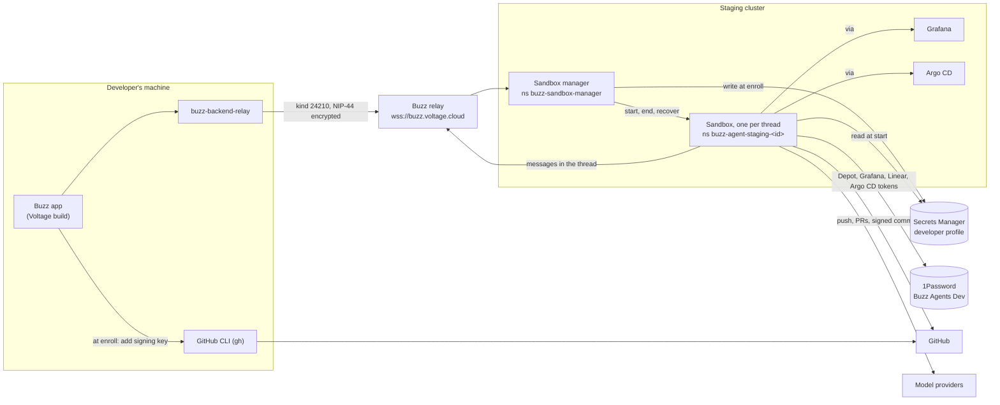
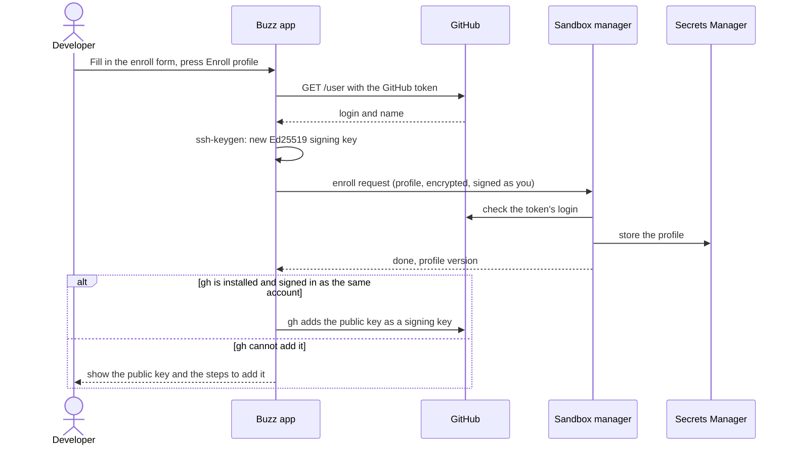
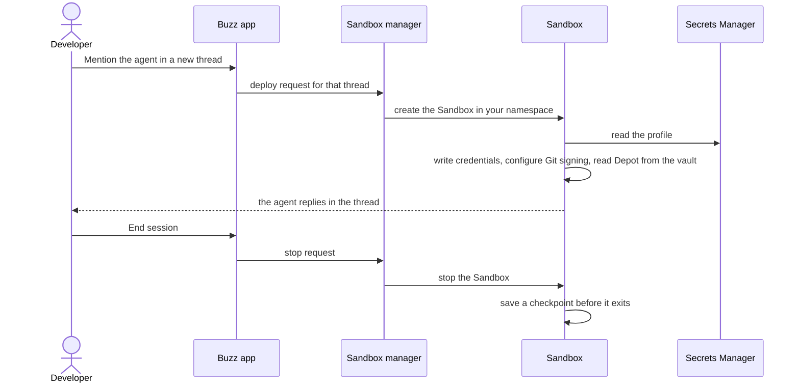

# Run Buzz agents in staging Sandboxes

A Remote workspace agent runs each thread in its own Kubernetes Sandbox in the staging cluster.
You need only your Buzz identity. You do not need AWS, Kubernetes, or VPN access.
Your agents use your GitHub account, your model subscriptions, and a shared set of team tools.
Every commit an agent makes is signed with a key that is on your GitHub account, so GitHub shows it as **Verified**.

- **Admins:** start at [Onboard a developer](#onboard-a-developer).
- **Developers:** start at [Set up your agents](#set-up-your-agents).

## How it works



- **The Buzz app** sends requests as you. Each request is a Nostr event of kind 24210. Its content is encrypted to the Sandbox manager with NIP-44.
- **The Sandbox manager** accepts requests only from owner keys in its developer list. It starts a Sandbox in your namespace for each thread.
- **You choose** the harness, model, effort, and fast mode for each agent. **The manager sets** where your profile and checkpoints are, so a request cannot choose them.
- **The Sandbox** loads your profile, starts the harness you chose, and replies in the thread as your agent.
- **The reaper** removes Sandboxes after their sessions end.

### Enroll once

You enroll one profile. All of your Remote workspace agents use it.



### Start a session



### Where each credential lives

| Credential | You enter it | Stored in | Used by |
|---|---|---|---|
| Buzz identity | Buzz app sign-in | Your machine | The app, to sign requests |
| GitHub token | Enroll form | Profile (Secrets Manager) | The Sandbox: clone, push, PRs |
| Agent signing key | Created by the app | Profile; public half on GitHub | The Sandbox: sign commits |
| 1Password service account token | Enroll form | Profile | The Sandbox: read the Buzz Agents Dev vault |
| Codex, Claude, OpenAI, Anthropic, OpenRouter credentials | Enroll form | Profile | The harness in the Sandbox |
| Depot, Grafana, Linear, Argo CD tokens | Nobody: admins keep them in the vault | 1Password Buzz Agents Dev | The Sandbox, through `via` |

The app never saves your tokens. The profile is encrypted in transit and at rest. Checkpoints never include credentials.

## Onboard a developer

Do these steps once for each new developer. You need the staging VPN for step 2.

1. **Add the developer to Terraform.** In voltage-terraform, add an entry to `developers` in `v2/environments/staging-agent/terraform.tfvars`:

   ```hcl
   developers = {
     <developer-id> = { owner_pubkey = "<their Buzz owner public key, 64 lowercase hex>" }
   }
   ```

   The developer ID has 1 to 32 lowercase letters, digits, or hyphens. Each owner key can appear only once.
2. **Apply it locally.** Merge the PR, then run `make plan` and `make apply` in `v2/environments/staging-agent`.
   CI cannot apply this module, because its Kubernetes identity is read-only.
   The apply creates the namespace `buzz-agent-staging-<developer-id>`, the profile secret, and the developer's permissions.
3. **Restart the manager and the reaper.** Both read the developer list only at startup:

   ```sh
   kubectl --context voltage-staging -n buzz-sandbox-manager rollout restart deploy/buzz-sandbox-manager
   kubectl --context voltage-staging -n buzz-sandbox-reaper rollout restart deploy/buzz-sandbox-reaper
   ```
4. **Give the developer vault access.** Make sure they are in the 1Password **Engineering** group, which can read **Buzz Agents Dev**.
   If they cannot create a service account, create one for them. See [1Password service account](#1password-service-account).
5. **Check their model seats.** Codex access tokens need a ChatGPT Business or Enterprise seat. The workspace owner must allow access tokens. Claude needs a Claude seat.

The developer's Buzz identity must be a member of the `buzz.voltage.cloud` community.

## Set up your agents

### 1. Install the Buzz app (Voltage build)

Remote workspace agents need the `buzz-gpui-voltage` package. On NixOS, add the flake input and install the package:

```nix
# flake.nix inputs
buzz-gpui.url = "github:voltagecloud/buzz/<commit on main>?dir=apps/buzz-gpui";

# configuration.nix
environment.systemPackages = [ buzz-gpui.packages.${system}.buzz-gpui-voltage ];
```

Sign in with your Buzz identity and join the `buzz.voltage.cloud` community.
Install the GitHub CLI (`gh`) and sign in with `gh auth login`, so the app can add your signing key to GitHub.

### 2. Get your credentials

Paste credentials only into the enroll form. Never put them in chat, tickets, or Git.

#### GitHub token

Create a fine-grained token in GitHub under **Settings → Developer settings → Fine-grained tokens**.

| Setting | Value |
|---|---|
| Resource owner | `voltagecloud` |
| Repository access | All repositories |
| Contents | Read and write |
| Pull requests | Read and write |
| Workflows | Read and write, only if agents can change `.github/workflows` |
| Issues | Read and write (optional) |
| Actions, Commit statuses | Read (optional) |
| Account permissions | None |

If the organization requires approval, the token stays **pending** until an owner approves it.

#### 1Password service account

Agents read team secrets from the **Buzz Agents Dev** vault through a 1Password service account. A service account is a login for software, and its token can read only the vaults you give it. Create one for each developer, so that you can revoke each one separately.

1Password owners and administrators can create service accounts. Other members need that permission from an admin. If you do not have it, ask an admin to create the account and share the token through 1Password.
If the menus below differ, use 1Password's [service account guide](https://developer.1password.com/docs/service-accounts/get-started/).

To create it in the web app at [teamvoltage.1password.com](https://teamvoltage.1password.com):

1. Open **Developer**, then **Directory**.
2. Under **Infrastructure Secrets Management**, select **Other**, then **Service Account**.
3. Enter a name, for example `buzz-agents-<developer-id>`.
4. Select only the **Buzz Agents Dev** vault, with **Read items**.
5. Leave the expiry at **Never**. When a developer leaves, delete their service account.
6. Select **Create Account**. Then select **Save in 1Password**, because the token shows only once.

To create it with the 1Password CLI instead:

```sh
op service-account create "buzz-agents-<developer-id>" --vault "Buzz Agents Dev:read_items"
```

Without `--expires-in`, the token does not expire.

To check the token, run this command. The output must show **Buzz Agents Dev** and no other vault.

```sh
OP_SERVICE_ACCOUNT_TOKEN='ops_…' op vault list
```

#### Codex access token (ChatGPT Business or Enterprise)

1. On chatgpt.com, switch to the **Voltage** workspace.
2. Open [chatgpt.com/admin/access-tokens](https://chatgpt.com/admin/access-tokens) and select **Create**.
3. Enter a name, select the Codex scope if the dialog shows it, and select the longest validity.
4. Copy the token (`at-…`). It shows only once.

The token does not refresh, so all of your Sandboxes can use it at the same time. Before it expires, create a new one and enroll again.
A personal ChatGPT Plus or Pro account cannot create these tokens. Use an OpenAI API key instead.

#### Claude subscription token (Claude Pro, Max, Team, or Enterprise)

Run this command in your own terminal:

```sh
claude setup-token
```

In the browser, sign in to claude.ai with your Voltage account, then approve. The terminal shows the token (`sk-ant-oat01-…`). The token is valid for one year.

#### OpenRouter API key (optional)

Create a key at [openrouter.ai/keys](https://openrouter.ai/keys). The **Buzz agent** harness can use it to run any OpenRouter model.

### 3. Create an agent

1. In the Buzz app, open **Agents → Your agents**.
2. Select **Create agent**, then select **Remote workspace** in the agent type list.
   To convert an existing Codex or Claude Code agent instead, open it and select **Remote workspace** under **Settings → Provider**. The agent keeps its instructions.
3. Fill in **Settings**, then select **Save**.

| Field | Value |
|---|---|
| Harness | **Claude Code**, **Codex**, or **Buzz agent** |
| Model | Optional for Claude Code and Codex, for example `claude-opus-5-5`. Required for Buzz agent, for example `qwen/qwen3-coder`. |
| Effort | How hard the model thinks, for example **Extra high**. Models without effort levels ignore it. |
| Fast mode | **On** gives faster output with higher usage, on models that support it. |
| Instructions | The agent's system prompt |
| Environment | Leave empty: `{}`. Never put secrets here. |

Every agent asks the Voltage Sandbox manager on its community, so there is nothing to choose about where it runs.

### 4. Enroll your profile

Do this once, on any of your Remote workspace agents. Enroll again only to change a credential.

| Field | Value |
|---|---|
| GitHub token | The fine-grained token from step 2 |
| Git email | A verified email on your GitHub account. The app fills in `git config --global user.email`. |
| via profile | The [shared via profile](#shared-via-profile) |
| 1Password service account token | `ops_…` |
| Codex access token | `at-…` (optional) |
| Claude subscription token | `sk-ant-oat01-…` (optional) |
| OpenAI API key, Anthropic API key | Optional. Leave each empty if you use the matching subscription token. |
| OpenRouter API key | Optional |

Select **Enroll profile**. The app shows **Enrolled. Profile version …**, then one of these results:

- **Added your agents' signing key to your GitHub account.** `gh` added the key. Your agents' commits show as **Verified**.
- **Add your agents' signing key to GitHub.** The app tells you why `gh` could not add the key. Select **Copy key**. On GitHub, open **Settings → SSH and GPG keys → New SSH key**, set **Key type** to **Signing Key**, paste the key, and save it.

The app finds your GitHub login and name from the token. The manager finds your developer ID from your Buzz identity.

To stop your agents from signing commits as you, delete the **Buzz agents** key under **Settings → SSH and GPG keys** on GitHub.

### 5. Start a session

1. Mention the agent in a new thread, for example `@my-agent summarize the open PRs in voltagecloud/cd`.
2. Wait for the reply. The first session can take a few minutes, because a staging agent node starts.
3. Reply in the same thread to continue the session.
4. Select **End session** in the thread banner to save a checkpoint and stop the Sandbox. Select **Recover from checkpoint** to continue from that checkpoint later.

Each thread gets its own Sandbox, so threads run in parallel. A developer can have five sessions at the same time. A session stops after 12 hours.

## Reference

### Shared via profile

Paste this profile into the enroll form. It contains only `op://` references, not secret values.

```toml
version = 1

[providers.onepassword]
type = "1password"
account = "teamvoltage.1password.com"

[services.grafana-staging]
description = "Staging Grafana HTTP API access through a service account token"
hint = "via grafana-staging api /api/org"
provider = "onepassword"

[services.grafana-staging.secrets]
token = "op://Buzz Agents Dev/Via Grafana Staging/via-token"

[services.grafana-staging.commands.api]
description = "Call the staging Grafana HTTP API with a service account token."
mode = "rest"
base_url = "http://grafana.monitoring.svc.cluster.local"
method_default = "GET"

[services.grafana-staging.commands.api.auth]
type = "bearer"
secret = "token"

[services.grafana-staging.commands.api.headers]
Accept = "application/json"

[services.linear]
description = "Linear app-actor API access through OAuth"
hint = "via linear api POST /graphql --json '{\"query\":\"{ viewer { id name } }\"}'"
provider = "onepassword"

[services.linear.secrets]
oauth = "op://Buzz Agents Dev/Via Linear App Voltage/text"

[services.linear.commands.api]
description = "Call configured Linear API endpoints with an app-actor OAuth bearer token."
mode = "rest"
base_url = "https://api.linear.app"
method_default = "GET"

[services.linear.commands.api.auth]
type = "oauth"
credential = "oauth"

[services.depot]
description = "Depot build cache (sccache, Turborepo, Go) shared by every developer's agents"
provider = "onepassword"

[services.depot.secrets]
organization = "op://Buzz Agents Dev/Depot/organization"
token = "op://Buzz Agents Dev/Depot/credential"

[services.argocd-staging]
description = "Staging Argo CD API: every app's status, resource tree and logs; sync and restart in application projects"
hint = "via argocd-staging api /api/v1/applications --query fields=items.metadata.name,items.spec.project,items.status.sync.status,items.status.health.status"
provider = "onepassword"

[services.argocd-staging.secrets]
token = "op://Buzz Agents Dev/Argo CD Staging/credential"

[services.argocd-staging.commands.api]
description = "Call the staging Argo CD API with the buzz-agents account token."
mode = "rest"
base_url = "http://argocd-server.argo.svc.cluster.local"
method_default = "GET"

[services.argocd-staging.commands.api.auth]
type = "bearer"
secret = "token"
```

### What an agent can reach

| An agent can | An agent cannot |
|---|---|
| Reach the public internet: GitHub, package registries, model APIs, Linear, Depot | Reach databases or other private services |
| Read staging logs and metrics in Grafana, with `via grafana-staging` | Reach internal ingresses, VPN-only hosts, or other pods |
| Read every staging Argo CD app and its logs, with `via argocd-staging` | Delete, edit, or exec into Argo CD apps |
| Sync and restart apps in the application projects: `admin-app`, `auth-service`, `backend`, `billing`, `feerate`, `frontend-turbo`, `nostr-server`, `sanctions-list`, `surge-coinprice`, `voltage-cash`, `webhook-proxy` | Sync or restart infrastructure projects |
| Push to your GitHub repositories, with your token's permissions. Branch protection still applies. | Use AWS or Kubernetes outside its own namespace |
| Use the shared Depot build cache | Reach production |

CAUTION: An agent runs with full tool access in its Sandbox, and it reads untrusted content from repositories, issues, and the web. Give your tokens only the access an agent needs.

## Troubleshooting

| What you see | What to do |
|---|---|
| *This Buzz identity is not a configured developer.* | Ask an admin to do [Onboard a developer](#onboard-a-developer), including the restart in step 3. |
| *Join the community at the relay to enroll through it.* | Join `buzz.voltage.cloud` in the app, then enroll again. |
| *GitHub did not accept the token.* | Make a new fine-grained token, then enroll again. |
| *The GitHub token belongs to a different login.* | Use a token from your own GitHub account. |
| *Use a Codex access token (at-...)* | Put an OpenAI API key in **OpenAI API key**, not in **Codex access token**. |
| *Choose either an OpenAI API key or a Codex access token* | Clear one of the two fields. The same applies to the two Claude fields. |
| *via profile requires providers and services* | Paste the complete [shared via profile](#shared-via-profile). |
| `op service-account create` fails with *(403) Forbidden* | You are not a 1Password owner or administrator. Ask one to create the service account and share the token with you through 1Password. |
| *Could not run ssh-keygen. Install OpenSSH.* | Install OpenSSH, then enroll again. |
| The app says *gh needs the admin:ssh_signing_key scope* | Run `gh auth refresh -h github.com -s admin:ssh_signing_key`, then enroll again. Or add the key yourself with **Copy key**. |
| Commits show as **Unverified** on GitHub | Add the signing key on GitHub, and make sure **Git email** is a verified email on your account. |
| *The Sandbox manager did not answer within 60 seconds.* | Ask an admin. The admin checks `kubectl --context voltage-staging -n buzz-sandbox-manager logs deploy/buzz-sandbox-manager`. |
| The agent does not reply after 10 minutes | Check that you enrolled. If you did, an admin checks the Sandbox: `kubectl --context voltage-staging -n buzz-agent-staging-<developer-id> get sandboxes,pods`. |
| The Sandbox log shows *Developer profile refused while …* | The text after *while* names the startup step that failed, and the text after the colon names the reason. Credentials are never printed. Ask an admin, and include that line. |

## Related

- Design: [docs/remote-agents.md](../docs/remote-agents.md)
- Agent image: [voltage/images/buzz-agent](images/buzz-agent/README.md)
- Infrastructure: voltage-terraform `v2/environments/staging-agent`
- Deployment: voltagecloud/cd `charts/buzz-sandbox-manager` and `staging/values/infra-utils`
- Tracking: Linear DEV-2884 (remote agents), DEV-2948 (one ChatGPT login for all of a developer's agents), DEV-2949 (staging Argo CD config in Git)
